<!-- source: docs/reference/ARCHITECTURE.md synced-through: 7e33f929de56372528b58bd9895f587735fef89a -->
> **[English](../../reference/ARCHITECTURE.md)** | **[简体中文](../zh-CN/ARCHITECTURE.md)** | **[日本語](../ja/ARCHITECTURE.md)** | **한국어**

# ATLAS 아키텍처

ATLAS V3.1.7의 시스템 아키텍처입니다. 2계층 설계로, 바깥쪽 에이전트 루프가 도구 호출 오케스트레이션을 담당하고, 안쪽 V3 파이프라인이 빌드 검증과 에너지 기반 선택을 통해 다양한 코드 후보를 생성합니다.

---

## 1. 시스템 개요

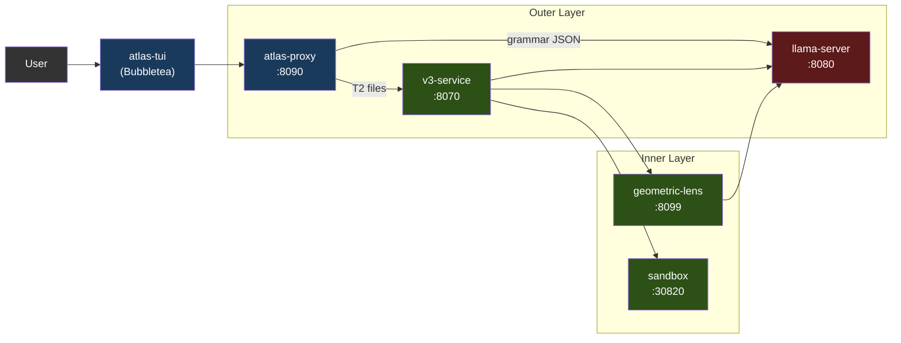

서비스는 Docker Compose(권장)를 통해 컨테이너로 실행되거나, `atlas` 런처를 통해 로컬 프로세스로 실행됩니다. GPU를 사용하는 것은 llama-server뿐입니다. 나머지는 모두 CPU에서 돌아갑니다.

채팅 프론트엔드는 **atlas-tui**(Bubbletea)입니다. `/v1/agent`(턴별 채팅 SSE)와 `/events`(파이프라인 패널용 전역 타입 봉투 피드)를 소비하는 네이티브 Go 터미널 UI입니다. `atlas`(대화형 기본값) 또는 `atlas tui`(명시적)로 실행합니다. 파이프라인 패널은 V3 단계를 실시간으로 보여주고, 채팅 패널은 어시스턴트 마크다운을 glamour로 렌더링합니다. 슬래시 명령 `/add /diff /commit /run` 등이 로컬 파일 컨텍스트와 셸 호출을 처리합니다. 모드 인식 입력(채팅 / `!bash` / `/slash`)에 힌트 드롭다운이 함께 제공됩니다.

도구 호출 + V3 파이프라인을 원하는 서드파티 클라이언트는 `/v1/agent`를 직접 대상으로 합니다. `/v1/chat/completions`는 llama-server로의 패스스루입니다(§3 참고). 계약은 [API.md](../../reference/API.md)에 문서화되어 있습니다.

### 1.1 지원 가속기

llama-server는 GPU를 사용하는 유일한 서비스입니다. 다른 모든 ATLAS 서비스는 CPU에서 돌아갑니다(프록시는 Go, v3-service / geometric-lens / sandbox는 Python). 덕분에 다중 백엔드 표면이 작게 유지됩니다 — 새 가속기를 추가한다는 것은 파이프라인을 변경하는 것이 아니라 새 Dockerfile + 엔트리포인트 환경 변수 분기를 추가하는 것을 의미합니다.

| 백엔드 | 상태 (V3.1.x) | 이미지 / 빌드 경로 | Compose 오버라이드 | 테스트된 카드 |
|---|---|---|---|---|
| **CUDA** (NVIDIA) | Blackwell: Supported(V3.1.0부터); 이전 GPU: Preview, 로컬 재빌드 필요 | `services/inference/Dockerfile.v31` → `atlas-llama` | (기본값) | RTX 5060 Ti 16GB (정규). 게시된 이미지는 Blackwell(컴퓨트 캐퍼빌리티 12.0/12.1) 전용으로 컴파일되어 있으며, 이전 세대는 로컬 재빌드가 필요합니다 — [SETUP.md](SETUP.md) 참고 |
| **ROCm / HIP** (AMD) | 커뮤니티 검증(Community-tested) (V3.1.1부터) | `services/inference/Dockerfile.rocm` → `atlas-llama-rocm` — 호스트 빌드(`pull_policy: build`, GHCR 이미지 없음) | `deploy/compose/docker-compose.rocm.yml` | RX 7900 XTX (커뮤니티 스모크 테스트, GH #26) |
| **Metal** (Apple Silicon) | 지원 ([#32](https://github.com/inferstep/ATLAS/issues/32)) | 하이브리드: 네이티브 llama-server (Metal) + 나머지는 Docker (macOS는 컨테이너로 GPU 패스스루 불가) | `deploy/compose/docker-compose.macos.yml` | M 시리즈; ≤16 GB에서 Q4_K_M, ≥24 GB 통합 메모리에서 Q6_K |
| **Vulkan** (크로스 벤더 폴백) | 프리뷰(Preview) | `services/inference/Dockerfile.vulkan` → `atlas-llama-vulkan` | `deploy/compose/docker-compose.vulkan.yml` | lavapipe CPU 부팅 경로 (스모크 테스트됨); 실제 GPU 검증은 아직 없음 |
| **SYCL** (Intel Arc) | 로드맵(Roadmap) — Intel Arc는 현재 `vulkan` 사용 | 미정 | 미정 | — |

**백엔드 선택은 런타임이 아니라 설치 시점에 이루어집니다.** `atlas init`는 `tier.detect_gpu()`(`atlas/commands/tier.py` 참고)를 실행해 감지된 모든 벤더 중 VRAM이 가장 큰 GPU를 고르고(`ATLAS_GPU_VENDOR` / `ATLAS_GPU_INDEX`로 재정의), `.env`에 `ATLAS_BACKEND={cuda|rocm|metal|vulkan}`를 기록합니다. 패키징된 네이티브 백엔드가 있으면 감지는 그것으로 귀결됩니다: NVIDIA는 CUDA, x86_64의 AMD는 ROCm, macOS는 하이브리드 Metal 경로. 호스트용으로 패키징된 네이티브 백엔드가 없으면(Intel Arc, arm64의 AMD, 인식되지 않는 벤더) 마법사가 Vulkan 범용 폴백을 제안합니다(기본값: 예) — 이미지 하나가 AMD, Intel, Adreno, MoltenVK, lavapipe CPU 래스터라이저를 커버하며, 성능은 튜닝된 네이티브 백엔드 대비 대략 20–40% 낮습니다. 마법사가 부팅되지 않을 `.env`를 쓰는 대신 거부하는 것은 쓸 수 있는 것이 아무것도 없을 때뿐입니다. 각 백엔드는 자체 이미지가 있습니다. CUDA와 Vulkan은 GHCR의 사전 빌드 이미지이며 ROCm은 AMD 호스트에서 첫 `up` 시 컴파일하므로, 사용자는 모든 백엔드의 라이브러리를 담은 무거운 이미지를 실행하지 않습니다.

**자체 모델 반입(BYO model) 표면 (V3.1.1).** `atlas lens check`는 실행 중인 llama-server에 대한 저렴한 사전 점검으로, 로드된 모델이 Lens 호환인지 보고합니다. `atlas lens build --samples <path>`는 `services/geometric-lens/geometric_lens/training.py`를 감싸 모델의 네이티브 임베딩 차원에 맞춰 새로운 C(x)(`cost_field.pt`) **그리고** G(x)(XGBoost) 아티팩트를 학습시킵니다. 이 둘을 함께 쓰면 사용자가 lens 코드를 포크하지 않고도 기본이 아닌 GGUF를 갈아 끼울 수 있습니다 — C(x) 생성자가 임의의 `input_dim`을 받기 때문에, 모델마다 바뀌는 것은 학습된 가중치뿐입니다. 사용자 대상 흐름은 [CLI.md § atlas lens](../../reference/CLI.md#atlas-lens)를 참고하세요. `atlas lens publish`(또는 통합 명령 `atlas publish`)는 아티팩트를 HuggingFace에 업로드하고 그 해시를 고정하는 레지스트리 PR을 엽니다.

**벤더 비의존적인 것**(모든 백엔드에서 동작): 문법 제약 JSON, 셀프 임베딩(`/embedding`), 레이어별 히든 스테이트, ASA 제어 벡터(백엔드와 무관하게 llama.cpp의 `control_vector_load`로 로드), KV 캐시 양자화, 바깥쪽 에이전트 루프 전체, V3 파이프라인, Geometric Lens, 샌드박스.

**백엔드별로 다른 것:**
- **Flash attention.** CUDA + ROCm: 완전 지원. Metal: 제한적(llama.cpp Metal 백엔드는 일부 head size에 대해 flash-attn을 지원하며, 지원되지 않으면 기본 비활성화). Vulkan: 드라이버에 따라 다름.
- **고정(pinned) 호스트 메모리.** `GGML_CUDA_NO_PINNED`는 CUDA + ROCm에 적용됩니다(HIP는 GGML 호환 계층에서 CUDA 경로를 미러링). Metal/Vulkan은 CUDA/HIP 고정 경로를 사용하지 않습니다.
- **멀티 GPU + 텐서 병렬화.** V1은 모든 백엔드에서 단일 GPU만 지원합니다. 멀티 GPU는 특정 벤더에 묶이지 않은 GH #34입니다.
- **Apple 통합 메모리.** macOS는 GPU+시스템 메모리를 공유합니다. "VRAM" 계산은 실제로는 "총 16 GB에서 OS + 앱을 뺀 것"입니다. §7 참고.

K3s 배포 경로(`scripts/install/install.sh`, `deploy/k3s/`의 매니페스트)는 V3.1.1 시점에 CUDA 전용입니다 — ROCm K8s 레시피는 V3.2 인프라 목록으로 연기되었습니다(`/dev/kfd` + `/dev/dri` hostPath 마운트와 `render`/`video` 그룹 멤버십, 즉 `deploy/compose/docker-compose.rocm.yml`의 클러스터 수준 등가물이 필요).

---

## 2. 서비스

| 서비스 | 포트 | 언어 | 용도 |
|---------|------|----------|---------|
| **llama-server** | 8080 | C++ (llama.cpp) | LLM 추론(CUDA / ROCm / Metal / Vulkan; SYCL은 로드맵 — §1.1 참고), 문법 제약 JSON, 셀프 임베딩, 레이어별 residual 히든 스테이트 |
| **atlas-proxy** | 8090 | Go | 에이전트 루프, 도구 호출 라우팅, 등급 분류, `/v1/agent` SSE, `/events` 타입 SSE, `/cancel`. `/v1/chat/completions`는 `max_tokens` 상한만 적용해 llama-server로 전달합니다(API.md 참고). |
| **atlas-tui** | (클라이언트) | Go | Bubbletea TUI; `/events`와 `/v1/agent` SSE 스트림을 소비. |
| **v3-service** | 8070 | Python | V3 파이프라인 HTTP 래퍼(PlanSearch, DivSampling, PR-CoT 등) |
| **geometric-lens** | 8099 | Python (FastAPI) | 내부 `/internal/*` 스코어링 서비스: C(x) 에너지 스코어링, G(x) XGBoost 품질 예측, 스텝별 스코어링 |
| **sandbox** | 30820 (호스트) / 8020 (컨테이너) | Python (FastAPI) | 격리된 코드 실행, 컴파일, 린팅, 테스트 실행 |

---

## 3. atlas-proxy (바깥 계층)

프록시는 채팅 프론트엔드의 진입점입니다. `/v1/agent`(타입 이벤트 스트림 — TUI가 사용하는 것)에서 사용자 메시지를 받아들이고, llama-server를 호출하고 도구 호출을 파싱·실행해 이벤트를 다시 스트리밍하는 내부 에이전트 루프를 실행합니다. `/v1/chat/completions` 엔드포인트는 llama-server로의 투명한 패스스루입니다. SDK 호환성을 위해 유지되며 에이전트 루프를 실행하지 않습니다. 전체 이벤트 타입 카탈로그는 [API.md](../../reference/API.md)를 참고하세요.

`services/proxy/`의 하위 폴더를 포함한 모든 비테스트 Go 파일과 담당 영역:

| 파일 | 담당 |
|---|---|
| `main.go` | HTTP 서버, 라우팅, 인증, 패스스루, 오류 엔벨로프, 비공개 값 로그 필터 |
| `loop.go` | `runAgentLoop`, 펜스 가져오기, 툴체인 감지 |
| `model_call.go`, `model_reply.go` | llama-server 호출 한 번과 모델 응답 읽기. `model_reply.go`는 모델 텍스트의 JSON 이스케이프를 해독하고 UTF-16 서로게이트 쌍을 한 문자로 읽습니다. `\b`와 `\f`는 글자로 남겨 터미널에 백스페이스나 폼 피드를 보내지 않습니다 |
| `model_prompt.go`, `task_tier.go` | 시스템 프롬프트와 컨텍스트 예산, 메시지 티어 |
| `server_agent.go` | `/v1/agent` 및 `/cancel` 엔드포인트 |
| `plan_generation.go`, `task_intake.go` | 요청에 플랜이 필요한지 판단과 플래너 호출, 요청이 선언한 태스크 계약 |
| `loop_end.go`, `loop_recovery.go` | 실행 종료(터미널, 시간 예산, 요약), 막힌 모델에게 보여 줄 내용과 남은 작업 |
| `model_fenced_channel.go` | 파일 본문을 가져오는 서브콜과 그 예산 |
| `gates_exit.go` | 종료 게이트와 그 게이트가 읽는 실행 상태. 검증 명령이 장시간 실행되는 서버라서 실패한 경우(시간 초과 또는 포트 점유)와 코드가 잘못되어 실패한 경우도 구분합니다 |
| `loop_turn.go`, `loop_checks.go`, `loop_results.go` | 루프 한 턴의 모델 호출과 응답, 도구 실행 전 검사, 결과 및 반복 차단기. `loop_turn.go`는 읽기 전용 호출이 반복되면 요청의 요구에 따라 행동하거나 답하도록 안내합니다 |
| `tools.go`, `tool_*.go` | 16개 도구 정의와 실행기, 티어 분류, 도구 호출 문법 |
| `gates*.go` | 정직성/플랜 게이트: 클레임 체크, 구조, 구문, 임베드 스크립트, 플랜 준수, 플랜 리마인더 |
| `loop_detectors.go` | 스턱 패턴 검출: 도구 반복, 추론 반복, 트레이스백의 오류 위치 확인 |
| `loop_project.go` | 컨텍스트 보강: 심볼 인덱스, 프로젝트 스캔, 워크스페이스 경계 제한, 세션 파일 매니페스트 |
| `guardrails_permissions.go` | 권한 게이트(`/v1/permission`), 트러스트 모드, 하드 차단 패턴 |
| `lens.go` | 렌즈 스코어링 호출, 캘리브레이션 상태 |
| `lens_identity.go` | Lens 직접 호출에 사용하는 프록시 소유 호출 식별자를 생성하고 첨부합니다 |
| `lens_required.go` | Geometric Lens의 가용성을 강제하고 실패를 추적하며 스코어링 불가 시 실행을 중단합니다 |
| `internal/logsafe/logsafe.go` | 승인된 필드만 허용하고 민감한 내용을 가려 로그용 도구 인자 요약을 만듭니다 |
| `internal/logsafe/filter.go` | 모든 로그 행이 지나는 writer. 자격 증명 형태의 값을 가리고 제어 문자를 텍스트로 출력합니다 |
| `internal/assetlint/lint.go`, `internal/assetlint/findings.go` | 어떤 라우트도 렌더링하지 않는 템플릿, 페이지가 로드하지 않는 스크립트·스타일시트, 없는 파일 참조, 라우트가 없는 폼·`fetch()` 대상을 검사하는 에셋 그래프 lint |
| `internal/shadowcapture/sink.go` | 요청의 선언과 ATLAS가 문장에서 읽은 내용을 비교하는 비공개 기록. 하나의 goroutine이 파일에 쓰며 어떤 결정도 이를 읽지 않습니다. `ATLAS_SHADOW_CAPTURE`가 파일을 지정해야 켜집니다 |
| `internal/memoryenvelope/envelope.go` | 선언된 배포 메모리 예산을 운영자가 명시한 호스트 용량과 비교하고 강제되지 않는 예산 초과를 보고합니다 |
| `internal/projectcontext/sample.go` | V3 요청에 보여 줄 프로젝트 내용: 플래너용 우선 파일 샘플, 수정 계획에 경로순으로 상한까지 추가할 읽은 파일, 요청별 바이트 한도에 맞춘 파일 잘라내기 |
| `internal/workspacefs/object_handle_linux.go` | 삭제 승인 중 Linux 파일시스템 객체를 열린 채 유지해 삭제 전 승인 대상이 교체되지 않게 합니다 |
| `internal/workspacefs/object_handle_other.go` | 객체를 안전하게 고정·검증할 수 없는 비 Linux 플랫폼에서 삭제 승인을 거부합니다 |
| `candidate_mutation_scope.go` | 모델 도구 호출에서 정확한 파일과 편집 범위를 도출해 후보가 요청 대상 밖을 수정하지 못하게 합니다 |
| `task_obligation_kinds.go` | 결정과 원장에서 요청의 의무를 도출하고 전달 결과가 이를 충족했는지 확인합니다 |
| `task_obligations.go` | 실행 의무가 호출자의 선언 계약과 기존 ATLAS 추론 중 어디서 오는지 선택하고 요청에 묶어 유지합니다 |
| `internal/shellcmd/command_evidence.go` | 셸 명령이 실행, 프로브, 정적 검사 중 무엇을 입증하는지 또는 아무것도 아닌지, 해당 부분의 종료 상태를 명령줄이 보고하는지 판단합니다 |
| `guardrails*.go` | 도구별 가드(축소, 누락 명령·모듈 안내, doctype 제거). `guardrails_reply.go`는 서두를 정규화해 향후 작업을 예고하기만 하는 답변을 완료 검사에서 인식하게 합니다 |
| `server_events.go` | 타입 엔벨로프 브로커(`/events`)와 SSE 배관 |
| `internal/v3client/client.go` | v3-service의 `/v3/generate` + `/v3/plan`용 SSE 클라이언트. 호출 상한 `ATLAS_V3_TIMEOUT`은 `tool_write_v3.go`에 남습니다 |
| `loop_state.go` | 공유 타입, 티어, 턴 상한 |
| `internal/wire/messages.go` | 모델 메시지, 도구 결과, 계획 등 경계를 넘는 데이터 |
| `internal/wire/v3.go` | V3 서비스 요청·응답·증거 봉투 및 이를 읽는 검사 |
| `internal/wire/tool_io.go` | 모델이 읽고 쓰는 JSON 형태의 각 도구 인자와 출력 |
| `internal/wire/tool_classification.go` | 도구 결과가 발생한 일을 표현하는 고정된 어휘 |
| `internal/wire/events.go` | `/events` 봉투 |
| `internal/taskcontract/task_contract.go` | 요청이 요구한 내용을 나타내는 작업 계약과 산출물 기록 |
| `internal/taskcontract/obligation_kinds.go` | 고정된 의무 어휘, 각각 필요한 증거 강도, 의무를 만드는 방법 |
| `internal/taskcontract/verification_requirements.go` | 타입이 있는 클라이언트 검증 요구, 실행 기록 및 해당 검사 |
| `candidate_advisory_policy.go` | 모델 제안을 유지할지 후보를 전달할지 결정하며 검증·선택 규칙 전에 강제 거부 조건을 적용합니다 |
| `candidate_authorization.go` | 후보 증거가 대상 범위와 기존 파일의 검증된 동작 보존을 포함한 작업 승인 요건을 충족하는지 확인합니다 |
| `candidate_grant.go` | 정확한 후보·대상·워크스페이스 상태에 묶인 일회용 허가를 생성·소비·폐기합니다 |
| `candidate_attribution.go` | 라우트·승인·정책·전달 담당이 이미 내린 결정으로 자동 후보 전달의 성공·거부 이유를 기록합니다 |
| `candidate_automatic.go` | V3가 선택한 정확한 후보가 자동 전달의 안전·식별 요건을 충족하는지 확인합니다 |
| `candidate_capture_only.go` | 캡처 전용 측정 실행에서 후보 전달을 막고 억제를 기록합니다 |
| `delivery.go` | 후보 전달 승인, 일회용 허가 소비, 현재 워크스페이스 재검사, 승인된 바이트 쓰기. 서비스가 만든 후보 내용을 전달할 수 있는 운영 라우트와 원래 도구도 열거합니다 |
| `candidate_policy.go` | 고정 후보 정책, 가능한 결과, 각 결정의 비공개 기록을 정의합니다 |
| `candidate_provenance.go` | 전달된 내용의 출처와 디스크 쓰기를 허용한 정책을 보고합니다 |
| `candidate_reachability.go` | 적격성과 남은 시간을 포함해 변경이 후보 생성을 건너뛴 이유를 판단·기록합니다 |
| `evidence_candidate_staging.go` | 격리된 샌드박스 사본에서 후보 파일에 클라이언트 선언 검증 명령을 실행하고 반환된 관측을 확인합니다 |
| `model_cut_call.go` | 불완전한 호출을 실행하지 않고 잘린 도구 호출의 완전한 필드와 현재 파일로 복구 안내를 만듭니다 |
| `delivery_handoff.go` | 전달된 내용이 모델 제안과 다르면 모델의 파일 컨텍스트와 도구 피드백을 갱신합니다 |
| `delivery_settlement.go` | 완료된 후보 전달을 기록하고 승인 산출물이 일치하는 바이트와 원장 상태로 여전히 존재하는지 확인합니다 |
| `delivery_edit_route.go` | 편집 도구 후보를 승인·전달 과정에 통과시키며 원래 도구의 결과 형식과 폴백 내용을 보존합니다 |
| `evidence_wiring.go` | 구문·선언 명령 증거 생성자를 후보 경로에 연결하고 후보 식별자를 부여하며 가용·누락 증거를 기록합니다 |
| `internal/wire/execution_outcome.go` | 명령 완료·중단·자원 소진을 분류해 불완전한 실행이 검증 성공으로 계산되지 않게 합니다 |
| `candidate_feasibility.go` | 생성 전에 가용 증거 생성자가 작업 요구를 충족할 수 있는지 평가·기록하되 생성 여부는 통제하지 않습니다 |
| `internal/fencing/framing.go` | 완전한 펜스 파일 페이로드를 식별하고 내용을 추출하며 프레이밍 문법과 재시도 안내를 제공합니다 |
| `internal/workspacefs/file_kind.go` | 경로의 종류를 확인하고 일반 파일만 읽습니다. 명명 파이프는 writer를 기다리며 열기가 멈출 수 있어 읽기 전에 열린 핸들의 종류를 검사합니다 |
| `internal/workspacefs/file_kind_unix.go` | 이름이 일치하는 파이프도 writer를 기다리지 않고 즉시 열도록 하는 비차단 열기 플래그 |
| `internal/workspacefs/file_kind_other.go` | 대응 기능이 없는 플랫폼의 같은 플래그. 종류 검사만으로 판단하게 합니다 |
| `model_old_str_watch.go` | 스트리밍 중 편집 텍스트가 대상 파일과 더 이상 일치할 수 없으면 폭주를 멈추고 복구를 안내합니다 |
| `loop_repair.go` | 세션 쓰기가 남긴 미해결 구문 복구를 추적하고 성급한 완료를 막으며 인계 시 보고합니다 |
| `candidate_route_disposition.go` | 각 후보 경로의 종료 방식과 전달 허가가 디스크 쓰기로 이어졌는지 추적합니다 |
| `candidate_route_entry.go` | 후보 생성 시도마다 고유 식별자를 만들어 증거·승인·전달 기록을 연결합니다 |
| `evidence_staged_command.go` | 후보 바이트·워크스페이스·전달이 여전히 최신일 때만 스테이징 검증을 완료 증거로 인정합니다 |
| `evidence_staging_contract.go` | 샌드박스 스테이징 요청·관측·실행 예산 및 식별자 결합을 정의·검증합니다 |
| `candidate_mutation_target.go` | 클라이언트가 출력 경로를 선언하지 않았을 때 파싱한 변경 호출이 후보 전달을 정확한 대상에 묶는지 확인합니다 |
| `evidence_syntax.go` | 프록시 구문 검사 관측을 정확한 후보 바이트와 구조 의무에 묶인 증거로 만듭니다 |
| `delivery_v3_fallback.go` | V3 실패·시간 초과 후 기록한 파일을 추적하고 여전히 최신인 미검사 내용을 최종 요약에 밝힙니다 |
| `evidence_verification.go` | 클라이언트 선언 명령 관측에서 증거를 만들고 충족하는 개별 검증 의무를 추적합니다. 세션에서 관측한 테스트 자산 출처에 따라 증거 강도도 제한합니다 |
| `gates_workspace_observation.go` | 포그라운드·백그라운드 명령의 파일 변경을 관측하고 산출물과 삭제를 세션 원장에 기록합니다 |
| `internal/workspacefs/confined_dir.go` | `os.Root`로 폴더 하나를 읽습니다. 폴더 밖으로 해석되는 이름은 오류이며 읽지 않고, 일반 파일이 아닌 이름은 없는 파일처럼 건너뜁니다 |
| `internal/workspacefs/sandbox_subdir.go` | `sandbox_subdir`는 ASCII 문자·숫자·점·밑줄·대시만 허용하며 최대 64자, `.` 또는 `..`는 금지합니다 |
| `server_service_answer.go` | 스택 서비스(llama-server, V3, lens, sandbox)의 응답을 최대 64 MiB 읽어 무한 응답이 프록시 메모리를 채우지 못하게 합니다 |
| `internal/shellcmd/shell_wrapper.go` | `validateShellCommand` 뒤의 명령 정책: 복합 명령을 나누고, 실행 래퍼(`sh -c`, `eval` 등) 안을 최대 16단계까지 살펴보며, 치명적인 명령과 검사할 수 없는 래퍼를 거부 |
| `internal/shellcmd/destructive.go` | 어떤 명령에도 허용하지 않는 셸 형태: 치명적인 삭제, fork bomb, 장치 쓰기 |

### 에이전트 루프 흐름

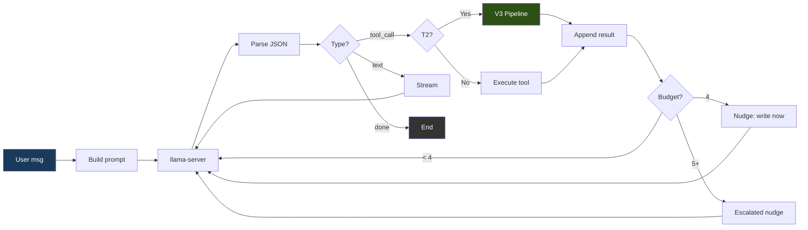

### 문법 강제

모든 모델 출력은 세 가지 유효한 JSON 형태 중 하나를 향하도록 제약됩니다:

```json
{"type": "tool_call", "name": "<tool_name>", "args": {...}}
{"type": "text", "content": "<message>"}
{"type": "done", "summary": "<summary>"}
```

기본 `strict` 모드에서 프록시는 완전한 JSON 스키마 — `additionalProperties: false`와 함께 `oneOf`를 사용하고 레지스트리에서 도구 이름을 열거 — 를 전송하며, llama-server가 이를 토큰 생성 중 문법으로 강제합니다. 문법 제약은 잘못된 형식의 출력을 불가능하게 만드는 것이 아니라 드물게 만듭니다: `ATLAS_GRAMMAR_MODE=loose`는 `{"type":"json_object"}`만 전송하고(유효한 JSON이되 형태는 강제하지 않음 — 일부 모델에는 이것이 필요합니다), 응답 토큰 상한이 JSON 중간을 자를 수 있습니다. 프록시는 파싱을 실패할 수 있는 것으로 취급합니다 — 산문/`reasoning_content`에서 JSON을 복구하고, 실행 전에 잘린 도구 인자를 감지하며, 표적화된 파스 실패 설명을 되먹이고, 3회 연속 실패 후 루프를 끊습니다.

**펜스 콘텐츠 채널(`@fenced`).** 파일 전체 본문은 JSON 채널을 통하지 않습니다. JSON 문자열에 코드를 넣으면 복잡한 줄마다 이스케이프 부담이 생깁니다. 서빙 중인 12B 모델을 측정했을 때 같은 해법이 마크다운 펜스 블록에서는 6/6 파싱되었으나 JSON 문자열에서는 0/6이었습니다(닫는 괄호 누락, 리터럴 `\n`이 문장을 주석에 합침, join에서 공백 소실). 시스템 프롬프트는 `write_file`의 `content`를 정확히 `@fenced`로 설정하도록 지시합니다. proxy는 문법과 `response_format`이 없는 *비제약* 서브콜을 한 번 보내고, 목표 확장자 태그(` ```python `, ` ```html ` 등)가 붙은 단일 펜스 블록으로 파일을 받습니다. 봉투는 JSON 제약 아래 두고 파일 본문만 일반 텍스트로 옮깁니다. 구현(`services/proxy/loop.go::fetchFencedContent`)에서 서브콜은 대화에 추가하지 않습니다. 주 대화에서는 모델이 `@fenced`를 쓰고 파일이 기록된 것으로 보입니다. 파일 자체에 ` ``` `가 있으면 마지막 펜스를 기준으로 추출해 내부 펜스에서 잘리지 않게 합니다. sentinel과 파일을 한 문자열에 넣으면 sentinel을 제거하고 인라인 내용을 사용합니다. 두 번 시도한 뒤에는 인라인 내용을 요청하며 되돌립니다. 각 시도는 실제 생성이며 최종 `done`의 `fenced_calls` / `fenced_tokens`와 시도별 `fenced_fetch` 단계 이벤트로 집계합니다.

반복 검출기는 **모델**이 보낸 호출을 지문으로 만듭니다. 도구 호출 분기 시작 시, 펜스 해석이 가져온 본문으로 `parsed.Args`를 덮어쓰기 전에 스냅샷을 뜹니다. 이 스냅샷이 없으면 동일한 호출에도 가져온 바이트가 매번 달라 검출기가 반응하지 않습니다. 동결 실행에서 일곱 턴의 `@fenced` 반복이 검출 없이 하네스 상한에 도달한 이유입니다. 가져온 바이트는 그대로 변경·게이트·원장·쓰기에 사용됩니다. 서명의 경로는 정규화하므로 `solve.py`와 `./solve.py`가 별도 예산을 얻지 못합니다.

경로의 펜스 할당량을 소진한 뒤 다시 요청하면, 정규 경로, 읽을 수 있는 현재 소스(크기 제한 또는 디스크에 없다는 명시적 설명), 여전히 가능한 대안(전체 파일 인라인, 표적 편집, 읽기, 모델이 요청하는 `run_command`)을 한 번 제공합니다. 정규 경로마다 한 번이며 별칭, 새 턴, 무관한 성공으로 다시 열리지 않습니다. 생성·명령 실행·도구 강제는 하지 않습니다. 계속 요청하면 일반 실패 호출 집계로 중단됩니다.

run-first 게이트가 경고 파일의 실행을 요구했는데 모델이 같은 원래 `@fenced` 쓰기를 반복하면, 요구만 되풀이하지 않습니다. 정규 경로, 최대 120개의 줄 번호가 붙은 현재 줄, 원장에 그 정확한 바이트의 실패 판정이 있다면 그 판정을 보여 주고 무효한 호출을 보류합니다. 펜스 해석 전에 실행하므로 차단된 반복은 생성을 소비하지 않습니다. 읽기만 하며 쓰기·명령 실행·도구 강제를 하지 않고, 정규 경로당 최대 한 번, 남은 작업 예산이 90초 미만이면 건너뜁니다. 이후에도 같은 의도를 반복하면 기존 금지와 반복 검출기가 정직하게 실행을 종료합니다.

run-first 게이트는 `runFirstInstruction`이라는 한 지시를 인용합니다. `runCommandFor`가 확장자에 맞춰 `python3`, `node`, `go run`, `java`, Kotlin의 `kotlinc … && java -jar`를 고릅니다. 종료하는 스크립트는 `run_command`, 서버 스크립트는 `run_background`로 보냅니다(포그라운드 서버 전환과 같은 `runsAServerLoop` 검사). 두 도구 모두 파일을 실행하면 경고 표시를 해제하므로, 백그라운드에서 시작해 안정화 구간의 traceback을 읽은 서버도 실행으로 셉니다. `python3 -m <module> file.py`와 `python3 -c ...`는 파일을 다른 프로그램에 넘기므로 그 파일의 서버 루프 시작으로 취급하지 않습니다. 이 세 규칙 이전인 2026-09-14 측정에서는 게이트가 `run_command python3 app.py`를 요구하고 전환 규칙은 이를 거부했으며, `run_background`가 표시를 해제하지 못하고 `python3 -m py_compile app.py`도 서버 시작으로 거부되어 디스크에 SyntaxError를 남긴 채 종료했습니다.

시도마다 생성을 소비하므로 실행 가능한 호출에만 채널을 엽니다. `fencedCallIsExecutable`은 도구가 어차피 통과해야 하는 인자 형태, 비어 있지 않은 경로, `validateToolWorkspacePaths`, `shouldDenyToolCall` 검사를 직접 호출합니다. 따라서 그 거부는 `executeToolCall` 거부의 부분집합입니다. 불가능한 호출은 해석하지 않고 `content`의 sentinel을 유지합니다. 도구가 자신의 오류와 `MutationNone`으로 거부하며 생성 대신 한 턴만 소비합니다. 검사 도입 전 측정에서는 300초 canary가 아무것도 쓰지 못한 채 36턴에 도달했습니다. 모든 턴이 경로 없이 `content: "@fenced"`를 가진 `write_file`이었으며 매번 채널을 열고 빈 경로의 할당량에 실패를 기록했습니다.

펜스 서브콜은 스트림만 연 뒤 서버가 보이지 않게 생성하는 동안 아무것도 보내지 않으며 멈출 수 있습니다. watchdog이 이를 끊습니다(`fencedStalledTimeout`, 약 25초). 멈춤은 파일이 아닌 세션의 성질이므로 다음 파일에서도 반복됩니다. 첫 멈춤 이후 채널을 실행이 끝날 때까지 끕니다(`ctx.FencedStalls`가 `fencedSessionStallLimit`를 넘음, `fencedChannelDisabledForSession`으로 검사). 다음 `@fenced`는 서브콜 없이 즉시 반환하고 인라인 쓰기로 안내합니다. 아래 쓰기 무결성 검사가 원래 `@fenced`로 피하려 했던 잘림을 잡으므로 인라인이 안전한 폴백입니다.

### 쓰기 무결성 검사

세 검사는 손상된 파일이 정상 쓰기로 기록되는 것을 막습니다. 각각 실제 원인을 알려 모델이 재전송으로 고칠 수 있게 합니다.

**이스케이프되지 않은 따옴표로 잘린 쓰기는 거부합니다.** `write_file`의 `content`에 이스케이프되지 않은 `"`가 있으면 JSON 문자열이 일찍 끝납니다. 관대한 디코더는 나머지를 버릴 키에 넣고 잘린 파일을 성공으로 기록할 수 있습니다. 루프는 파싱된 편집 호출에 실제 도구 서명 밖의 키가 있는지 입력 스키마 리플렉션으로 확인하고, 그 값이 길거나 코드 구두점을 포함해 유출된 본문처럼 보이면 거부합니다(`swallowedContentFeedback`). 문자열이 일찍 끝났음을 알리고 내부 따옴표 이스케이프 또는 `structural_edit`를 요청합니다.

**렌더링마다 500이 나는 Jinja 템플릿을 쓰기 시점에 잡습니다.** `{% for x in xs %)`처럼 `)`로 태그를 닫아도 `html.parser`는 통과하고 서버는 시작하지만 매 렌더링에서 `TemplateSyntaxError`가 납니다. 샌드박스는 실제 템플릿(`templates/` 디렉터리 또는 `.jinja`/`.jinja2` 이름)에 `{%` 문 태그가 있을 때만 Jinja도 파싱합니다. 따라서 `{{ }}`를 쓰는 Vue/Angular HTML은 Jinja 파서로 보내지 않으며, 서드파티 확장의 미지 태그·필터 오류는 무시합니다. proxy는 직접 쓰기 게이트와 V3 컴파일 스모크 검사 모두에서 파일 경로를 보내 이 범위를 적용하게 합니다.

**대화형 작업은 baseline이 컴파일되면 V3 복구를 건너뜁니다.** 복구는 생성 후보가 하나도 통과하지 못했을 때만 실행됩니다. 대화형 작업의 신호는 컴파일 여부뿐입니다(서버를 샌드박스에서 끝까지 실행할 수 없음). 그 시점에 유일하게 컴파일되는 코드는 모델의 원래 쓰기이며, 컴파일되도록 고친 후보가 이를 넘어 검증된 것은 아닙니다. baseline이 컴파일되면 그대로 반환하고, 세션의 약 50%를 재작성에 쓰는 대신 에이전트 루프에 예산을 돌려줍니다. 알고리즘 작업은 실행할 수 있으므로 복구를 유지하며 모델 생성 자체 테스트 결과를 진단으로 기록합니다.

### 도구

`services/proxy/tools.go`에 16개의 도구가 등록되어 있습니다. 각 도구의 내용과 제한, 읽기 전용 여부는 [API.md § Tools available to the agent loop](../../reference/API.md#tools-available-to-the-agent-loop)를 참고하세요.

### 산출물 원장(관측용)

`executeToolCall`은 각 호출이 세션 산출물에 한 일을 정규 워크스페이스 경로를 키로 하는 `AgentContext.Ledger`에 기록합니다. 관측할 뿐 복원·거부·이벤트 발생 같은 결정을 내리지 않습니다. `ToolEffect`가 처리 방식을 고릅니다.

| 효과 | 기록 내용 |
|--------|------------------|
| 직접 변경(`write_file`, `edit_file`, `structural_edit`, `insert_after`, `replace_lines`) | 호출 후 파일을 다시 읽고 해시하므로 기록은 제안한 바이트가 아닌 실제 디스크 바이트를 가리킵니다 |
| `delete_file`, `move_file` | 경로가 실제 사라진 뒤 tombstone을 기록하고 체크포인트 바이트를 보존하되 자동 복원은 금지합니다. 이동 목적지는 새로 관측하고 판정은 옮기지 않습니다 |
| `run_command` | 추적 경로를 모두 다시 해시합니다. 바뀌지 않은 파일은 판정을 유지하고 바뀐 파일은 잃습니다. 전후 워크스페이스 순회(`applyShellChanges`, stat만 사용, 의존성·캐시·빌드 디렉터리 제외)에서 완료 판정이 가능한 종류의 생성·수정 파일은 세션 작업으로 원장에 들어갑니다. 요청 시작 때 있던 파일을 명령이 지우면 `deleted:shell` tombstone이 되어 승인 없는 삭제로 판단합니다. 실행이 만들고 나중에 지운 파일은 원장에서 빠집니다. 순회 상한에 도달하면 요약에 한계를 남깁니다 |
| `run_background`, `stop_background` | 시작 시 워크스페이스 위험을 올리고 회수한 종료 코드가 있을 때만 내립니다. 각 호출 전후를 `run_command`처럼 순회하고 첫 살아 있는 작업을 시작한 호출 뒤의 상태를 기준으로 보관합니다. 완료 처리에서 종료 작업을 회수하거나 `stop_background`가 종료를 확인하거나 세션 종료 시 작업을 회수해 더 이상 쓰는 작업이 없으면 같은 규칙으로 비교합니다. `delete_file`, `move_file`, 이전 순회가 이미 기록한 삭제는 작업에 다시 귀속하지 않습니다 |

변경이 없음을 증명한 분기(`MutationNone`)는 기록하지 않습니다. 세션이 소유한 적 없는 경로에 거부된 쓰기도 원장에 들어가지 않습니다.

`ValidationKind`/`ValidationStatus`는 도구 결과에서 복사해 해당 해시에 묶습니다. 해시가 달라지면 `CurrentValidation()`은 즉시 unknown을 반환합니다. 정확한 해시에 명시적 `passed`가 있어야 바이트를 체크포인트로 보관하며 파일당 256 KiB, 세션당 2 MiB까지입니다. 상한을 넘으면 관측만 남기고 바이트는 보관하지 않으며 `checkpoint_unavailable`에 이유를 기록합니다.

체크포인트를 남길 수 있는 변경 도구는 자신이 쓴 바이트에 명시적 통과를 제공하는 도구입니다. `TestWhichMutatorsCanEverPromoteACheckpoint`로 측정합니다:

| 도구 | `passed` 도달 | 비고 |
|------|------------------|------|
| `write_file`, `edit_file`, `insert_after`, `replace_lines`, `structural_edit` | 가능 | 샌드박스에 연결될 때 구문 게이트를 통해 |
| `delete_file`, `move_file` | 불가 | 내용을 바꾸지 않아 판정할 대상이 없음 |

일곱 변경 도구의 모든 분기는 자신의 `MutationStatus`를 가집니다. 경계에서 직접 변경 도구를 분류하는 것은 구조적으로 금지되어 있어, 미분류 분기와 의도적 무변경을 구별할 수 없기 때문입니다. `noMutation` / `errNoMutation`은 쓸 바이트를 만들지 않은 분기, `refusedNoCheck`는 준비된 바이트를 거절한 가드, `errFailedMutation`은 쓰기를 시도해 대상이 불확실해진 경우입니다. `TestEvery*OutcomeIsClassified`가 각 계열을 검사합니다.

#### 모델에 보이는 것

분류는 서버 측 사실입니다. `ToolResult.ModelFacing()`은 결과를 `success` / `data` / `error`와 V3 출처 필드로 줄이고, 결과가 `ctx.Messages`에 들어가는 유일한 경로인 `MarshalText`는 이를 거칩니다. 전체 구조체는 내부용으로 모든 필드를 계속 직렬화합니다. 모델용 투영은 허용 목록이므로 `ToolResult`의 새 필드는 명시적 결정 전까지 대화에 들어가지 않습니다.

`services/proxy/tool_result_contract_test.go`와 `services/proxy/tool_effect_test.go`의 세 테스트가 경계를 지킵니다. `TestEveryModelFacingSerializationSiteIsInventoried`는 새 직접 직렬화나 미등록 경로의 도구 메시지에서 실패합니다. `TestModelFacingTextCarriesNoClassification`은 결과별 투영 바이트를 고정하고, `TestModelPromptBytesAreUnchangedByClassification`은 분류가 달라진 두 분기에서 루프를 실행해 요청 본문을 부모 커밋과 비교합니다.

한계는 추론으로 숨기지 않습니다. `move_file`의 파일시스템 간 복사 경로는 운영에서 도달 가능하지만, 임시 디렉터리 하나가 두 파일시스템에 걸칠 수 없어 운영 경로 테스트가 없습니다.

#### 복원

복구는 반복 검출기가 중단하는 터미널 하나에만 연결됩니다. 실행이 스스로 손상됐음을 입증한 산출물을 가진 채 끝나는 곳입니다. 나머지 열두 `done` 방출 지점은 그대로입니다. 아무것도 입증하지 않은 종료에는 복구할 근거도 없습니다. `TestRestorationIsWiredToExactlyOneTerminal`은 이 범위가 늘어나면 실패합니다.

그 종료 지점에서 산출물을 각각 다시 읽고 쓰기 경로와 같은 구문 계약으로 재검사해 독립적으로 결정합니다. 각 조건이 충족되지 않으면 행동하지 않습니다:

| 필요 조건 | 거절 조건 |
|----------|---------------|
| 이 세션이 경로를 썼음 | 여기의 산출물이 아니었음 |
| 현재 바이트를 새로 읽고 재검사함 | 검사기를 실행하지 못해 판정 불명 |
| 정확한 해시에 입증된 실패가 있음 | 현재 내용이 파싱되거나 검사한 적 없음 |
| 보관 바이트가 있고 상한 안이며 자체 기록과 해시가 일치함 | 퇴출·상한 초과·자기 모순 |
| 보관 버전이 *같은 종류*의 검사를 통과함 | 구조 검사 통과는 구문의 증거가 아님 |
| 두 버전이 다름 | 이미 더 안전한 버전임 |
| tombstone도 복원 금지도 아님 | 모델이 의도적으로 삭제·이동함 |
| 살아 있는 백그라운드 위험이 없음 | 백그라운드 작업이 쓰는 중일 수 있음 |

쓰기는 변경 도구와 같은 write-then-rename인 `atomicReplaceFile`을 거치며 결과를 다시 읽고 해시합니다. 정확히 기록됐음을 입증하지 못한 복원은 실패이며 실제 오류를 보존하고 현재 바이트는 그대로 둡니다. 복구는 진행 힌트를 설정하거나 세션 쓰기를 등록하거나 도구 이벤트를 보내거나 V3 출처를 주장하지 않습니다. 중단을 완료로 바꾸지도 않습니다. 요약은 경로별로 복원한 파일, 그대로 둔 파일과 이유, 복원하지 못한 파일을 밝히며 모두 함께 바뀌었다고 암시하지 않습니다.

#### 종료 계약과 세션 예산

세션은 하나의 방출기에서 정확히 한 종료 이벤트를 보냅니다. 기존 `summary`와 함께 `status`(`completed`, `incomplete`, `stopped`, `timed_out`, `failed`) 및 안정적인 기계 판독용 `reason`을 추가합니다. 클라이언트는 status가 없으면 `incomplete`, 알 수 없는 값이면 원문 그대로 표시하며 완료로 보지 않습니다(`clients/tui/internal/app/events.go`의 `onDone`, VS Code·JetBrains 확장의 `doneOutcome`). broker의 `done`/`stage_end` 봉투도 `success: true` 대신 같은 결과를 보고합니다.

`completed`가 아닌 상태에서는 문장도 필드도 서버가 소유합니다. 모델 설명은 완료 게이트가 승인한 경우에만 통과합니다. 미완료 종료에 요약이 없으면 서버가 결과, 디스크에 산출물이 있는지, 유효함이 입증됐는지를 밝히는 요약을 만듭니다. 미완료 상태에서 도달한 완료 주장은 일부 수정하지 않고 통째로 교체합니다. 이로써 Phase 2B의 공백을 닫아, status 도입 이전의 `summary`만 읽는 클라이언트도 둘 다 읽는 클라이언트와 같은 사실을 보게 합니다.

실행 전 워크스페이스 경계 검사가 거부한 호출도 실패 호출로 셉니다. 루트를 열 수 없는 세션은 같은 거부를 예산 끝까지 반복하지 않고 세 턴에 중단됩니다. `workspacePathFields`는 도구별 경로 인자의 단일 등록부이며 테스트도 별도 사본 없이 이를 열거합니다.

워크스페이스 위험은 시작 시도 횟수가 아닌 작업 식별자 집합입니다. dispatch 전에 거절된 `run_background`는 위험을 소유하지 않습니다. 살아 있는 작업은 정확히 하나를 소유하고 중복 id가 두 번 올리지 못합니다. 안정화 구간 전에 끝난 작업은 다른 종료와 같은 추적 경로 재해시로 즉시 정리합니다. dispatch됐을 수 있으나 쓸 수 있는 id가 없으면 회수할 수 없는 미식별 위험을 올립니다. 무엇이 실행 중인지 모르면 작업 공간이 조용하다고 할 수 없기 때문입니다. 작업 정리는 해당 위험만 지우며 멱등적이고 underflow가 없습니다. 자체 작업이 살아 있는 `done` 또는 `text` 종료에서는 완료 결정 전에 각 작업과 `stop_background` 호출을 다른 게이트처럼 제한된 횟수로 안내합니다. 모델이 검증용 서버를 멈추면 자신의 요약을 유지할 수 있습니다. 계속 실행 중이면 `background_work_unresolved`가 되고 요약에 작업 이름을 표시합니다.

적용할 검사기가 없는 산출물도 존재와 최신성의 증거로 완료를 입증할 수 있으나 구문 통과로 다시 이름 붙이지 않습니다. 경로가 문서여야 하고(`isDocumentAsset`, 기존 `stripOneFenceLayer`와 같은 집합), 원장이 이미 소유하며, 기록이 정확히 `none`/`not_applicable`이고 현재 디스크 바이트를 나타내야 합니다. 미지원 언어, 알 수 없는 확장자, 내장 코드가 있는 템플릿은 제외됩니다. 이 경우의 검사 미실행은 텍스트 파일과 의미가 다릅니다.

변경하려 했지만 변경을 입증하지 못한 경로는 원장과 별도로 미해결 작업으로 추적합니다. 원장은 디스크에서 소유한 것을 기록하며 반영되지 않은 의도는 아무것도 소유하지 않기 때문입니다. 인자가 파싱되고 경로가 워크스페이스 안이며 권한이 부여되고 거부 목록에 없을 때, dispatch 전에 열므로 펜스 해석 실패도 의무로 남습니다. 같은 정규 경로에서 원장이 입증한 현재 검증 통과 바이트 또는 검사기 미적용의 `not_applicable`만 닫습니다. 삭제는 부재 확인, 이동은 원본 부재와 목적지 바이트의 검증이 필요합니다. 최대 64경로이며 초과하면 안전하게 거부합니다. 미해결 작업이 있으면 생성마다 한 번의 제한된 기회로 완료하거나 `delete_file`로 명시적으로 포기하도록 합니다. 대신 쓰기·삭제·실행하지 않으며 산문만으로 의무는 끝나지 않습니다.

모델의 `done`과 텍스트 답변은 하나의 finalizer에서 같은 순서로 판단합니다. 기존 산출물 실패는 더 구체적인 이유를 유지합니다. 그렇지 않고 디스크 변경을 요구받았으나 아무것도 바꾸지 않았다면 `incomplete` / `action_demanded_unmet`, 검증을 요구받았으나 하지 않았다면 `incomplete` / `verification_demanded_unmet`, 그 외에는 완료를 유지합니다. 요약을 고치는 것과 같은 조건을 쓰므로 기계 판독 결과와 문장이 모순되지 않습니다.

각 종료 게이트는 세 번까지 되돌립니다. 횟수가 끝나도 관측을 멈추지는 않으며 종료 시 여전히 사실인 항목을 기록합니다. 산출물의 사실인 `claim_check_unresolved`(렌더링할 템플릿 없음), `warned_file_never_run`(파싱 경고 파일 미실행), `unread_citation`(읽지 않은 파일 인용)은 앞선 거부가 없다면 각 이유로 `incomplete`를 만듭니다. 오탐이 알려진 휴리스틱은 완료를 허용하되 남은 문제를 요약합니다. 라우트 없는 폼·요청 대상, 호출되지 않는 추가 코드, 미완료 계획, 파일을 stdin으로 넣어서만 실행한 프로그램, 검증 후 바뀐 바이트가 해당합니다. 검증이 요구됐으면 바이트 변화나 마지막 변경 전에 시작한 서버에 대한 프로브는 미검증이므로 `verification_demanded_unmet`입니다. 소진된 게이트가 있으면 `done` 이벤트의 `unresolved`에 이름을 담습니다.

모델의 `done`은 선언한 파일과 작성한 파일의 의무가 쓰기 경로와 동일한 구문 계약으로 *현재* 충족됐음을 입증해야 `completed`입니다. 삭제·이동이 있으면 그것이 요청이었는지 여기서 알 수 없어 `delete_intent_unestablished`로 거부합니다. 실행 가능한 산출물(실행 언어의 코드와 HTML 페이지)이 모두 현재 실행으로 작동했거나 실행할 것이 없으면 `deliverables_demonstrated`, 일부가 최신이고 파싱만 되면 `deliverables_parse_only`입니다. 작업 계약이 없거나 페이지인 경우 실행을 강제하지 않으므로 파싱만으로 `completed`일 수 있습니다. 이유와 요약은 이를 밝히고 미실행 파일을 나열합니다. 그 이상의 모델 주장(모든 테스트 통과, 모든 것이 작동함)은 서버 문장 뒤에 미확인으로 표시합니다.

세션 예산은 서버 소유로 총 600초, 마무리용 30초를 남겨 570초에 작업을 멈춥니다. `ATLAS_AGENT_SESSION_TIMEOUT_SEC`는 [120, 3600] 범위에서 총량을 덮어쓰며 형식 오류·0·음수·범위 밖은 로그와 함께 기본값으로 돌아갑니다. 응답 컨텍스트는 마무리까지 유지하고 작업 컨텍스트(LLM, 도구, 게이트, V3, sandbox)는 예약 시간만큼 일찍 끝냅니다. 작업 중단이 설명 채널을 죽이지 않게 하기 위해서입니다. 기한에는 작업 취소, 이 세션의 백그라운드 작업만 회수, 추적 경로 재해시, 기존 Phase 3B 복원 결정을 수행하고 예약 시간 안에 한 `timed_out`을 보냅니다. 클라이언트 연결 종료는 timeout이 아닙니다. 작업과 자체 job은 정리하되 닫힌 응답에 결과를 주장하지 않습니다. Phase 2 펜스 허용도 이미 `ctx.Ctx`의 기한을 예약하므로 자동으로 작업 기한을 따릅니다.

후속 재현성 작업으로 남은 점: 시스템 프롬프트의 도구 설명은 Go map 순서라 같은 코드의 실행마다 프롬프트 바이트가 다릅니다. 이는 프롬프트 재현성에만 영향을 주며 동작에는 영향을 주지 않습니다. `services/proxy/tool_effect_test.go`의 `conversationBytes`가 바로 이 이유로 시스템 메시지를 제외합니다.

`SessionWrites`는 모델이 준 원시 경로를 키로 하는 별도의 오래된 맵이며 별칭 문제는 `services/proxy/loop_state.go`에 설명되어 있습니다. write_file 덮어쓰기 가드의 자체 초안 판단, 활성 디버그 빠른 경로, 세션 매니페스트 안내, V3 프로젝트 컨텍스트, 산출물 변화 검사, 편집 도구 완화 게이트가 이를 읽습니다. 여기서는 이를 바꾸지 않습니다.

작업 계약의 검증 요구(`decideVerificationDemand`)는 `recordLedgerEffect`가 모든 변경 도구의 반영을 정규화해 기록한 원장에서 코드 산출물을 가져옵니다. 통과한 실행이 어떤 경로의 어떤 바이트를 확인했는지는 `services/proxy/guardrails.go`의 `changedPathsForCoverage`가 세션 쓰기와 원장의 정규 코드 산출물을 합쳐 계산합니다. 따라서 요구와 충족 여부가 같은 식별자를 읽습니다. 이전에는 세션 쓰기 맵만 읽었는데 `edit_file`과 `structural_edit`는 그 맵에 기록하지 않고 전달된 후보는 어떤 편집 도구도 기록하지 않아, `task_mode: work`의 편집은 무엇을 실행해도 `verification_demanded_unmet`로 끝났습니다. coverage는 실행이 변경 경로의 현재 바이트를 지목했다는 사실만 뜻합니다. 완료에는 여전히 실행이 필요하고 이후 변경은 검증 요구를 다시 열며 변경 의무는 원장 자체 검증으로 해소합니다. 프로그램·테스트 실행이나 페이지 가져오기 구간만 coverage를 묶으며 명령줄이 그 구간의 종료 상태를 보고해야 합니다(`shellcmd.ClassifyCommandEvidence`). 파싱·lint·빌드와 `tail`로 파이프한 테스트는 묶지 않습니다. 파일을 명시하지 않는 실행기는 발견한 세션 파일을 묶습니다(`shellcmd.RunnerEntries`): `pytest`와 `pytest tests/`는 테스트 파일, `python -m unittest`는 `test*.py`, `go run .`은 패키지, `go test ./...`는 테스트가 있는 패키지(없으면 컴파일뿐), `npm test`, `jest`, `vitest`는 기본 패턴 파일입니다. 명시한 진입점처럼 import를 따라갑니다. 실패도 기록하고 같은 바이트의 실패는 이전 통과를 취소해 최신 결과가 결정합니다. 종료 시 요구가 미충족이면 검증 게이트는 finalizer의 거부 전에 해당 파일을 실행할 명령과 함께 알립니다. 취소된 편집은 무변경을 보고하므로 원장에 관측이 남지 않습니다.

### 도구 선택 편향 완화

측정된 레퍼런스 배포에서, `structural_edit`가 옳은 경우에도 `structural_edit`보다
`edit_file`을 선호하는 편향이 나타났습니다(BiasBusters arxiv 2510.00307 —
인접한 도구 이름의 임베딩이 경쟁하며, 설명이 이름보다 더 중요함).
프록시에서 모델 독립적인 네 가지 방어책이 결합됩니다:

1. **설명 재작성**(`services/proxy/tool_edit.go`, `services/proxy/tool_structural_edit.go`). edit_file의 설명은 파일 전체/함수
   전체 용도에 대해 경고하고, structural_edit의 설명은 >10줄 / 노드 전체 교체에
   필수(REQUIRED)라고 명시하며, write_file의 설명은 새(NEW) 파일 전용임을
   명시합니다.
2. **조건부 GBNF 문법**(`services/proxy/tool_schema.go`,
   `services/proxy/model_call.go:stepExclusions`). 5줄 초과의 기존 .py/.html/.htm
   파일에 대한 write_file가 거부되면, 다음 LLM 호출은 도구 이름 생성
   규칙에서 edit_file와 write_file를 금지하는 GBNF 문법으로 제약됩니다.
   모델은 물리적으로 그것들을 내보낼 수 없습니다. 제한은 한 번의
   결정 후 만료됩니다.
3. **단계별 도구 목록 필터**(동일 트리거). 일시적인
   `[system note]` 사용자 메시지가 주입되어, 이 단계에서는 structural_edit가
   유일한 구조적 편집 도구임을 모델에 상기시킵니다.
4. **ASA 스티어링 벡터**(`services/geometric-lens/asa_calibration/`).
   활성화 스티어링이 residual-stream 분포를 상류에서 이동시켜, 어떤
   거부도 발생하기 전인 첫 시도 결정에서도 structural_edit가 선호되도록 합니다.
   `services/inference/entrypoint-v3.1.sh`가 `/models/ast_edit_steering.gguf`에서
   자동 로드하되, 그 `.model` 사이드카가 선택된 모델과 일치할 때만
   로드합니다 — `services/geometric-lens/asa_calibration/README.md`의 워크플로를
   통해 호환 빌드가 이루어지면 항상 켜져 있습니다. `ATLAS_CONTROL_VECTOR*`
   환경 변수로 path/scale/layer-range를 재정의합니다.

   **모델별 결합.** 각 ASA 벡터는 특정 모델의 residual-stream 기하
   구조에 대해 학습됩니다. 모델 간 폴백은 어느 것도 안전하지 않습니다.
   `atlas asa check`는 `.model` 사이드카를 확인하고, 로드된 임베딩
   차원을 탐침하며, GGUF 레이어 메타데이터를 파싱해 `compat` /
   `needs-build` / `incompatible`을 보고합니다. `atlas asa build`는
   로드된 모델로부터 추출 레이어를 도출하고 벡터와 마커를 기록하며,
   lens 컨테이너 안에서 실행됩니다. `atlas asa publish`는 업로드 전에
   누락되거나 불일치하는 마커를 거부합니다. [CLI.md § atlas asa](../../reference/CLI.md#atlas-asa) 참고.

### 파일별 등급 분류

각 `write_file`/`edit_file` 호출은 독립적으로 분류됩니다:

| 등급 | 최대 턴 | 동작 |
|------|-----------|--------|
| T0 (대화형) | 12 | 텍스트 응답만 |
| T1 (단순) | 0 (무제한) | 직접 쓰기 — V3 오버헤드 없음 |
| T2 (기능) | 0 (무제한) | V3 파이프라인 실행 |
| T3 (난이도 높음) | 0 (무제한) | V3 파이프라인 실행 |

위 두 열은 서로 다른 분류기에서 옵니다. 표가 하나의 분류기처럼 보이는 것은 우연일 뿐입니다. **턴 수**는 사용자의 메시지를 평가하는 메시지 티어(`services/proxy/task_tier.go:classifyAgentTier`), **동작**은 편집 파일을 평가해 실제 V3 진입을 결정하는 파일 티어(`services/proxy/tools.go:classifyFileTier`)입니다. 메시지 티어는 v3-service로 전달되지만 로그에만 남습니다.

T1/T2/T3의 턴 상한이 같으므로 메시지 티어의 실질적 결정은 대화인지 여부뿐입니다. T0는 실행을 제한하고 Plan 모드를 건너뛰며 나머지는 동일하게 작동합니다. 따라서 12자 미만의 인사 또는 질문 형태라는 적극적 증거가 있어야 대화로 판단하고 나머지는 작업으로 봅니다. 대화를 작업으로 오인하면 플래너 호출 하나를 낭비하지만 작업을 대화로 오인하면 실제 요청을 제한하고 계획을 생략해 실패시키기 때문입니다.

`task_mode: work`를 선언한 클라이언트는 대화 티어로 분류하지 않습니다(`declaredTier`). "Can the page also show today's date"처럼 질문 형태의 작업 요청은 선언으로만 질문과 구별할 수 있습니다. 분류기는 선언 없는 호출자의 폴백입니다.

질문 검사(`isQuestionMessage`)도 같은 비대칭을 따릅니다. 괄호·백틱 밖에서 절을 끝내는 `?`(뒤에 끝·공백·따옴표)는 질문이나 URL query나 정규식의 `?`는 아닙니다. 문장 첫 wh 단어는 완전한 단어여야 하므로 "Whole-number…", "Whenever…", "However…"는 제외합니다. "when"/"where" 시작은 "when does"처럼 도치되어야 합니다. "When the timer hits zero, …"는 작업 요청을 시작하기 때문입니다. 시작의 "do" 뒤에는 대명사가 필요하므로("do you") "Do the same for the /users route"는 작업입니다. 문장 중간의 조동사는 주어가 필요해 ". Do not hardcode the answer."도 질문이 아닙니다. 중간 절의 wh 단어는 "what DOES x do"처럼 바로 조동사가 오는 도치일 때만 질문입니다. "what it is", "where it was found" 같은 관계절은 주어-동사 순서의 설명이므로 "post an item (what it is, where it was found)"라는 필드 목록은 질문이 아닙니다. 같은 이유로 과거형 조동사는 도치 집합에서 제외합니다. 작업에 잘못된 제한을 적용해서는 안 되며 `?` 없는 드문 중간 과거형 질문을 놓쳐도 플래너 호출 하나만 듭니다. 이 수정 전에는 분실물 웹 앱 요청이 "where it was found" 때문에 대화로 분류되어 턴이 제한되고 계획이 생략됐습니다.

등급 상한은 0(무제한)입니다. 언제 중단할지는 루프 내부의 디텍터 스택이 결정합니다: lens 회귀(`agent_lens_intervention`), 추론 반복(`agent_reasoning_intervention`), 도구 호출 반복(`agent_repeat_intervention`), 경로 인식 에러 브레이커, 동작 없는 done 게이트, 주장 검증 게이트, 증거 게이트, 계획 준수 임계값, 빈 응답 폴백. 운영자는 일회성 "앱 전체 수정" 프롬프트를 위해 `ATLAS_MAX_TURNS=<n>`으로 재정의할 수 있습니다 — `services/proxy/loop_state.go::envOverrideMaxTurns` 참고.

세 게이트는 요청의 표현 대신 실행이 관측한 사실로 발동 여부를 정합니다. 요청 표현은 열린 어휘라 목록으로 완전히 덮을 수 없기 때문입니다:

- **검증 게이트** — 사용자가 수정을 요청했거나, 실제 실행·테스트·검사가 0이 아닌 코드로 끝난 뒤 통과한 검증이 없으면 `done`을 막습니다. 두 번째 조건은 모델이 자체적으로 도입한 실패 테스트도 잡습니다. 나중 실패는 이전 통과를 취소합니다. 실패한 lint·파싱은 같은 검사의 재통과 또는 실행 통과로 해소되지만 lint 통과가 실패 테스트를 지우지는 않습니다. 프로그램·테스트 실행 또는 HTTP 오류가 실패로 이어지는 페이지 요청(`curl -f`, 또는 응답 본문을 `grep`으로 파이프)만 검증으로 인정하고, 명령줄이 그 구간의 종료 상태를 보고해야 합니다(`services/proxy/internal/shellcmd/command_evidence.go`). 파싱·lint·빌드·`--version`, `pytest | tail`, `pytest || true`, `app.py; echo`, `app.py &`는 검증이 아닙니다. 게이트는 해당 명령과 이유를 모델에 알립니다. 원장은 boolean이 아니라 산출물에 묶입니다. 매 검증 실행은 명령줄, 증거 종류, 실패 여부, stdin 계약, 검증 구간이 지목한 각 세션 작성 파일의 sha256을 `VerificationRecord`에 추가합니다. 종료 시 다시 해시해 검증 당시 바이트가 아니면 `done`을 되돌립니다. 출력이 요구된 작업에서 성공 실행이 아무것도 출력하지 않으면 실패 검증으로 고정합니다. `prog < file`(리다이렉션 위치와 무관) 또는 `cat file | prog`로만 실행한 프로그램은 호출자가 쓰지 않을 수도 있는 계약으로 검증한 것이므로 독립 실행을 요구합니다. 파싱 경고와 함께 기록한 파일은 실행 대기가 되어 이후 쓰기·편집을 되돌리며, 인터프리터나 `./file`로 실제 실행을 *시도*해야 해제됩니다. `cat`/`grep`/`ls`나 `python -m py_compile`은 증거도 해제 조건도 아닙니다. 실패 실행 연속 횟수가 2를 넘으면 `done`을 기다리지 않고 패치를 멈추고 새로 쓰라는 조언을 즉시 넣습니다.
- **행동 없는 완료 게이트** — 상태 변경을 요구했으나 디스크에 아무것도 반영되지 않으면 `done`을 막습니다. **유효한 `task_contract`가 있으면 `task_mode`가 결정합니다.** `work`는 변경을 요구하고 `question`은 요구하지 않으며 문구로 덮어쓰지 않습니다. 계약이 없으면 기존 휴리스틱대로 명시적 행동 표현, 또는 비대화 메시지에서 프로젝트를 열었으나 바꾸지 않은 경우를 막습니다. `services/proxy/guardrails.go::decideActionDemand`가 이 선택을 담당하고 두 사용 지점이 공유합니다. 이 함수는 휴리스틱을 한 번 평가합니다. 계약이 결정해도 비교용으로 그 결과를 기록합니다. 따라서 목록에 없는 동사("remove the debug logging")도 포괄하고, 읽고 답하기만 하는 것이 맞는 대화형 질문은 제외합니다.
- **증거 게이트** — 실제 본문을 보여 주지 않은 워크스페이스 파일을 답변이 언급하면 종료를 막습니다. 먼저 읽지 않은 파일의 편집을 거부하는 규칙을, 답변 자체가 산출물인 경우에도 적용합니다. `AgentContext.BodySeen`은 실제 모델에게 보인 파일만 기록해 `FilesRead`보다 좁습니다. `outline_file`은 최신성 추적을 위해 전체 소스를 캐시하지만 모델에는 서명과 줄 범위만 보여 주기 때문입니다. 읽거나 직접 작성한 파일이면 해제됩니다.

#### 클라이언트 작업 모드

요청은 경계에서 검증하는 `task_contract.task_mode`를 보낼 수 있습니다(`work` 또는 `question`; 없음과 있으나 빈 값은 구별). 효과와 한계는 다음과 같습니다:

- **있으면 권위 있는 판단**: 상태 변경이 필요한지라는 한 질문만 결정합니다.
- **없으면 폴백**: 기존 자연어 휴리스틱을 그대로 사용합니다. 이전 클라이언트를 그대로 수용하며 모드를 추론하거나 만들어내지 않습니다.
- **의무를 만들지 완료를 만들지는 않습니다.** `work`의 변경 요구는 현재 해시의 산출물 유효성, 적용 가능한 검증, 미해결 변경 의무·백그라운드 위험·낡은 검증·차단 tombstone·권한 결함이 없다는 기존 증거로 입증해야 합니다.
- **파괴적 작업을 허가하지 않습니다.** `question`은 변경을 허용하지 않고 변경 의무, 손상 산출물, 검증 실패, 백그라운드 위험, 삭제 의무도 지우지 않습니다. 모델이 변경하면 같은 안전·완료 규칙을 적용하며, 삭제에는 별도의 경로·객체 식별자에 묶인 확인이 필요합니다.
- **모델에게 보내지 않습니다.** 프롬프트에 없으며 모델·V3·lens 출력으로 설정할 수 없습니다. 내부적으로 잘못된 모드는 질문 대신 작업을 요구하는 쪽으로 안전하게 닫습니다.

비공개·관측 전용·기본 비활성인 shadow 진단 기록([OPERATIONS.md](../../guides/OPERATIONS.md#private-diagnostics-task-contract-shadow-capture))은 **기록 종류마다** 버전을 둡니다. 한 종류에 필드를 추가해 다른 종류를 몰래 재정의하지 않기 위해서입니다:

| 기록 | 버전 | 계약 |
| --- | --- | --- |
| `task_contract_shadow_gate` v1 | 1 | 기존 휴리스틱의 관측만 포함. 작업 모드 이행 전 봉인 캡처는 v1이며 기존 분석기로 계속 읽을 수 있음 |
| `task_contract_shadow_gate` v2 | 2 | v1에 `live_action_demand`(실제 결정)와 `action_demand_source`(`legacy`, `contract_work`, `contract_question`, `contract_invalid_failed_closed`) 추가 |
| `task_contract_shadow_request` | 1 | 변경 없음 |
| `task_contract_shadow_footer` | 1 | 변경 없음 |

`comparison`은 여전히 계약과 기존 방식의 비교이며, `influences_live_decision`은 관측자와 sink가 정책에 영향을 줄 수 있는지를 뜻하고 false를 유지합니다. 스키마 변경은 고정된 필드 집합과 읽기 구현을 가진 새 버전으로 처리합니다. 기존 버전을 재정의하거나 알 수 없는 필드를 무시하지 않습니다.

TUI는 일반 메시지에 `work`, 일회성 `/ask <message>`에 `question`을 보냅니다. VS Code와 JetBrains는 사용자가 선택한 Work/Question 모드를 보내며 기본은 `work`입니다. e2e·신뢰성 하네스도 `work`를 보냅니다. 모든 자체 클라이언트는 선언하므로 계약 없는 외부 요청에는 V3 후보가 없습니다([CANDIDATE_POLICY.md](../../reference/CANDIDATE_POLICY.md)). `expected_outputs`와 `verification`은 전달·검증되지만 **아직 이행되지 않아** 산출물·검증 의무는 기존 방식으로 도출합니다.

증거 게이트는 대화형 질문이 행동 없는 완료 게이트에서 면제되어 답변 경로에 완료 검사가 없던 공백을 닫습니다. 세 모듈에 걸친 진단 질문을 측정했을 때 12세션 모두 `list_directory` 후 한 파일만 outline하고 본문을 읽지 않은 채 답했습니다. 결과는 관측 대신 추측한 파일명에 따랐습니다(`scoring.py` 11/11 오답, `planning.py` 1/1 정답). 프롬프트에 "scored"가 있었기 때문이며, 한 답변은 읽지 않은 파일의 "lines 134-142"를 인용했습니다.


분류기는 `services/proxy/tools.go`(`classifyFileTier`)에 있고, 로직 패턴 매처는 같은 파일(`hasLogicIndicators`)에 있습니다.

**항상 T1 (직접 쓰기):**
- 이름으로 식별되는 설정 파일(예: `package.json`, `go.mod`, `pyproject.toml`, `dockerfile`, `docker-compose.*`)
- 확장자로 식별되는 데이터 파일(`.json`, `.yaml`, `.yml`, `.toml`, `.csv`, `.xml`, `.env`)
- 스타일 파일(`.css`, `.scss`, `.less`)
- 문서(`.md`, `.txt`, `.rst`)와 셸 스크립트(`.sh`, `.bash`)
- **10줄** 미만의 사소하게 작은 파일(그 크기에서는 V3가 의미 있게 다양화할 것이 없음)
- 로직 지표가 없는 미지의 확장자

정확한 설정 파일 목록과 확장자 집합은 `services/proxy/tools.go:classifyFileTier`에 있습니다.

`edit_file`, `insert_after`, `replace_lines`는 `runEditPipeline`(`services/proxy/tool_write_v3.go`)을 통해 들어가 `deliverEditCandidate`에서 끝납니다. `write_file`은 `writeFileWithV3`로 V3 서비스 생성 스트림을 직접 호출합니다. `structural_edit`는 먼저 V3의 `/internal/structural_edit`에 splice를 보낸 뒤 같은 티어 결정을 직접 내리고 `deliverEditCandidate`로 전달합니다. `runEditPipeline`과 `structural_edit`는 `max(oldTier, newTier)`로 분류하므로 T2+ 파일을 T1 스텁으로 축소하는 파괴적 편집도 대상입니다. 파이프라인을 건너뛴 편집 도구는 티어와 상관없이 후보 생성을 받지 못하며, 티어 시스템은 이를 방지하기 위해 존재합니다. `tests/contracts/api/test_write_gate_coverage.py`는 다섯 쓰기 도구가 모두 파이프라인에 들어가 미해결 호출, 내장 스크립트, 중복 main 게이트를 동일하게 거치는지 확인합니다.

**T2 (V3 파이프라인)** — 파일이 ≥10줄이고 다음 중 하나에 해당하면 자격을 충족합니다:
- `hasLogicIndicators(content)`가 true 반환 — 함수/메서드 정의, 제어 흐름, 에러 처리, Flask/FastAPI/Django 라우팅, Express/Node API, React 상태/데이터, 검증, 데이터베이스 호출, JSX/React 컴포넌트 패턴, 임포트를 포괄하는 패턴 패밀리 전반에서 **2개 이상 일치**(리터럴 토큰 목록은 `services/proxy/tools.go:hasLogicIndicators`에 있음)
- 또는 파일이 인식되는 소스 코드/마크업 확장자(`.py`, `.go`, `.rs`, `.ts`, `.tsx`, `.js`, `.jsx`, `.html`, `.htm`, …)를 가지고 있고 로직 지표가 발동하지 않은 경우 — T2에서 의심의 혜택을 받습니다(12줄짜리 컴포넌트 셸 같은 최소하지만 실제인 파일을 포괄)

**T3 (난이도 높음)** — 현재 분류기는 단독으로 T3를 내보내지 않습니다. 순환 복잡도(cyclomatic-complexity) 리파이너(`refineTierWithCC`, GH #39 항목 2의 `/internal/cyclomatic_complexity` 경유)가 McCabe CC를 기준으로 *상향*합니다: CC ≥ 8이면 T2로(T1에서 올라오는 경우 포함), CC ≥ 16이면 T3로. 절대 하향하지 않습니다.

### Plan 모드 (턴별 사전 점검)

Plan 모드는 모델이 도구를 호출하기 시작하기 전에 에이전트 턴마다 한 번 실행되는 사전 계획 단계입니다. 플래너는 서로 다른 온도로 LLM에서 후보 계획 3개를 샘플링하고, 각각을 휴리스틱하게 채점해 가장 좋은 것을 고릅니다. 우승 계획은 시스템 프롬프트에 들어가며, 모델이 계획을 벗어나 헤맬 때 자동으로 계획을 수정하는 준수 게이트의 기준이 됩니다.

두 가지 실패 유형을 해결하도록 설계되었습니다:

1. **탐색 헤맴.** 계획이 없으면 모델의 처음 2~4번의 도구 호출은 `read_file → list_directory → search_files → read_file → ...`처럼 행동 대신 탐색이 되기 쉽습니다. 계획이 있으면 시스템 프롬프트가 "이것을 읽고, 저것을 편집하고, curl로 검증하라"고 명시합니다.
2. **증거 없는 "done".** 계획의 `verify_step`은 수정의 증거로 취급됩니다. 검증 게이트는 그 단계가 성공할 때까지 `done`을 거부합니다.

#### 전체 흐름

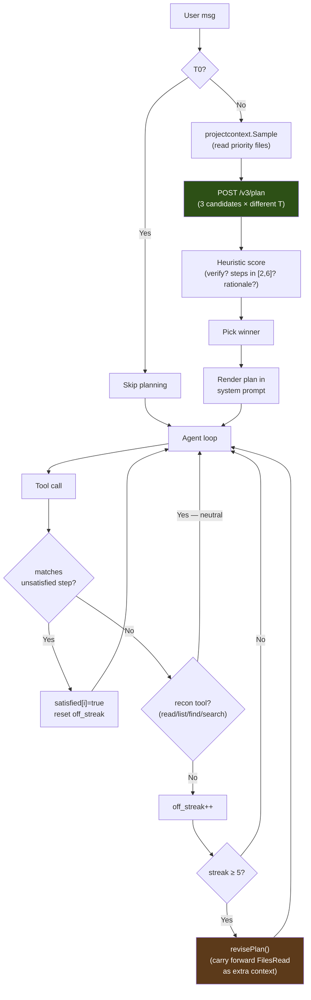

#### 구성요소

##### v3-service: `/v3/plan` (Python)

`services/v3-service/planning.py`에 정의되어 있고, `services/v3-service/main.py`가 라우트를 제공합니다. 핸들러는 다음을 수행합니다:

1. 사용자 메시지, 작업 디렉터리, 잘라낸 프로젝트 파일로 `PLAN_PROMPT_TEMPLATE`을 렌더링합니다.
2. 시드 오프셋과 온도 `[0.3, 0.5, 0.7]`로 LLM을 3번 호출합니다. 기본적으로 선택적 `chat_template_kwargs: {enable_thinking: false}` 제어를 보내고 계획 JSON용으로 출력 토큰 2,048개를 확보합니다. 이를 지원하는 템플릿은 추론 채널을 끄고, 다른 템플릿은 이 플래그를 무시합니다. `ATLAS_PLAN_THINKING=1`은 추론을 요청하고 예산을 8,192로 올립니다. 모델 계열별 프롬프트 지시문은 주입하지 않습니다.
3. 각 원시 응답을 마크다운 펜스를 허용하고 중괄호 깊이를 인식하는 추출기(`_parse_plan_json`)로 파싱합니다.
4. 파싱된 각 계획을 `_score_plan`으로 채점합니다(상한 1.0):
   - `verify_step`이 있으면 **+0.3**
   - `len(steps) ∈ [2, 6]`이면 **+0.2**, 그 밖의 1단계 이상이면 **+0.05**. 단계가 없는 계획은 0점입니다
   - verify 단계가 프로그램이나 그 테스트를 실행하거나 페이지를 가져오면(`pytest`, `python3 app.py`, `curl`, `go test` 등) **+0.2**. 빌드, 파싱, 린트만 하는 단계(`py_compile`, `tsc`, `ruff`, `go build`)에는 점수가 없습니다. 에이전트 루프도 이를 검증으로 세지 않습니다
   - verify 단계가 서버를 시작하기만 하면 **−0.3**. 이것으로 +0.3이 상쇄됩니다
   - 이미 있는 파일을 만드는 단계가 있으면 **−0.5**
   - 사용자가 이름을 말한 파일을 대상으로 하는 단계마다 **+0.1**(상한 +0.2)
   - `rationale`이 비어 있지 않으면 **+0.1**
5. 점수가 가장 높은 계획을 고릅니다. 동점이면 단계가 적은 계획이 우선합니다(군더더기를 줄이기 위해). 우승 계획의 verify 단계가 서버를 시작하기만 하면 그 `verify_step` 표시를 떼어 냅니다. 단계 자체는 계획에 남고, 루프 자체의 검증 게이트에 맡깁니다.
6. 모든 후보의 파싱이 실패하면 한 단계짜리 폴백(`{action: "investigate the request and act"}`)을 반환하므로, 플래너 실패로 에이전트 루프가 멈추는 일은 없습니다.

API 계약은 [API.md § POST /v3/plan](../../reference/API.md#post-v3plan)에 문서화되어 있습니다.

##### proxy: 브리지, 훅, 게이트 (Go)

| 파일 | 역할 |
|---|---|
| `services/proxy/internal/v3client/client.go` | `PlanStreaming(reqCtx, v3URL, requestID, req, onProgress)` — SSE 스트림을 열고, 진행 이벤트를 콜백으로 전달하며, `event: result` 프레임에서 최종 `Plan`을 반환합니다. `reqCtx`가 에이전트의 요청 컨텍스트를 묶으므로 `/cancel`은 진행 중인 계획을 중단합니다. V3 파이프라인 실행용 `GenerateStreaming`과 같은 구조입니다. |
| `services/proxy/internal/wire/` | `V3PlanRequest`(`v3.go`), `Plan`, `PlanStep`(`messages.go`) 타입. |
| `services/proxy/loop_state.go` | `AgentContext`에 `Plan`, `PlanStepsSatisfied[]`, `PlanOffStreak`, `PlanRevisions`가 추가됩니다. |
| `services/proxy/plan_generation.go`, `services/proxy/internal/projectcontext/sample.go` | `projectcontext.Sample()`는 플래너를 위해 우선 파일(app.py, templates/index.html, package.json, …)을 순회합니다. `shouldGeneratePlan()`은 티어, 메시지 길이, 읽기 전용 요청 여부로 판단합니다. `generatePlan()`은 브리지를 실행하고, 토큰별 잡음을 버리며, 전체 단계 목록과 함께 `plan_loaded`를 내보냅니다. |
| `services/proxy/plan_gates.go` | `matchPlanStep()`(도구 이름과 경로 접미사의 느슨한 일치), `recordPlanAdherence()`(도구 호출별 집계. 어떤 단계와도 일치하지 않는 정찰 호출 — `read_file`/`list_directory`/`find_file`/`search_files` — 은 중립이며 `off_streak`를 늘리지 않습니다), `revisePlan()`(`FilesRead`를 추가 컨텍스트로 넘겨 다시 생성). |

시스템 프롬프트 렌더링은 `buildSystemPrompt`에서 이루어집니다. 계획 단계는 번호 목록으로 렌더링되고 `✓` 표시는 verify 단계에만 붙으며, verify 단계는 검증 게이트가 `done`에 대해 지키는 "수정 증거" 단계로 명시됩니다. (단계별 ☐/✓/⚐ 글리프는 TUI 렌더링에 속합니다. 아래를 참고하세요.)

##### tui: 렌더링 (Go)

`clients/tui/internal/pipelinestate/plan.go`는 `PlanView`(모델의 상태)를 정의하고, `clients/tui/internal/app/state.go`는 `clients/tui/internal/app/events.go`의 채팅 디스패처에 연결된 `applyPlan*` 핸들러 3개를 정의합니다:

| 이벤트 | 핸들러 | UI 효과 |
|---|---|---|
| `plan_loaded` | `applyPlanLoaded` | `m.plan`을 새 계획으로 교체하고, 모든 단계를 상태 글리프와 함께 보여 주는 여러 줄의 채팅 행을 추가합니다. 수정본은 `m.plan`을 덮어쓰고 Satisfied 플래그를 초기화합니다. |
| `plan_adherence` (일치) | `applyPlanAdherence` | 일치한 단계의 `Satisfied` 플래그를 바꾸고, 한 줄짜리 `✓ s2 satisfied · edit_file (1/3)`을 추가합니다. |
| `plan_adherence` (불일치) | `applyPlanAdherence` | **조용함** — 계획 외 호출은 내부 상태만 갱신합니다. 이 필터가 없으면 계획 외 호출마다 채팅 행이 생겨 실제 진행 상황이 묻힙니다. |
| `plan_revise` | `applyPlanRevise` | 현재 계획에 `Revising=true`를 설정하고 `Plan revising (rev 1): <reason>`을 추가합니다. 다음 `plan_loaded`(`revision>0`)가 이를 교체합니다. |
| `v3_plan` | `formatV3StageEvent` | 플래너 자체의 진행 상황(`candidate 1 score=0.80`, `plan 1 won`)을 `plan` 채팅 행 메타 태그 아래에 렌더링합니다. |

#### 튜닝 항목

`services/proxy/plan_gates.go`에 정의:

| 상수 | 기본값 | 이유 |
|---|---|---|
| `planAutoReviseThreshold` | 5 | 자동 수정이 실행되기 전까지의, 정찰이 아닌 계획 외 도구 호출 수입니다(정찰 도구는 연속 횟수를 늘리지 않으므로 자연스러운 탐색은 세지 않습니다). 잘못된 계획을 일찍 잡을 만큼 엄격하고, 빗나간 호출 몇 번으로 헤맴 판정을 하지 않을 만큼 느슨합니다. |
| `planMaxRevisions` | 2 | 루프당 자동 수정 횟수의 상한입니다. 이를 넘으면 마지막 계획이 남고 수정만 멈춥니다. 수정 결과가 같은 단계를 돌려주면 계획을 버립니다. 계획을 벗어나는 비정상적인 입력이 `/v3/plan`을 끝없이 반복하는 것을 막습니다. |

`services/v3-service/planning.py` 상수:

| 상수 | 기본값 | 이유 |
|---|---|---|
| `n_candidates` | 3 | 온도 `[0.3, 0.5, 0.7]`로 다양하게 샘플링합니다. 후보가 많을수록 시간이 더 걸립니다(레퍼런스 모델에서 후보당 약 5~30초). |
| `max_tokens` (후보별) | 2048 | 경험상 근거가 포함된 6단계 계획을 담기에 충분합니다. 초기 테스트에서 1024는 JSON 중간에서 잘렸습니다. |

#### Plan 모드를 건너뛰는 경우

`shouldGeneratePlan`의 세 가지 조건:

1. **`ctx.Tier == Tier0Conversational`** — 사소한 대화("hi", "thanks")는 계획하지 않습니다.
2. **`len(trimmed) < 12`** — 이전 턴의 계획에 기대는 짧은 응답("yes do it", "looks good")은 다시 계획하지 않습니다.
3. **`isReadOnlyRequest(message)`** — 보기만 하는 요청("list the files")에는 계획이 필요 없고, 잘못된 계획은 모델을 편집으로 이끕니다.

그 밖의 모든 턴은 계획합니다. 실패(`/v3/plan` 5xx, 네트워크 오류, 폴백으로도 구할 수 없을 만큼 모든 후보를 파싱할 수 없는 경우)는 조용히 축소 동작합니다. 루프는 `ctx.Plan` 없이 실행되고, 에이전트 루프는 Plan 모드가 꺼져 있을 때와 똑같이 동작합니다.

#### 비용

소요 시간: 레퍼런스 모델에서 **후보당 약 5~30초**(후보 3개 스윕). 토큰 비용: 예산은 `3 × 2048 max_tokens`이고, 실제로는 후보당 약 1500토큰 × 3 = 약 4500토큰입니다.

둘 다 에이전트의 첫 도구 호출 전에 지불합니다. 이 투자는 모델이 쓸모없는 탐색 라운드를 건너뛰는 순간 회수됩니다(도구 호출마다 약 5~10초의 LLM 왕복과 도구 실행이 듭니다).

#### 테스트

| 계층 | 파일 | 다루는 내용 |
|---|---|---|
| v3-service 계획 엔드포인트 | `tests/v3-service/pipeline/test_plan_scoring.py`(채점기). 파서는 `curl /v3/plan`으로 스모크 테스트 | 채점기는 프로그램, 그 테스트 또는 프로브를 실행하는 verify 단계에 점수를 주고, 정적 검사(빌드, 파싱, 린터)와 정찰 호출에는 주지 않습니다. 파서의 허용 범위(펜스, 산문 머리말, 중괄호 중첩)는 후보 3개 샘플러로 확인합니다 |
| 프록시 브리지 | `services/proxy/internal/v3client/client_test.go`, 스테이지 라우팅은 `services/proxy/tool_write_v3_bridge_test.go` | SSE 파싱, 결과 누락 오류, 스테이지 라우팅 |
| 프록시 훅 | `services/proxy/loop_test.go` | 우선 파일 선택, 잘라내기 임계값, 폴백 순회, 티어와 길이 판단 |
| 프록시 준수 | `services/proxy/plan_gates_test.go`, 시스템 프롬프트는 `services/proxy/gates_test.go` | 일치 로직(도구 이름 + 경로 접미사), 실패한 호출 제외, 수정 횟수 상한, 시스템 프롬프트 렌더링 |
| TUI 렌더링 | `clients/tui/internal/pipelinestate/plan_test.go`, 핸들러는 `clients/tui/internal/app/state_plan_test.go` | `PlanView` 상태 전이, 수정 시 plan_loaded 교체, 계획 외 호출의 무음 처리 |

### 안전 제한

운영자용 제한과 조절 항목입니다. 내부 가드(traceback 위치 확인, 누락 모듈·명령·잘못된 인라인 스크립트·대소문자 불일치 안내, 심볼 근거 확인, 무변경·빈 내용·구문 게이트, doctype 제거)는 `services/proxy/guardrails*.go`와 `services/proxy/loop_*.go`에 있습니다. 구조 게이트는 `services/proxy/gates.go`에 있으며 `edit_file`, `structural_edit`, 모든 `write_file` 분기에서 미해결 직접 호출, 즉 향후 `NameError`를 도입하는 `.py` 쓰기를 거부합니다. 모든 요청에서 실행하고 끄는 요청 필드는 없습니다. 같은 파일의 내장 스크립트 게이트는 `.html`/`.htm`/`.jinja`/`.jinja2`와 **Python 문자열 리터럴**(`render_template_string`) 안의 `<script>` JavaScript를 파싱하고 `<style>` CSS의 괄호를 확인합니다. v3-service의 `POST /internal/embedded_script_check`를 거쳐 새로 손상시키는 변경을 거부합니다. 다른 게이트는 이 코드에 구조적으로 눈이 멀어 있습니다. 2026-08-01 dogfooding에서 Flask 인라인 `<script>`에 여분의 `)`가 남았지만 Python 컴파일, 서버 시작, `curl /`의 200 응답으로 검증과 `done`이 통과한 채 브라우저 페이지가 작동하지 않았습니다. 구문 게이트와 같은 정상→손상 규칙으로 이미 손상된 복구 중 파일은 허용합니다. 서비스 불가, 문법 누락, 모호한 블록(템플릿 문 태그, `<script src>`, 비 JS `type`, 이스케이프된 Python 문자열)은 발견 없음으로 처리하며 쓰기를 막지 않습니다. 누락 명령 안내는 `command not found`에 발동합니다. 샌드박스는 비 root 사용자로 실행되고 기반 파일 시스템이 읽기 전용이므로 런타임 apt 설치가 불가능하다고 알리고 pip 대안이나 사전 설치 툴체인을 안내해 반복 중단까지 같은 실패를 되풀이하지 않게 합니다. 잘못된 인라인 스크립트 안내는 `python -c` 검증의 `-c` 인수 자체에서 SyntaxError가 날 때 발동합니다(여러 문장의 `def`/`for` 본문을 한 줄에 넣은 경우). 해법 파일은 맞고 검증만 틀릴 수 있으므로 반복 대신 테스트를 `.py`로 옮기도록 합니다.

**수정 반복 중 빠른 쓰기 경로.** V3는 T2+ 파일의 *첫* 쓰기에서 baseline을 생성합니다. 모델이 쓴 파일의 실행 실패를 방금 봤다면 다음 쓰기는 편집-테스트-수정 루프의 표적 수정이므로 V3를 생략하고 직접 씁니다(구문·구조 게이트는 유지). V3 전체 파이프라인은 호출당 수분이며 디버그 중 파일에서는 쓸 수 있는 결과 없이 폴백할 때도 많습니다. 매 반복마다 이를 지불하면 몇 회만 시도할 수 있습니다. 빠른 경로는 `SessionWrites[path]`와 해당 파일을 참조한 가장 최근 실행 실패로 판단합니다.

**개선 반복과 맴돌기.** `write_file` 반복 서명은 경로와 **공백을 뺀 내용 지문**을 사용합니다. 같은 초안을 다시 내면 충돌해 집계되지만, 연속 컴파일 오류를 고치며 실질적으로 바꾼 내용은 다른 서명이므로 반복으로 세지 않습니다. 반복을 발견하면 **중단 전에 안내**합니다. 첫 발견은 교정용 `[system note]`를 넣고 계속하며, 안내 뒤 두 번째 발견에서만 종료합니다. 이는 정당한 수정 과정에서 해법을 디스크에 남기고 검증 전에 즉시 중단하던 동작을 대체합니다.

| 제한 | 값 | 목적 |
|-------|-------|---------|
| 대화 축소 | 슬롯별 슬라이딩 윈도우: system + 최신 사용자 지시 + 편집 중 파일 + `per-slot context − ATLAS_MAX_TOKENS − 2048 − slot/8`에 들어가는 최근 메시지. `slot/8`은 코드·JSON에서 문자 수/4 추정이 부족한 tokenizer 여유입니다. 고정한 지시와 파일도 예산에 포함합니다. 최소 8개 유지, `ATLAS_AGENT_HISTORY_BUDGET`으로 상한 설정. 서버가 여전히 컨텍스트 초과로 거부하면 최소 윈도우로 줄여 한 번 재시도합니다 | 편집 파일을 잃지 않고 컨텍스트 초과 방지 |
| 중복 읽기 단축 | 변경 없는 파일을 다시 읽을 때 내용이 아직 컨텍스트에 있으면 포인터만 반환하고, 없으면 전체 재제공(`ATLAS_DEDUP_READS=0`으로 비활성화) | 맹목적 편집 없이 재인코딩 방지 |
| V3 대화형 시간 상한 | 호출당 `ATLAS_V3_TIMEOUT`(기본 300초). 초과 시 모델의 구문·구조 게이트 통과 내용으로 폴백하고 최종 요약에 파일 명시(`0`은 비활성화) | 긴 복구 지연에도 응답성 유지 |
| 턴별 추론 예산 | 약 6144 추론 토큰에서 스트림 종료(`ATLAS_REASONING_BUDGET`, 0은 비활성화); 내장 tool_call 추출 또는 재요청 | 추론 반복 제한 |
| 기존 파일 write_file | 5줄 초과면 거부; .py/.html/.htm은 단계별 문법으로 `structural_edit` 유도 | 정밀 `edit_file` 또는 전체 노드 `structural_edit` 사용 |
| 의심스러운 축소 | `oldSize >= 100B` 및 `newSize < 64B`인 `structural_edit`/`edit_file` 거부(`services/proxy/guardrails_write.go::validateNotSuspiciouslyShrunk`) | 파괴적 스텁 쓰기 차단 |
| structural_edit 내용 폭주 | `content`가 8 KB 초과이면서 파일의 4배 초과면 거부 | 대체 노드에 추론이 유출된 대형 내용 차단 |
| structural_edit 노드 크기 전제 | 대체물이 노드의 5배 이상, 30줄 이상 더 크며 기존 내용을 중복하거나 파일에 20줄 이상 모듈 문자열 상수가 있으면 거부(v3-service `_replacement_dwarfs_node`) | 작은 selector로 전체 blob을 끼우면 노드 내용을 삭제합니다. 관측된 Flask 앱은 파싱되지만 `@app.route`가 모두 사라졌음 |
| 중복 진입점 | 이전에 최대 하나였던 최상위 `if __name__ == "__main__":`를 여러 개 남기는 `.py` 쓰기 거부(`services/proxy/gates_edit_requests.go::duplicateMainGuard`) | 전체 파일을 노드에 넣은 징후. 파싱·실행돼도 첫 blocking `app.run()` 뒤는 도달 불가 |
| 중복 lexical binding | 한 스코프에서 같은 이름의 `let`/`const` 중복 선언 거부(v3-service `embedded_script_check`) | 브라우저의 초기 SyntaxError로 스크립트 전체와 모든 핸들러가 멈춰도 서버는 200. tree-sitter는 파싱하므로 구문 검사로는 못 봄 |
| 렌더 루프 중단 | 반복 타이머가 구동하던 함수가 한 번만 예약되고 다시 예약되지 않는 변경 거부(v3-service `embedded_script_check`에 이전 파일 전달; `services/proxy/gates.go::embeddedScriptGate`) | JS 파싱·서버 시작·200 응답과 다른 검사 모두 통과해도 한 프레임 뒤 화면 정지 |
| V3 범위 밖 재작성 | 호출자 편집이 그대로 둔 줄을 후보가 없애면 후보를 버리고 호출자 내용 유지(`services/proxy/gates.go::v3RewroteBeyondTheEdit`) | V3는 전체 파일을 고쳐 작은 파일에서 무관한 부분도 재입력함. 실제 세션에서 `#e94562`→`#e94162`, `id="msg"`→`id=" msg"`; 둘 다 구문 오류 아님 |
| 오류 반복 차단 | **같은 경로·같은 종류**의 연속 3실패. 숫자·인용 구간·경로를 제거한 메시지 골격을 비교합니다. 다른 거부는 연속 횟수를 초기화합니다. 서로 다른 세 가지 거부는 모델이 반복하지 않고 수렴하고 있음을 뜻합니다 | 정상적인 반복 작업을 중단하지 않고 통제되지 않는 실패 순환을 멈춤 |
| 실패 호출 상한 | 실행당 12회(`maxTotalFailures`) | 거부 종류가 바뀌며 횟수가 초기화돼도 전체 실패 순환 제한 |
| 계획 완료 게이트 | 계획 점수 ≥0.6, 단계 ≥2, 하나 이상 일치한 경우, 도구 호출과 맞지 않는 계획 단계가 남으면 `done` 거부(`services/proxy/guardrails.go::planIncompleteMessage`) | 여러 부분의 요청을 일부만 전달하고 완료로 선언하는 문제. 턴별 알림은 이미 있었으나 무시됐음 |
| 탐색 예산 | 연속 읽기 4회에서 안내, 5회 이상 강화. 읽기는 항상 실행하고 안내는 다음 턴을 쓰기로 유도 | 끝없는 탐색 방지 |
| 명령 출력 제한 | stdout 8,000자, stderr 4,000자 | 컨텍스트 범람 방지 |
| 검색 결과 | 최대 200건, 파일 검색은 1 MB 초과 제외 | 검색 비용 제한 |
| 잘림 탐지 | 도구 인자 JSON 파싱 검사 | 잘린 모델 출력 탐지 |

---

## 4. V3 파이프라인 (안쪽 계층)

T2+ 파일에 대해 `write_file`/`edit_file` 실행기 안에서 활성화됩니다. 파이프라인은 네 개의 페이즈를 가지며, 모든 단계에 조기 종료 지점이 있습니다.

### 파이프라인 흐름

```mermaid
flowchart LR
    Entry["T2 detected"] --> Probe["Probe"] --> Score1["C(x)/G(x)"] --> SB1["Sandbox"]
    SB1 --> Pass1{"Pass?"}
    Pass1 -->|"Yes"| Done["Done"]

    Pass1 -->|"No"| Alloc["CxGx Gate\nk >= 3"] --> PS["PlanSearch"] --> DS["DivSampling"] --> BF["BudgetForcing"] --> Build["Build Check"] --> Score2["Score K"] --> SB2["Test K"]

    SB2 --> AnyPass{"Passed?"}
    AnyPass -->|"1+"| Select["Lens Select"] --> Done

    AnyPass -->|"0"| FA["Failure Analysis"] --> PRCOT["PR-CoT"]
    PRCOT --> PRPass{"Pass?"}
    PRPass -->|"Yes"| Done
    PRPass -->|"No"| Refine["Refinement"] --> Done

    style Entry fill:#1a3a5c,color:#fff
    style Done fill:#333,color:#fff
    style Probe fill:#1a3a5c,color:#fff
    style Alloc fill:#1a3a5c,color:#fff
    style PS fill:#1a3a5c,color:#fff
    style DS fill:#1a3a5c,color:#fff
    style BF fill:#1a3a5c,color:#fff
    style Select fill:#2d5016,color:#fff
    style Score1 fill:#2d5016,color:#fff
    style Score2 fill:#2d5016,color:#fff
    style SB1 fill:#2d5016,color:#fff
    style SB2 fill:#2d5016,color:#fff
    style Build fill:#2d5016,color:#fff
    style PRCOT fill:#5c3a1a,color:#fff
    style Refine fill:#5c3a1a,color:#fff
    style FA fill:#5c3a1a,color:#fff
```

범례: 파랑 = 생성, 초록 = 검증/선택, 갈색 = 수리.

### 페이즈 상세

**Phase 0: Probe**는 점진적 예산 재시도(light → standard → nothink)로 baseline 후보 하나를 생성하고 선택 모델의 C(x)/G(x) 아티팩트로 채점해 샌드박스에서 테스트합니다. 통과하고 증거 기록이 닫히면 조기 종료하며, 그렇지 않으면 생성을 계속합니다.

**기존 후보(incumbent)**(#259). proxy의 쓰기·편집 경로는 항상 호출자 파일을 `baseline_code`로 보내며 그 정확한 바이트도 후보입니다:

- 같은 샌드박스 검증, 계약 기록, 거부 조건, lens 점수를 적용합니다. 생성 슬롯을 쓰지 않고 풀 인덱스 -1로 생성 후보와 함께 순위를 매깁니다. 자신의 기록이 닫히면 즉시 반환합니다.
- 생성 후보는 같은 검사를 통과하고 더 높은 순위여야 교체할 수 있습니다. 파일의 역할도 보존해야 합니다. 모든 최상위 def·class·대입 이름과 다른 프로젝트 파일이 import하는 모든 이름이 대상입니다.
- 공백만 다른 사본으로는 교체하지 않습니다.

기존 후보를 유지하면 `phase_solved`는 `incumbent`이고 proxy는 모델 자신의 바이트를 씁니다.

**후보 할당: CxGx 게이트**(`phase2` / `phase2_allocated`로 방출)가 실패한 프로브에 후보를 몇 개 줄지 결정합니다. 프로브의 C(x)+G(x) 결합 점수(임베딩 추출 1회, 두 모델 모두 사용)가 2단계 규칙을 구동합니다: 보정된 C(x) 정규화 에너지가 Budget Forcing이 쓰는 것과 같은 사다리에서 기본 티어를 고르고, G(x) 품질 점수가 모델의 보정된 severe 경계 아래로 떨어지면 그 티어를 +1, 한참 아래(그 0.75배)로 떨어지면 +2 올립니다 — 프로브가 C(x)에는 싸 보이지만 G(x)에는 틀려 보이는 경우입니다. 티어가 k를 정하고(`nothink` 1, `standard` 3, `hard` 5, `extreme` 8) 여기에 **k >= 3의 하드 플로어**가 걸립니다. 따라서 게이트는 기존에 고정돼 있던 k=3에 후보를 더할 수만 있고 뺄 수는 없으며, 최악의 경우가 곧 예전 동작입니다. 두 신호 모두 이 모델의 보정 파일(`cx_normalization.json`, `gx_thresholds.json`)을 필요로 합니다: 보정되지 않은 lens 또는 lens가 거절한 probe(임베딩 배치보다 김, 비어 있음)는 `standard`에서 정확히 k=3을 할당합니다. 미보정 번들은 의미 없는 척도로 라우팅하지 않고 기존 파이프라인을 실행합니다. 전혀 채점할 수 없는 lens는 실행을 중단합니다([ADR 0011](../../adr/0011-the-lens-is-required.md)).

이 플로어가 앞서 제거된 C(x) 전용 할당기와의 차이입니다: 그쪽은 플로어가 없어서 *방금 실패한* 프로브의 태스크에 k=1을 건네주었습니다. 렌즈 기반 할당이 고정 또는 무작위 티어 할당보다 나은지는 측정되지 않았습니다. 이전의 4개 군 비교(게이트 적용, 고정 k=3, 같은 티어 구성을 태스크 간에 섞은 것, k=8, 군당 n=175)는 어느 쪽의 근거도 되지 않습니다. 이 비교는 Qwen3.5-9B에서, 이 저장소에 없는 패치된 러너로, 라이브 게이트가 적용할 수 없는 에스컬레이션 시 사고(thinking)를 켠 채, G(x) 헤드 학습에 쓰인 LiveCodeBench 태스크에서 실행되었고, 그 표본 크기에서는 군 간 차이가 잡음 범위 안에 있습니다.

라이브 경로와의 차이: 프록시의 V3 브리지는 `ATLAS_V3_TIMEOUT`(기본 300s) 이후 파이프라인 호출을 포기합니다. 벤치에는 없던 상한이라, k=8로의 무제한 에스컬레이션은 예산을 생성에 다 써 버리고 시간 안에 낼 수 있었던 k=3 답 대신 타임아웃 폴백을 반환하게 됩니다. 그래서 라이브 오케스트레이터는 남은 실시간과 해당 태스크에서 관측된 호출당 지연을 함께 넘기고, 게이트는 예산이 실제로 생성할 수 있는 수준까지 티어를 낮춥니다 — 에스컬레이션이 Phase 3를 굶기지 않도록 리파인먼트 1회분을 남겨 두되, 플로어 아래로는 결코 내려가지 않습니다. 벤치 러너는 예산을 넘기지 않고 측정된 그대로 할당합니다. 구현은 `services/v3-service/stages/cxgx_gate.py`이며 두 오케스트레이터가 공유합니다.

**Phase 1: 제약 기반 생성(Constraint-Driven Generation)**

**V3는 항상 실행됩니다.** 라우팅 규칙이 보내는 모든 요청에서 계획과 후보 생성을 실행합니다. 조건은 Tier 2 이상의 파일, 설정된 V3 서비스, 방금 실패를 본 파일을 반복 수정 중이지 않은 세션입니다. 둘을 끄는 요청 필드는 없습니다. `bypass_v3`, `v3_mode`, `feasibility_mode`는 제거되었으며 V3 off, planner-only, `enforce` 요청은 다른 시스템으로 조용히 실행되지 않고 400이 됩니다. V3 없는 측정은 연구용 빌드가 필요합니다.

- **PlanSearch**는 서로 다른 제약 집합을 추출해 구조가 다른 구현 계획을 만듭니다. probe가 아직 채우지 않은 할당 슬롯당 하나(k-1)입니다. 계획 구성과 코드 생성은 worker thread에 fan-out합니다(`services/v3-service/stages/plan_search.py`의 `_fan_out`). 요청 thread 밖에서 추론을 dispatch하는 유일한 V3 단계입니다. worker는 부모 ContextVar나 local을 상속하지 않으므로 요청 상태는 취소 범위와 같은 운반체인 요청별 `LLMAdapter`로 전달합니다. 각 추론 호출의 식별자도 `LLMAdapter.request_identity`에 있습니다. 헤더 resolver는 ContextVar 폴백을 쓰지 않습니다. worker에서는 요청 없음으로 읽혀 귀속 정보가 조용히 사라지기 때문입니다. 모델에 전혀 연결하지 못하면 짧은 후보 목록 대신 `PlanSearchInfrastructureError`를 발생시킵니다. DivSampling이 부족한 슬롯을 채우므로, 그렇지 않으면 빈 배치와 거절된 배치를 후속 단계에서 구별할 수 없습니다.
- **DivSampling**은 섭동 다양성을 적용합니다: 4개 역할(competitive_programmer, systems_engineer, mathematician, pragmatist) + 4개 지시(step_by_step, edge_case_first, complexity_aware, constraint_driven) + 4개 스타일(functional, pythonic, optimize_iteratively, structured)
- **Budget Forcing**은 사고 토큰 할당을 제어합니다:

| 등급 | 사고 토큰 |
|------|----------------|
| nothink | 0(템플릿 수준 사고 비활성화) |
| light | 1,024 |
| standard | 2,048 |
| hard | 4,096 |
| extreme | 8,192 |

각 등급은 시스템 프롬프트(직접 응답 또는 단계별 사고)와 최대 토큰 예산에 대응합니다. 선택 모델의 보정된 C(x) 에너지로 등급을 선택하며, 보정이 없으면 다른 모델의 상수 대신 설정된 기본 예산을 사용합니다.

**Phase 2: 검증 및 선택**

- **빌드 검증**: Python(`py_compile`), TypeScript(`tsc --noEmit`), JavaScript(`node --check`), Go(`go build`), Java(`javac`), Kotlin(`kotlinc`), Rust(샌드박스 `/execute` 경로에서는 `rustc`. `Cargo.toml` 프로젝트는 감지되어 `cargo build`를 쓰고, `cargo check`는 빌드 커맨드 허용목록을 통해서만 허용), C/C++(`/execute`에서는 `-Wall`을 붙인 완전한 `gcc`/`g++` 컴파일. `-fsyntax-only`는 `/syntax-check` 경로에만 적용), Ruby(`ruby -c`, 인터프리터 언어라 컴파일 단계 없음), PHP(`php -l`, 동일), Shell(`bash -n`). Next.js, React, Flask, Django, Express에는 프레임워크별 오버라이드가 있습니다.
- **거부권(Veto)**: 샌드박스 통과 후보에도 세 검사가 적용됩니다. lens 거부는 단계별 `gx_min`이 모델의 보정된 severe 기준보다 낮을 때입니다(실행은 되나 생성이 스텁으로 붕괴). 구조 거부는 Python 대상만 검사해 tree-sitter의 직접 식별자 호출이 로컬 def·import·builtin·프로젝트 심볼에 해석되지 않으면 잠재 `NameError`로 거부합니다. Python 문법은 다른 언어도 관대하게 파싱해 HTML의 `Time (mins)`를 호출로 오인한 적이 있습니다. 같은 이유로 호출 그래프 거부도 Python만 대상으로, 정의 없는 파일 간 호출을 검사합니다. 거부된 후보는 `passed=false`, `vetoed_by`, 오류 출력에 거부 사유를 기록하고 Phase 3 복구 풀에 들어갑니다. 최종 에너지 폴백은 이를 반환하지 않습니다. 모두 거부되고 복구도 실패하면 코드를 반환하지 않고 호출자가 baseline을 사용합니다
- **입력만 사용하는 합의(CodeT)**: 0/K 통과이고 생성 테스트 스위트가 있으면 후보를 생성된 *입력*으로 실행하고 출력 일치로 군집화합니다. 모델이 추측한 정답표가 아닌 독립 프로그램의 수렴이 신호입니다. *모든* probe 사례에서 실제 답이 있어야 참여할 수 있습니다. crash의 `CRASH` 표식은 거부하고 빈 출력은 군집화하지 않으며 일부만 유효한 결과도 합의 자료로 인정하지 않습니다. 군집은 최소 두 후보가 필요합니다. 자기 자신과의 일치는 증거가 아닙니다
- **Lens 선택**(1개 이상 통과): C(x) 에너지로 정렬해 가장 낮은 것이 승리
- **`/syntax-check` 판정**: 한 번에 한 파일의 구문만 검사하므로 단독 파일에서 볼 수 없는 형제 파일·패키지 참조는 오류가 아닙니다. Java는 컴파일하지 않고 파싱합니다(`javac -XDshould-stop.ifNoError=PARSE`). Kotlin과 TypeScript는 구문 진단만 셉니다(kotlinc의 `syntax error`, tsc의 TS1xxx). JavaScript는 `.cjs`로 검사하고 모듈 구문 때문에만 실패하면 `.mjs`로 검사해 Node의 모듈 유형 감지가 판정을 좌우하지 못하게 합니다. HTML은 markup을 포함하고 태그·주석·`<script>`·`<style>` 내부에서 끝나지 않아야 합니다. 자원 계약이 중단했거나 시작조차 못 한 검사기는 `valid: true` 대신 `status: "not_run"`과 `outcome`을 반환합니다. proxy는 이를 통과나 구문 오류가 아닌 미실행으로 기록합니다.

**Phase 3: 복구**(0/K 통과 또는 모든 통과 후보가 거부된 경우) — 두 전략을 순서대로 실행하며 조기 종료합니다:

- **실패 분석(Failure Analysis)**: 실패를 분류(wrong_algorithm, implementation_bug, edge_case_miss, time_limit, format_error, partial_correct)
- **PR-CoT**: 4개 관점(logical_consistency, information_completeness, biases, alternative_solutions) x (분석 + 수리) = ~8회 LLM 호출, 최대 3라운드
- **Refinement Loop**: 실패 분석 → 제약 정제 → 코드 생성 → 테스트 → 학습. 2회 반복, 120초 예산, 각 약 5회 이상 LLM 호출. 코사인 거리 필터(>= 0.15)로 가설 반복을 막습니다. 남은 시간(라이브는 `ATLAS_V3_TIMEOUT`, bench는 루프 자체 120초)이 관측된 호출 지연 기준 약 3회 순차 호출인 한 반복을 감당할 때만 진입합니다. 아니면 `refinement_skip`을 내보내고 폴백으로 갑니다

### 모듈 맵

파이프라인 스테이지는 `services/v3-service/stages/`에 있는 12개의 Python 모듈입니다. `services/v3-service/pipeline.py`가 그중 11개를 오케스트레이션합니다(10개는 직접, `constraint_refinement`는 리파인먼트 루프를 통해). `embedding_store`는 오프라인 벤치 러너(`atlas/bench/v3_runner.py`)에서만 실행되며, 이 러너는 체크아웃의 `services/v3-service/`를 자신의 경로에 올리므로 두 호출자가 하나의 스테이지 구현을 공유합니다:

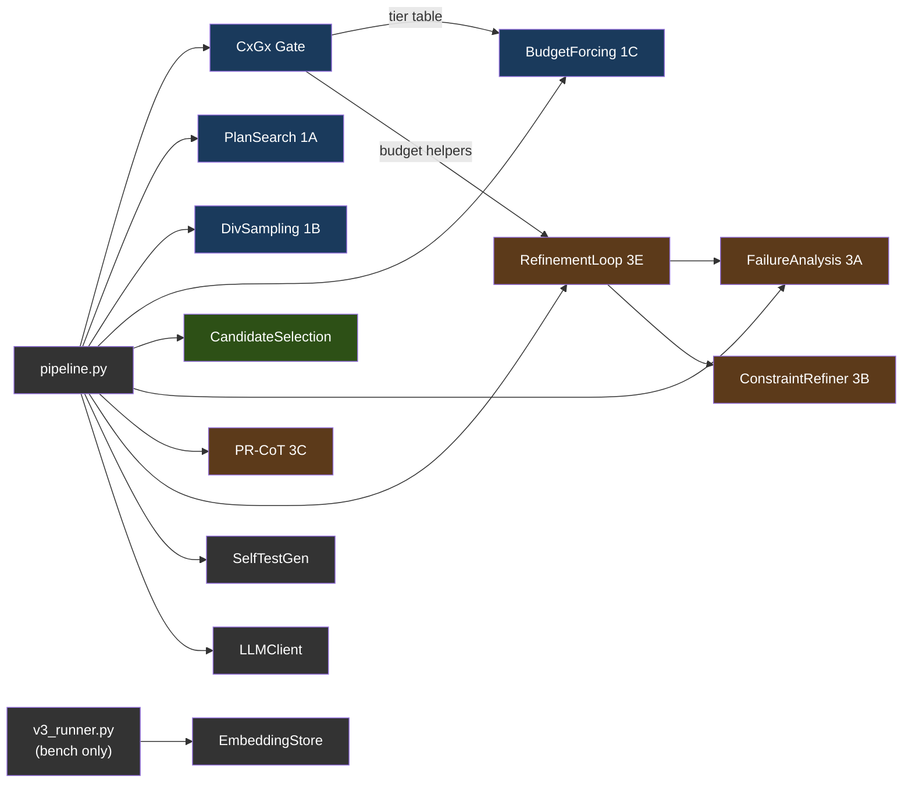

범례: 파랑 = Phase 1(생성), 초록 = Phase 2(선택), 갈색 = Phase 3(수리), 회색 = 유틸리티. `v3_runner.py`가 공급하는 모듈은 벤치 러너 전용이며, 서비스는 이를 호출하지 않습니다. 서비스 자체는 `main.py`(HTTP 핸들러) → `pipeline.py`(오케스트레이터) → `planning.py` / `scoring.py` / `symbols.py` / `adapters.py` 라는 평면적 형제 모듈 구성입니다.

---

## 5. Geometric Lens

모델 임베딩의 기하 구조를 분석하여 코드를 실행하지 않고도 코드 품질을 평가하는 신경 스코어링 시스템입니다. 전적으로 CPU에서 돌아갑니다. 서비스 표면은 내부 전용(`/internal/*`)입니다: C(x)/G(x) 스코어링(단발 및 스텝별).

#### 왜 "Geometric Lens"인가?

Geometric Lens의 핵심 아이디어는 간단한 전제에서 출발합니다: 모델을 키우는 것을 멈추고 지원 인프라로 감싸기 시작하라. Jose Crespo의 ["Everyone's Wrong About AI Programming"](https://www.josecrespophd.org/p/everyones-wrong-about-ai-programming)은, 현재 LLM이 올바른 코드 경로와 잘못된 코드 경로의 비용이 같은 평평한 임베딩 공간에서 작동하기 때문에 AI 생성 코드가 오류 쪽으로 표류한다고 주장합니다. 해법은 올바른 코드가 "내리막"이고 잘못된 코드가 "오르막"인 에너지 지형을 모델 주위에 구축하는 것입니다.

Anthropic의 [Manipulating Manifolds](https://transformer-circuits.pub/2025/linebreaks/index.html) 연구는 트랜스포머가 이미 임베딩 공간에 조작 가능한 기하 구조를 만든다는 증거를 제공합니다 — 원재료는 이미 거기 있습니다. Bar 등의 [Geometric Unification of Generative AI](https://arxiv.org/html/2510.00666v1)는 데이터 매니폴드 위의 거리 함수를 학습하고 스코어링에 사용하는 방법을 형식화합니다.

ATLAS는 이를 두 개의 상호 보완적 모델로 구현합니다. C(x)는 선택된 모델 자체 임베딩 위의 학습된 에너지 함수(`hidden_dim`→512→128→1 MLP)입니다. 각 코드 후보는 llama-server에 의해 임베딩되고, C(x)는 그것이 그 기하 구조에서 어디에 위치하는지 스코어링합니다. 낮은 에너지는 후보가 알려진 정답 코드와 군집함을 의미합니다. 높은 에너지는 알려진 오답 코드와 군집함을 의미합니다. 외부 오라클도, 실행도 필요 없습니다 — 선택된 모델 표현의 기하 구조만 필요합니다.

G(x)는 품질 예측기입니다 — PCA로 축소된 임베딩 위의 XGBoost 분류기로, 후보가 축소된 공간에서 어디에 위치하는지로부터 통과/실패를 예측합니다. C(x)가 "이 후보가 얼마나 좋은가?"에 답한다면, G(x)는 "이 후보가 통과할 가능성이 있는가?"에 답합니다. 이것이 유일한 G(x) 구현입니다: 이전의 메트릭 텐서 정식화와 그 correctability 엔드포인트는 XGBoost가 배포 경로가 되면서 제거되었습니다(기하 인식 변형은 git 이력을 참고하세요).

### 스코어링 모델

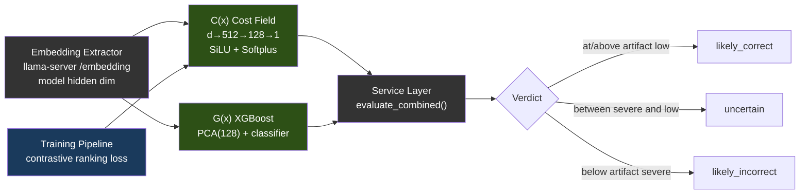

다음 수치는 공개된 V3 연구에 사용된 동결 레퍼런스 아티팩트를 설명합니다. 출처(provenance)일 뿐 런타임 차원이나 기본값이 아닙니다:

| 모델 | 레퍼런스 아키텍처 | 학습 데이터 | 성능 |
|-------|-------------|---------------|-------------|
| **C(x)** | 4096→512→128→1 MLP (SiLU, Softplus) | 597개 LCB 임베딩 (504 PASS, 93 FAIL) | Val AUC 0.9467, sep 2.04x |
| **G(x)** | PCA(4096→128) + XGBoost | 13,398개 임베딩 (4,835 PASS, 8,563 FAIL) | PCA 80.8% 분산 |

C(x) 정규화는 `sigmoid(steepness × (energy - midpoint))`입니다. 선택된 모델의 `cx_normalization.json`이 두 값을 공급하며, `atlas lens build`가 그 모델의 라벨링된 PASS/FAIL 후보로부터 이를 도출합니다. G(x) 판정 임계값도 마찬가지로 `gx_thresholds.json`에서 옵니다. 어느 쪽 캘리브레이션도 없으면, 정규화된 판단은 레퍼런스 아티팩트의 스케일을 빌리는 대신 중립/비캘리브레이션 상태로 유지됩니다.

**모델 호출의 귀속.** Lens의 모든 모델 서버 요청(`/embedding`, `/v1/models` 식별 프로브)은 `geometric_lens/model_transport.py`를 통합니다. 이는 ATLAS가 쓰는 두 상관 헤더 `X-ATLAS-Request-ID`, `X-ATLAS-V3-Invocation-ID`를 전달합니다. 값은 Lens 미들웨어가 현재 요청에 묶은 식별자에서만 옵니다(모든 ATLAS Python 서비스와 같은 ContextVars). V3는 스코어링 호출에 둘 다 보냅니다. 식별자가 없으면 헤더도 없고 일부만 있으면 그대로 유지하며, 요청 종료 때 바인딩을 지워 동시 요청·백그라운드 작업이 교환하거나 상속하지 못하게 합니다. 시작 자체 검사와 `/ready` 재검사는 `ATLAS_LENS_STARTUP_REQUEST_ID`, `ATLAS_LENS_STARTUP_INVOCATION_ID`가 둘 다 설정됐을 때만 식별자를 가집니다. 귀속된 임베딩 트래픽이 필요한 수집은 이 쌍을 선언하고 relay에 등록하며, 일반 배포는 둘 다 설정하지 않습니다. 귀속 용도뿐이며 스코어링·선택·승인·완료 로직은 읽지 않고 후보 바이트·사용자 내용도 들어가지 않습니다.

**proxy의 직접 Lens 호출은 자체 호출 식별자를 가집니다.** proxy가 모델을 사용하는 Lens 경로로 직접 호출하는 것은 쓰기별 `/internal/lens/score-per-step`이며 V3 후보 호출이 아닙니다. `services/proxy/lens_identity.go`가 요청을 만들고 묶인 `X-ATLAS-Request-ID`와 그 요청 id만으로 만든 proxy 소유 식별자를 붙입니다. 값은 `proxy-lens:` 뒤에 `sha256("atlas/proxy-lens-invocation/v1\n" + request_id)`의 처음 32개 16진수입니다. 결정적이어서 모델 트래픽 전에 relay가 등록할 수 있고, 한 요청의 직접 Lens 호출은 동일하며 요청 간 및 V3 UUID와는 구별됩니다. 타입이 있는 요청 id 외에 산문·경로·후보 바이트·도구 인자·모델 출력을 쓰지 않으며 모델이 설정할 수도 없습니다. 기존 `X-ATLAS-V3-Invocation-ID` 헤더를 사용합니다. 헤더 이름은 역사적이고 값은 일반 모델 호출 범위의 식별자입니다. 자격 증명이 아닌 범위 표식이며 변경·권한·후보·완료 승인에 쓰지 않고 SSE·도구 결과·프롬프트·로그에도 나타나지 않습니다. 요청 id가 없거나 고정 형식 `[A-Za-z0-9._:-]{1,128}` 밖이면 식별자를 만들지 않습니다. 명세와 벡터는 `services/proxy/testdata/lens_invocation_vectors.json`에 있습니다.

**임베딩 용량 경계.** llama-server는 한 `/embedding` 요청을 단일 물리 배치(`-ub`, `ATLAS_UBATCH`)로 처리하고 더 긴 입력은 거절합니다. Lens 점수는 전체 시퀀스에 대한 한 번의 forward입니다. 거절은 텍스트 품질이 아닌 배포 전송 한계이며 점수와 분리합니다. 응답은 `scored: false`, 모든 점수의 `null`, 타입이 있는 `failure`입니다. 종류는 서버의 `input_tokens`·`capacity_tokens`를 가진 `embed_capacity`, `model_server_error`, `model_server_unreachable`, `embedding_contract`, NaN·무한대의 `nonfinite_score`, `internal`입니다. 분할한 입력은 아티팩트를 학습한 벡터가 아니므로 서빙 중 잘라내거나 나누지 않습니다. v3-service는 후보에 실패를 기록하고 모든 채점 후보 뒤로 정렬하며 마지막 남은 검증 후보일 때만 전달합니다. proxy는 미채점 쓰기에 임계값을 적용하지 않습니다. `LLAMA_EMBED_CAPACITY_TOKENS`로 선언하거나 거절에서 관측한 용량은 `/health`와 `/ready`에 표시하고, proxy 생성 상한보다 작으면 상태 차원의 `lens_scoring: partial`로 보고합니다. 결정 기록: [ADR 0010](../../adr/0010-lens-capacity-boundary-is-typed.md).

현재의 모든 Lens 번들에는 `model_identity.json`도 포함됩니다. 서비스는 그 모델 이름이 llama-server의 `/v1/models`가 보고하는 서빙 모델 id와 일치할 것을 요구합니다(탐침이 실패하면 `ATLAS_MODEL_NAME`이 폴백). 임베딩 폭이 같다는 것만으로는 서로 다른 두 모델 간의 호환성을 입증할 수 없습니다.

> **참고:** 모델 가중치(.pt, .pkl)는 저장소에 커밋되지 않고 학습 중 만들어져 이미지에 포함되거나 런타임에 마운트됩니다. 파일이 없으면 스코어링 엔드포인트는 `enabled: false`와 자리표시자 값(C(x) 0.0, G(x) `gx_score: 0.5`, `verdict: "unavailable"`)을 반환합니다. proxy와 V3는 이를 채점 불가로 취급하며 파일이 생길 때까지 요청을 거부합니다([ADR 0011](../../adr/0011-the-lens-is-required.md)). 채점을 시도했으나 계산할 수 없으면 숫자 없이 `scored: false`와 타입이 있는 `failure`를 반환합니다. lens나 모델 서버 실패는 실행을 중단하고, lens가 거절한 입력(너무 김, 비어 있음, 비유한 값)은 미채점으로 보고합니다. 학습 데이터와 가중치는 [HuggingFace](https://huggingface.co/datasets/itigges22/ATLAS)에 있습니다.

> **실행 사이에 아무것도 보존하지 않습니다.** lens는 채점한 코드, 프로젝트 인덱스, 과거 세션 저장소를 보관하지 않으므로 이전 실행의 내용이 lens를 통해 다음 실행에 전달되지 않습니다. 상태·준비 검사와 세 개의 `/internal/lens/*` 스코어링 호출을 제공합니다(`services/geometric-lens/main.py`).

---

## 6. Sandbox

컴파일, 테스트, 린팅을 갖춘 격리 코드 실행 환경입니다. 그림은 구현된 핸들러 목록이며 지원 등급을 보장하지 않습니다. Java, Kotlin, Ruby, PHP는 Preview입니다([지원 매트릭스](../../guides/SUPPORT_MATRIX.md)). 기본 Docker 배포에서 Go, Rust, C, C++의 `/execute` 핸들러는 컴파일할 수 있지만 작업 디렉터리 `/tmp/sandbox`가 `noexec`라 네이티브 바이너리를 실행할 수 없습니다([#163](https://github.com/inferstep/ATLAS/issues/163)). `/shell` 프로젝트 명령은 `/workspace`에서 빌드·실행할 수 있고, Go의 `go run`은 실행 가능한 `GOTMPDIR` 마운트를 사용합니다. `/syntax-check`는 파싱 또는 컴파일만 하며 제출한 프로그램을 실행하지 않습니다.

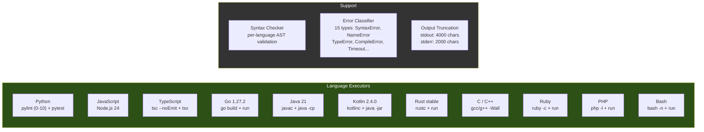

허용되는 언어 별칭: `py`/`python3` (Python), `js`/`node` (JavaScript), `ts` (TypeScript), `golang` (Go), `java` (Java), `kt`/`kts` (Kotlin), `rs` (Rust), `c++` (C++), `rb` (Ruby), `php` (PHP), `sh`/`shell` (Bash). 흔히 쓰는 CLI 도구는 이미지에 구워져 있고(`git`, `sqlite3`, `jq`, `patch`, `zip`/`unzip`, `xz`, `curl`), 바이너리 검사 도구(binutils의 `strings`, `objdump`, `readelf`, `nm`, 그리고 `file`, `xxd`)도 함께 들어 있습니다 — 컨테이너는 읽기 전용 베이스 위에서 비루트로 돌아가므로, 태스크가 셸로 호출하는 것은 전부 미리 설치돼 있어야 하며 런타임에 apt로 설치할 수 없습니다. 바이너리에 대한 `read_file`은 원시 바이트 대신 이 도구들을 가리키는 안내를 반환합니다. 최대 실행 시간: Docker 배포에서는 300초(compose가 프록시의 5분 `run_command` 상한에 맞춰 `MAX_EXECUTION_TIME=${ATLAS_SANDBOX_MAX_EXECUTION_TIME:-300}`를 설정; 순수 코드 기본값은 60초). 메모리, CPU, 프로세스 상한은 컨테이너 수준입니다: compose가 `mem_limit ${ATLAS_SANDBOX_MEM:-1536m}`, `cpus ${ATLAS_SANDBOX_CPUS:-2}`, `pids_limit ${ATLAS_SANDBOX_PIDS:-1024}`를 설정하며, `atlas init`이 호스트에 맞는 값(RAM과 코어의 ~75%)을 `.env`에 기록합니다. 쓰기 가능한 마운트는 언어 생태계마다 하나씩 있는 tmpfs이며 Docker는 기본적으로 `noexec`로 마운트합니다. `/home/sandbox/gobuild`는 예외로 `exec`가 있습니다. `go run`이 `GOTMPDIR`에 네이티브 바이너리를 링크한 뒤 실행하기 때문입니다. 기본 `GOTMPDIR=/tmp`에서는 모든 `go run`이 `fork/exec ...: permission denied`로 실패했습니다. 컴파일 언어를 추가할 때는 툴체인이 임시 디렉터리와 프로젝트 트리 중 어디에서 실행하는지 확인해야 합니다. `/workspace`는 이미 실행을 허용하므로 변경이 필요 없습니다. 두 개의 워크스페이스 경로: **`/execute`**(V3 후보 테스트 경로)는 `/tmp/sandbox`(tmpfs) 아래의 일시적 스크래치 디렉토리를 사용; **`/shell`**(에이전트의 `run_command` 경로, 그리고 백그라운드 프로세스용 `/jobs/*`)은 `/workspace`에 대해 실행됩니다 — `ATLAS_PROJECT_DIR`(Docker)에서 바인드 마운트된 프로젝트 루트 또는 hostPath `${ATLAS_PROJECTS_DIR}`(K3s)로, 프록시가 보는 것과 동일한 경로입니다.

---

## 7. VRAM 예산 예시

9B Q6 모델과 32K 컨텍스트를 사용해 실측한 RTX 5060 Ti 16GB 배포 사례 하나:

| 구성요소 | VRAM |
|-----------|------|
| Qwen3.5-9B-Q6_K 모델 가중치 | ~6.9 GB |
| KV 캐시 (32K 컨텍스트) | ~1.3 GB |
| **llama-server 총합** | **~8.2 GB** |
| Geometric Lens | 0 (CPU 전용, 모델용 ~12 MB RAM, PyTorch 런타임용 ~128 MB) |
| v3-service | 0 (CPU 전용) |
| sandbox | 0 (CPU 전용) |
| atlas-proxy | 0 (Go 바이너리, ~30 MB RAM) |
| **여유 VRAM** | **~7.8 GB** |

llama-server 외부의 모든 연산은 CPU에서 돌아갑니다. GPU는 오로지 LLM 추론과 임베딩 추출에만 사용됩니다.

### 7.1 백엔드별 VRAM 예산

위의 8.2 GB / 7.8 GB 여유 분할은 예시일 뿐 ATLAS 모델 기본값이 아닙니다. 실제 사용량은 `atlas init`가 선택한 모델, 양자화, 컨텍스트, 병렬 슬롯 설정을 따릅니다. 다른 백엔드는 구조적으로 다릅니다:

| 백엔드 | 보고되는 "VRAM" | 부하 시 현실적 예산 | 비고 |
|---|---|---|---|
| **CUDA** (전용 VRAM) | 하드웨어 스펙(정규 5060 Ti에서 16 GB) | 스펙의 ~95%(드라이버가 ~500 MB 예약) | 위 표의 수치가 직접 적용됨. |
| **ROCm** (전용 VRAM) | 하드웨어 스펙 | 스펙의 ~90–95%(HIP 런타임이 CUDA보다 약간 무거움) | RX 7900 XTX (24 GB) → 14B Q5 + 32K 컨텍스트를 2개 병렬 슬롯으로 여유롭게 실행. |
| **Metal** (Apple 통합) | 총 시스템 RAM | 시스템 RAM의 **~70%** | OS + 브라우저 + IDE가 ~30%를 잡아먹음. 16 GB MBP의 *현실적* 예산은 11 GB — macOS 자체 GPU 워킹셋이 같은 메모리에 얹히면 Qwen3.5-9B Q6_K(가중치 ~6.9 GB + 32K에서 KV ~1.3 GB, §7 기준)에는 여유가 거의 없음. ≤16 GB에서는 Q4_K_M(5 GB) 사용; Q6_K는 ≥24 GB 통합 메모리를 원함. |
| **Vulkan** (크로스 벤더) | 하드웨어 스펙 | 실측된 배포 아직 없음 (프리뷰(Preview) — lavapipe CPU 경로에서만 검증됨) | 같은 카드에서 튜닝된 네이티브 백엔드 대비 ~20–40% 낮은 성능 예상. |
| **SYCL** (Intel Arc) | 하드웨어 스펙 | 로드맵(Roadmap) — Intel Arc는 현재 Vulkan 사용 | A770 (16 GB) 목표는 NVIDIA 16 GB와 보수적으로 동등. |

---

## 8. 배포

서비스 의존성 그래프(배포 모드 전반에서 동일):

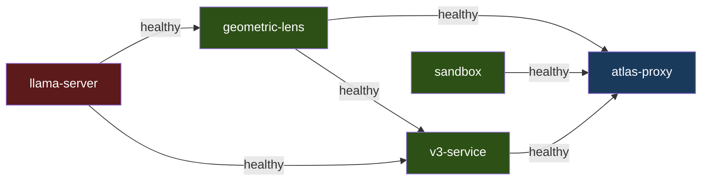

`llama-server`와 `sandbox`는 독립적으로 시작합니다. `geometric-lens`는 `llama-server`가 healthy해지기를 기다리고, `v3-service`는 `llama-server`와 `geometric-lens`를, `atlas-proxy`는 `llama-server`, `geometric-lens`, `v3-service`, `sandbox`를 기다립니다. Docker Compose, 베어메탈, K3s는 동일한 `services/inference/entrypoint-v3.1.sh`로 구동되므로, 컨텍스트 크기, KV 캐시 양자화, flash attention, mlock이 환경 변수로 제어되며 이 모드들 전반에서 동작이 동일합니다. macOS 하이브리드 경로는 엔트리포인트의 플래그를 미러링하는 `scripts/install/atlas-llama-macos.sh`를 통해 네이티브 llama-server를 실행합니다.

설치와 모드별 기동 절차(NVIDIA / ROCm 오버라이드, 베어메탈, macOS 하이브리드 Metal, K3s 매니페스트)는 [SETUP.md](SETUP.md)에, macOS 네이티브 경로는 [SETUP_MACOS.md](../../guides/SETUP_MACOS.md)에 있습니다.

---

## 9. 데이터 흐름

### T1: 단순 파일 쓰기

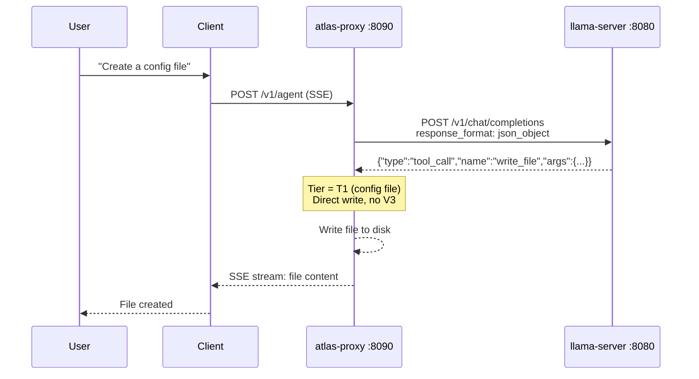

LLM 호출 1회. V3 오버헤드 없음.

### T2: 기능 파일 쓰기

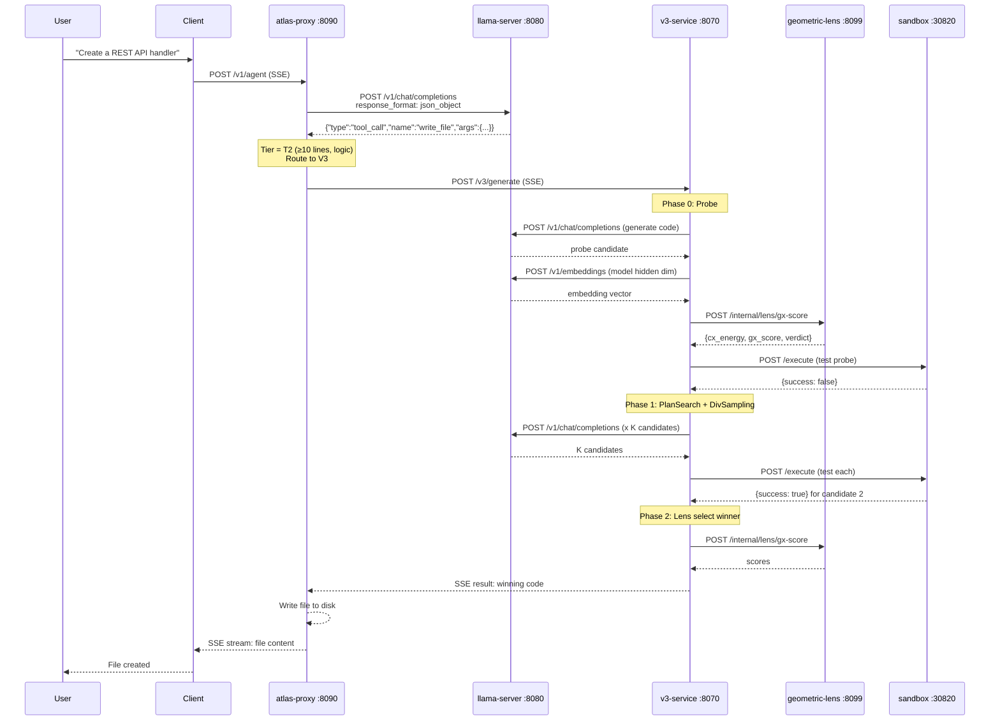

알고리즘성 작업 기준 최소 3회의 llama-server 호출(probe 생성 1회 + 셀프 테스트 생성 1회 + 임베딩 추출 1회). 대화형 작업(게임, UI, 프레임워크 코드)은 셀프 테스트 생성을 건너뛰므로 최소 2회입니다. Phase 3 수리가 모든 전략을 동원하면 최대 30회 이상.

### 기존 코드 편집

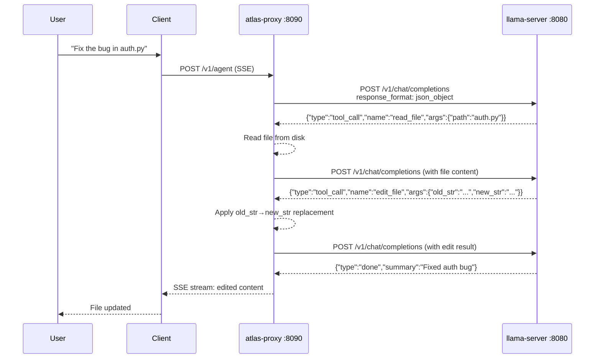

5줄을 초과하는 기존 파일은 `write_file`에 대해 거부됩니다 — 모델은 `edit_file`(정밀, ≤10줄) 또는 `structural_edit`(노드 전체 재작성: Python, HTML, Go, JavaScript, TypeScript)를 사용해야 합니다. `.py`/`.html`/`.htm` 파일에서는 단계별 문법 게이트(BiasBusters #2)가 다음 결정에 대해 도구 이름 생성 규칙에서 `edit_file`/`write_file`를 능동적으로 금지하여 모델이 잘못된 지름길로 되돌아가지 못하게 합니다.
