<!-- source: docs/reference/ARCHITECTURE.md synced-through: 7bb86537fd98a8ed6bc63d551502482c722aa60a -->
> **[English](../../reference/ARCHITECTURE.md)** | **[简体中文](../zh-CN/ARCHITECTURE.md)** | **[日本語](../ja/ARCHITECTURE.md)** | **한국어**

# ATLAS 아키텍처

ATLAS V3.1.7의 시스템 아키텍처입니다. 2계층 설계로, 바깥쪽 에이전트 루프가 도구 호출 오케스트레이션을 담당하고, 안쪽 V3 파이프라인이 빌드 검증과 에너지 기반 선택을 통해 다양한 코드 후보를 생성합니다.

---

## 1. 시스템 개요

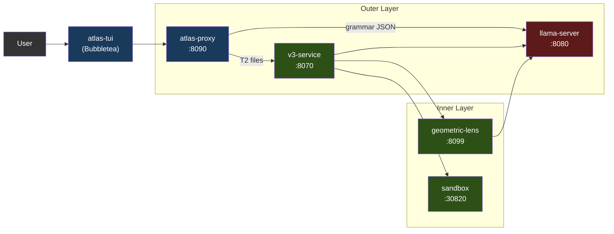

서비스는 Docker Compose(권장)를 통해 컨테이너로 실행되거나, `atlas` 런처를 통해 로컬 프로세스로 실행됩니다. GPU를 사용하는 것은 llama-server뿐입니다. 나머지는 모두 CPU에서 돌아갑니다.

채팅 프론트엔드는 **atlas-tui**(Bubbletea)입니다. `/v1/agent`(턴별 채팅 SSE)와 `/events`(파이프라인 패널용 전역 타입 봉투 피드)를 소비하는 네이티브 Go 터미널 UI입니다. `atlas`(대화형 기본값) 또는 `atlas tui`(명시적)로 실행합니다. 파이프라인 패널은 V3 단계를 실시간으로 보여주고, 채팅 패널은 어시스턴트 마크다운을 glamour로 렌더링합니다. 슬래시 명령 `/add /diff /commit /run` 등이 로컬 파일 컨텍스트와 셸 호출을 처리합니다. 모드 인식 입력(채팅 / `!bash` / `/slash`)에 힌트 드롭다운이 함께 제공됩니다.

도구 호출 + V3 파이프라인을 원하는 서드파티 클라이언트는 `/v1/agent`를 직접 대상으로 합니다. `/v1/chat/completions`는 llama-server로의 패스스루입니다(§3 참고). 계약은 [API.md](../../reference/API.md)에 문서화되어 있습니다.

### 1.1 지원 가속기

llama-server는 GPU를 사용하는 유일한 서비스입니다. 다른 모든 ATLAS 서비스는 CPU에서 돌아갑니다(프록시는 Go, v3-service / geometric-lens / sandbox는 Python). 덕분에 다중 백엔드 표면이 작게 유지됩니다 — 새 가속기를 추가한다는 것은 파이프라인을 변경하는 것이 아니라 새 Dockerfile + 엔트리포인트 환경 변수 분기를 추가하는 것을 의미합니다.

| 백엔드 | 상태 (V3.1.x) | 이미지 / 빌드 경로 | Compose 오버라이드 | 테스트된 카드 |
|---|---|---|---|---|
| **CUDA** (NVIDIA) | 지원(Supported) (V3.1.0부터) | `services/inference/Dockerfile.v31` → `atlas-llama` | (기본값) | RTX 5060 Ti 16GB (정규). 게시된 이미지는 Blackwell(컴퓨트 캐퍼빌리티 12.0/12.1) 전용으로 컴파일되어 있으며, 이전 세대는 로컬 재빌드가 필요합니다 — [SETUP.md](SETUP.md) 참고 |
| **ROCm / HIP** (AMD) | 커뮤니티 검증(Community-tested) (V3.1.1부터) | `services/inference/Dockerfile.rocm` → `atlas-llama-rocm`, 호스트에서 빌드 (`pull_policy: build`; GHCR 이미지 없음) | `deploy/compose/docker-compose.rocm.yml` | RX 7900 XTX (커뮤니티 스모크 테스트, GH #26) |
| **Metal** (Apple Silicon) | 지원 ([#32](https://github.com/inferstep/ATLAS/issues/32)) | 하이브리드: 네이티브 llama-server (Metal) + 나머지는 Docker (macOS는 컨테이너로 GPU 패스스루 불가) | `deploy/compose/docker-compose.macos.yml` | M 시리즈; ≤16 GB에서 Q4_K_M, ≥24 GB 통합 메모리에서 Q6_K |
| **Vulkan** (크로스 벤더 폴백) | 프리뷰(Preview) | `services/inference/Dockerfile.vulkan` → `atlas-llama-vulkan` | `deploy/compose/docker-compose.vulkan.yml` | lavapipe CPU 부팅 경로 (스모크 테스트됨); 실제 GPU 검증은 아직 없음 |
| **SYCL** (Intel Arc) | 로드맵(Roadmap) — Intel Arc는 현재 `vulkan` 사용 | 미정 | 미정 | — |

**백엔드 선택은 런타임이 아니라 설치 시점에 이루어집니다.** `atlas init`는 `tier.detect_gpu()`(`atlas/commands/tier.py` 참고)를 실행해 감지된 모든 벤더 중 VRAM이 가장 큰 GPU를 고르고(`ATLAS_GPU_VENDOR` / `ATLAS_GPU_INDEX`로 재정의), `.env`에 `ATLAS_BACKEND={cuda|rocm|metal|vulkan}`를 기록합니다. 패키징된 네이티브 백엔드가 있으면 감지는 그것으로 귀결됩니다: NVIDIA는 CUDA, x86_64의 AMD는 ROCm, macOS는 하이브리드 Metal 경로. 호스트용으로 패키징된 네이티브 백엔드가 없으면(Intel Arc, arm64의 AMD, 인식되지 않는 벤더) 마법사가 Vulkan 범용 폴백을 제안합니다(기본값: 예) — 이미지 하나가 AMD, Intel, Adreno, MoltenVK, lavapipe CPU 래스터라이저를 커버하며, 성능은 튜닝된 네이티브 백엔드 대비 대략 20–40% 낮습니다. 마법사가 부팅되지 않을 `.env`를 쓰는 대신 거부하는 것은 쓸 수 있는 것이 아무것도 없을 때뿐입니다. 각 백엔드는 자체 이미지를 가지므로(CUDA와 Vulkan은 GHCR에 사전 빌드되어 있고, ROCm은 첫 `up` 때 AMD 호스트에서 컴파일됨), 사용자는 모든 백엔드의 라이브러리를 담은 무거운 이미지를 실행하지 않습니다.

**자체 모델 반입(BYO model) 표면 (V3.1.1).** `atlas lens check`는 실행 중인 llama-server에 대한 저렴한 사전 점검으로, 로드된 모델이 Lens 호환인지 보고합니다. `atlas lens build --samples <path>`는 `services/geometric-lens/geometric_lens/training.py`를 감싸 모델의 네이티브 임베딩 차원에 맞춰 새로운 C(x)(`cost_field.pt`) **그리고** G(x)(XGBoost) 아티팩트를 학습시킵니다. 이 둘을 함께 쓰면 사용자가 lens 코드를 포크하지 않고도 기본이 아닌 GGUF를 갈아 끼울 수 있습니다 — C(x) 생성자가 임의의 `input_dim`을 받기 때문에, 모델마다 바뀌는 것은 학습된 가중치뿐입니다. 사용자 대상 흐름은 [CLI.md § atlas lens](../../reference/CLI.md#atlas-lens)를 참고하세요. `atlas lens publish`(또는 통합 명령 `atlas publish`)는 아티팩트를 HuggingFace에 업로드하고 그 해시를 고정하는 레지스트리 PR을 엽니다.

**벤더 비의존적인 것**(모든 백엔드에서 동작): 문법 제약 JSON, 셀프 임베딩(`/embedding`), 레이어별 히든 스테이트, ASA 제어 벡터(백엔드와 무관하게 llama.cpp의 `control_vector_load`로 로드), KV 캐시 양자화, 바깥쪽 에이전트 루프 전체, V3 파이프라인, Geometric Lens, 샌드박스.

**백엔드별로 다른 것:**
- **Flash attention.** CUDA + ROCm: 완전 지원. Metal: 제한적(llama.cpp Metal 백엔드는 일부 head size에 대해 flash-attn을 지원하며, 지원되지 않으면 기본 비활성화). Vulkan: 드라이버에 따라 다름.
- **고정(pinned) 호스트 메모리.** `GGML_CUDA_NO_PINNED`는 CUDA + ROCm에 적용됩니다(HIP는 GGML 호환 계층에서 CUDA 경로를 미러링). Metal/Vulkan은 CUDA/HIP 고정 경로를 사용하지 않습니다.
- **멀티 GPU + 텐서 병렬화.** V1은 모든 백엔드에서 단일 GPU만 지원합니다. 멀티 GPU는 특정 벤더에 묶이지 않은 GH #34입니다.
- **Apple 통합 메모리.** macOS는 GPU+시스템 메모리를 공유합니다. "VRAM" 계산은 실제로는 "총 16 GB에서 OS + 앱을 뺀 것"입니다. §7 참고.

K3s 배포 경로(`scripts/install/install.sh`, `deploy/k3s/`의 매니페스트)는 V3.1.1 시점에 CUDA 전용입니다 — ROCm K8s 레시피는 V3.2 인프라 목록으로 연기되었습니다(`/dev/kfd` + `/dev/dri` hostPath 마운트와 `render`/`video` 그룹 멤버십, 즉 `deploy/compose/docker-compose.rocm.yml`의 클러스터 수준 등가물이 필요).

---

## 2. 서비스

| 서비스 | 포트 | 언어 | 용도 |
|---------|------|----------|---------|
| **llama-server** | 8080 | C++ (llama.cpp) | LLM 추론(CUDA / ROCm / Metal / Vulkan; SYCL은 로드맵 — §1.1 참고), 문법 제약 JSON, 셀프 임베딩, 레이어별 residual 히든 스테이트 |
| **atlas-proxy** | 8090 | Go | 에이전트 루프, 도구 호출 라우팅, 등급 분류, `/v1/agent` SSE, `/events` 타입 SSE, `/cancel`. `/v1/chat/completions`는 `max_tokens` 상한 조정만 적용한 채 llama-server로 전달(API.md 참고). |
| **atlas-tui** | (클라이언트) | Go | Bubbletea TUI; `/events`와 `/v1/agent` SSE 스트림을 소비. |
| **v3-service** | 8070 | Python | V3 파이프라인 HTTP 래퍼(PlanSearch, DivSampling, PR-CoT 등) |
| **geometric-lens** | 8099 | Python (FastAPI) | 내부 `/internal/*` 스코어링 서비스: C(x) 에너지 스코어링, G(x) XGBoost 품질 예측, 스텝별 스코어링 |
| **sandbox** | 30820 (호스트) / 8020 (컨테이너) | Python (FastAPI) | 격리된 코드 실행, 컴파일, 린팅, 테스트 실행 |

---

## 3. atlas-proxy (바깥 계층)

프록시는 채팅 프론트엔드의 진입점입니다. `/v1/agent`(타입 이벤트 스트림 — TUI가 사용하는 것)에서 사용자 메시지를 받아들이고, llama-server를 호출하고 도구 호출을 파싱·실행해 이벤트를 다시 스트리밍하는 내부 에이전트 루프를 실행합니다. `/v1/chat/completions` 엔드포인트는 llama-server로의 투명한 패스스루입니다. SDK 호환성을 위해 유지되며 에이전트 루프를 실행하지 않습니다. 전체 이벤트 타입 카탈로그는 [API.md](../../reference/API.md)를 참고하세요.

`services/proxy/`의 테스트가 아닌 모든 Go 파일(하위 폴더 포함)과 각 파일이 담당하는 영역입니다:

| 파일 | 담당 |
|---|---|
| `main.go` | HTTP 서버, 라우팅, 인증, 패스스루, 오류 엔벨로프, 비공개 값 로그 필터 |
| `loop.go` | `runAgentLoop`, 펜스 가져오기, 툴체인 감지 |
| `model_call.go`, `model_reply.go` | llama-server 호출 1회와 모델이 돌려준 응답 읽기. `model_reply.go`는 모델 텍스트의 JSON 이스케이프를 디코딩하며, UTF-16 서로게이트 쌍은 한 문자로 읽습니다. `\b`와 `\f`는 글자로 남으므로 백스페이스나 폼 피드가 터미널에 닿지 않습니다 |
| `model_prompt.go`, `task_tier.go` | 시스템 프롬프트와 컨텍스트 예산, 메시지가 받는 등급 |
| `server_agent.go` | `/v1/agent` 및 `/cancel` 엔드포인트 |
| `plan_generation.go`, `task_intake.go` | 요청에 계획이 필요한지 판단과 플래너에 계획을 요청하는 호출, 요청이 선언한 작업 계약 |
| `loop_end.go`, `loop_recovery.go` | 실행이 끝나는 방식(종료 이벤트, 시간 예산, 요약), 막힌 모델에게 보여 줄 내용과 실행이 아직 마치지 않은 작업 |
| `model_fenced_channel.go` | 파일 본문을 가져오는 서브콜과 그 서브콜이 쓸 수 있는 예산 |
| `gates_exit.go` | 종료 게이트와 그 게이트가 읽는 실행 상태. 검증 명령이 오래 실행되는 서버여서 실패했는지(시간 제한에 걸렸거나 포트가 이미 사용 중), 코드가 망가져서 실패했는지도 구별합니다 |
| `loop_turn.go`, `loop_checks.go`, `loop_results.go` | 루프의 한 턴: 모델 호출과 응답, 도구 실행 전 검사, 결과와 스턱 루프 차단기. `loop_turn.go`는 읽기 전용 호출이 반복된 뒤 요청이 요구하는 바에 따라 실행에 행동하거나 답하라고 재촉합니다 |
| `tools.go`, `tool_*.go` | 16개 도구 정의와 실행기, 등급 분류, 도구 호출 문법 |
| `gates*.go` | 정직성/계획 게이트: 클레임 체크, 구조, 구문, 임베드 스크립트, 계획 준수, 계획 리마인더 |
| `loop_detectors.go` | 스턱 패턴 검출: 도구 반복, 추론 반복, 트레이스백 지역화 |
| `loop_project.go` | 컨텍스트 보강: 심볼 인덱스, 프로젝트 스캔, 워크스페이스 봉쇄, 세션 파일 매니페스트 |
| `guardrails_permissions.go` | 권한 게이트(`/v1/permission`), 트러스트 모드, 하드 차단 패턴 |
| `lens.go` | 렌즈 스코어링 호출, 캘리브레이션 상태 |
| `lens_identity.go` | Lens 서비스를 직접 호출할 때 쓰는, 프록시가 소유한 호출 신원을 만들어 붙입니다 |
| `lens_required.go` | geometric Lens를 사용할 수 있어야 한다는 조건을 강제하고, Lens 실패를 추적하며, 스코어링을 쓸 수 없으면 실행을 멈춥니다 |
| `internal/logsafe/logsafe.go` | 로그용으로 개인정보에 안전한 도구 인자 요약을 만듭니다. 승인된 필드만 허용하고 민감한 내용은 가립니다 |
| `internal/logsafe/filter.go` | 모든 로그 줄이 지나가는 writer: 자격 증명 형태의 값을 가린 다음, 제어 문자를 텍스트로 출력합니다 |
| `internal/assetlint/lint.go`, `internal/assetlint/findings.go` | 에셋 그래프 린트: 어떤 라우트도 렌더링하지 않는 템플릿, 어떤 페이지도 로드하지 않는 스크립트나 스타일시트, 존재하지 않는 파일에 대한 참조, 어떤 라우트도 제공하지 않는 폼 또는 `fetch()` 대상 |
| `internal/shadowcapture/sink.go` | 비공개 섀도 캡처: 요청이 선언한 것과 ATLAS가 요청 텍스트에서 읽은 것을 비교하는 레코드. 고루틴 하나가 파일에 쓰며, 어떤 결정도 이를 읽지 않습니다. `ATLAS_SHADOW_CAPTURE`가 파일을 지정하지 않으면 꺼져 있습니다 |
| `internal/memoryenvelope/envelope.go` | 선언된 배포 메모리 예산을 운영자가 밝힌 호스트 용량과 대조해 검증하고, 강제되지 않는 예산 초과를 보고합니다 |
| `internal/projectcontext/sample.go` | V3 요청에 보여 주는 프로젝트 내용: 플래너가 고른 우선 파일 샘플, 실행이 읽은 파일(수정된 계획의 컨텍스트에 경로의 정렬 순서로 한도까지 추가), 그리고 요청이 담을 수 있는 바이트로 잘라낸 각 파일 |
| `internal/workspacefs/object_handle_linux.go` | 삭제 승인 동안 Linux 파일 시스템 객체를 열어 두어, 승인된 객체가 제거 전에 바꿔치기되지 않게 합니다 |
| `internal/workspacefs/object_handle_other.go` | Linux가 아닌 플랫폼에서는 파일 시스템 객체를 안전하게 고정하고 검증할 수 없으므로 삭제 승인을 거부합니다 |
| `candidate_mutation_scope.go` | 모델의 도구 호출에서 정확한 파일과 편집 범위를 도출하여, 후보가 요청된 대상 밖의 어떤 것도 수정하지 못하게 합니다 |
| `task_obligation_kinds.go` | 요청의 결정과 원장에서 요청의 의무를 도출하고, 전달 결과가 그 의무를 해소했는지 검사합니다 |
| `task_obligations.go` | 실행 의무를 호출자가 선언한 계약에서 가져올지 ATLAS의 레거시 추론에서 가져올지 고르고, 그 결정을 요청에 묶어 둡니다 |
| `internal/shellcmd/command_evidence.go` | 셸 명령이 보여 주는 것: 실행, 프로브, 정적 검사 또는 아무것도 아님. 그리고 명령줄이 그 부분의 종료 상태를 보고하는지 |
| `guardrails*.go` | 도구별 스티어링 가드(축소, 누락된 명령/모듈 스티어, doctype 제거). `guardrails_reply.go`는 도입 문구를 정규화하여, 앞으로 할 작업을 알리기만 하는 응답을 완료 검사가 알아볼 수 있게 합니다 |
| `server_events.go` | 타입 엔벨로프 브로커(`/events`)와 SSE 배관 |
| `internal/v3client/client.go` | v3-service의 `/v3/generate` + `/v3/plan`용 SSE 클라이언트. 호출 상한 `ATLAS_V3_TIMEOUT`은 `tool_write_v3.go`에 남습니다 |
| `loop_state.go` | 공유 타입, 등급, 턴 상한 |
| `internal/wire/messages.go` | 모델의 메시지, 도구 결과, 계획: 경계를 넘는 것 |
| `internal/wire/v3.go` | V3 서비스의 요청, 응답, 증거 엔벨로프와 그것을 읽는 검사 |
| `internal/wire/tool_io.go` | 각 도구의 인자와 출력. 모델이 읽고 쓰는 JSON 형태 |
| `internal/wire/tool_classification.go` | 도구 결과가 무슨 일이 일어났는지 말할 때 쓰는 닫힌 단어 집합 |
| `internal/wire/events.go` | `/events` 엔벨로프 |
| `internal/taskcontract/task_contract.go` | 작업 계약과 산출물 레코드: 요청이 무엇을 요구했는지 |
| `internal/taskcontract/obligation_kinds.go` | 닫힌 의무 단어 집합, 각 의무에 필요한 강도, 의무를 만드는 방법 |
| `internal/taskcontract/verification_requirements.go` | 타입이 있는 클라이언트 검증 요구 사항, 실행 기록, 그리고 그 검사 |
| `candidate_advisory_policy.go` | 모델의 제안을 유지할지 후보를 전달할지 결정합니다. 검증 및 선택 규칙보다 먼저 하드 거부권을 적용합니다 |
| `candidate_authorization.go` | 후보 증거가 작업의 승인 요구 사항을 충족하는지 검사합니다. 대상 범위와 기존 파일의 검증된 동작 보존도 포함합니다 |
| `candidate_grant.go` | 정확한 후보, 대상, 워크스페이스 상태에 묶인 일회용 권한을 만들고, 소비하고, 폐기합니다 |
| `candidate_attribution.go` | 자동 후보 전달이 성공하거나 거부된 이유를 기록합니다. 라우트, 승인, 정책, 전달 담당자가 이미 내린 결정을 사용합니다 |
| `candidate_automatic.go` | V3가 선택한 바로 그 후보가 자동 전달을 위한 안전 및 신원 요구 사항을 충족하는지 검사합니다 |
| `candidate_capture_only.go` | 캡처 전용 측정 실행 중에는 후보 전달을 막고, 그 억제를 기록합니다 |
| `delivery.go` | 후보 전달을 승인하고, 일회용 권한을 소비하며, 현재 워크스페이스 상태를 다시 검사하고, 승인된 바이트를 씁니다. 서비스가 작성한 후보 내용을 전달할 수 있는 프로덕션 라우트와 출발 도구의 목록도 둡니다 |
| `candidate_policy.go` | 고정된 후보 정책, 그 정책이 낼 수 있는 결과, 각 결정의 비공개 기록을 정의합니다 |
| `candidate_provenance.go` | 전달된 내용이 어디서 왔는지, 어떤 정책이 그 내용을 디스크에 닿게 허용했는지 보고합니다 |
| `candidate_reachability.go` | 변경이 후보 생성을 우회한 이유(자격과 남은 시간 포함)를 판단하고 기록합니다 |
| `evidence_candidate_staging.go` | 격리된 샌드박스 사본의 후보 파일에 대해 클라이언트가 선언한 검증 명령을 실행하고, 돌아온 관찰 결과를 검사합니다 |
| `model_cut_call.go` | 잘린 도구 호출의 완전한 필드와 현재 파일로 복구 안내를 만듭니다. 불완전한 호출은 실행하지 않습니다 |
| `delivery_handoff.go` | 전달된 내용이 모델이 제출한 것과 다를 때 모델의 파일 컨텍스트와 도구 피드백을 갱신합니다 |
| `delivery_settlement.go` | 완료된 후보 전달을 기록하고, 승인된 아티팩트가 여전히 존재하며 바이트와 원장 상태가 일치하는지 검사합니다 |
| `delivery_edit_route.go` | 편집 도구의 후보를 승인과 전달 과정으로 넘기며, 출발 도구의 결과 형식과 폴백 내용을 보존합니다 |
| `evidence_wiring.go` | 구문 증거와 선언된 명령 증거의 생산자를 후보 라우트에 연결하고, 후보 신원을 부여하며, 사용 가능하거나 누락된 증거를 기록합니다 |
| `internal/wire/execution_outcome.go` | 명령의 완료, 중단, 자원 고갈을 분류하여 불완전한 실행이 성공한 검증으로 집계되지 않게 합니다 |
| `candidate_feasibility.go` | 생성 전에 사용 가능한 증거 생산자가 작업을 충족할 수 있는지 평가하고, 생성을 제어하지 않은 채 그 평가를 기록합니다 |
| `internal/fencing/framing.go` | 완전한 펜스 파일 페이로드를 인식해 내용을 추출하고, 프레이밍 문법과 재시도 안내를 제공합니다 |
| `internal/workspacefs/file_kind.go` | 경로에 무엇이 있는지 답하고, 일반 파일만 읽습니다. 이름 있는 파이프는 writer가 나타날 때까지 open을 붙잡아 두므로, 무엇이든 읽기 전에 열린 핸들의 종류를 판단합니다 |
| `internal/workspacefs/file_kind_unix.go` | 논블로킹 open 플래그. 독자가 찾는 이름을 가진 파이프도 writer를 기다리지 않고 즉시 열립니다 |
| `internal/workspacefs/file_kind_other.go` | 그 플래그에 해당하는 것이 없는 플랫폼용 같은 플래그. 종류 검사가 단독으로 판단하게 둡니다 |
| `model_old_str_watch.go` | 스트리밍 중인 편집 텍스트가 더 이상 대상 파일과 일치할 수 없게 되면 폭주를 멈추고, 복구 안내를 제공합니다 |
| `loop_repair.go` | 세션 쓰기가 남긴 미해결 구문 수리를 추적하고, 너무 이른 완료를 막으며, 핸드오프 때 해결되지 않은 수리를 보고합니다 |
| `candidate_route_disposition.go` | 각 후보 라우트가 어떻게 끝났는지, 그 전달 권한이 실제로 내용을 디스크에 닿게 했는지 추적합니다 |
| `candidate_route_entry.go` | 후보 생성 시도마다 고유한 신원을 만들어 증거, 승인, 전달 기록을 연결할 수 있게 합니다 |
| `evidence_staged_command.go` | 후보 바이트, 워크스페이스, 전달이 최신인 동안에만 스테이징된 검증을 완료 쪽으로 인정합니다 |
| `evidence_staging_contract.go` | 샌드박스 스테이징 요청, 관찰 결과, 실행 예산, 그리고 그 신원 바인딩을 정의하고 검증합니다 |
| `candidate_mutation_target.go` | 클라이언트가 출력 경로를 선언하지 않았을 때, 파싱된 변경 호출이 후보 전달을 정확한 대상에 고정하는지 검사합니다 |
| `evidence_syntax.go` | 프록시의 구문 검사 관찰 결과를 정확한 후보 바이트와 구조적 의무에 묶인 증거로 바꿉니다 |
| `delivery_v3_fallback.go` | V3가 실패하거나 시간 초과된 뒤 쓰인 파일을 추적하고, 아직 최신인 미검사 내용을 최종 요약에서 밝힙니다 |
| `evidence_verification.go` | 클라이언트가 선언한 명령의 관찰 결과에서 증거를 만들고, 그 증거가 개별 검증 의무 중 어느 것을 충족하는지 추적합니다. 선언된 검증의 증거 강도를, 이 세션이 본 테스트 에셋의 출처에 따라 제한하기도 합니다 |
| `gates_workspace_observation.go` | 포그라운드와 백그라운드 명령이 만든 파일 변경을 관찰하고, 산출물과 삭제를 세션 원장에 기록합니다 |
| `internal/workspacefs/confined_dir.go` | 한 폴더를 `os.Root`로 읽습니다. 폴더 밖의 무언가로 해석되는 이름은 읽기가 아니라 오류이며, 일반 파일이 아닌 것을 가진 이름은 없는 이름처럼 건너뜁니다 |
| `internal/workspacefs/sandbox_subdir.go` | ASCII 문자, 숫자, 점, 밑줄, 대시로 된 최대 64자의 `sandbox_subdir`만 허용하며, `.`이나 `..`은 절대 허용하지 않습니다 |
| `server_service_answer.go` | 스택의 서비스(llama-server, V3 서비스, 렌즈, 샌드박스)의 응답을 최대 64 MiB까지 읽습니다. 끝없이 보내는 서비스가 프록시의 메모리를 채우지 못하게 합니다 |
| `internal/shellcmd/shell_wrapper.go` | `validateShellCommand` 뒤의 명령 정책: 복합 명령을 나누고, 실행 래퍼(`sh -c`, `eval` 등) 안을 최대 16단계까지 살펴보며, 치명적인 명령과 검사할 수 없는 래퍼를 거부 |
| `internal/shellcmd/destructive.go` | 어떤 명령도 쓸 수 없는 셸 형태: 치명적인 삭제, 포크 폭탄, 장치에 대한 쓰기 |

### 에이전트 루프 흐름

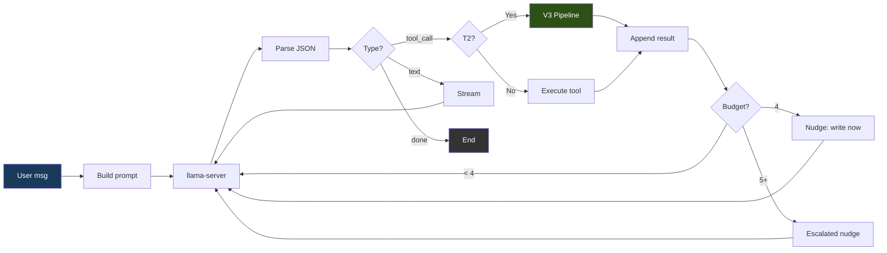

### 문법 강제

모든 모델 출력은 세 가지 유효한 JSON 형태 중 하나를 향하도록 제약됩니다:

```json
{"type": "tool_call", "name": "<tool_name>", "args": {...}}
{"type": "text", "content": "<message>"}
{"type": "done", "summary": "<summary>"}
```

기본 `strict` 모드에서 프록시는 완전한 JSON 스키마 — `additionalProperties: false`와 함께 `oneOf`를 사용하고 레지스트리에서 도구 이름을 열거 — 를 전송하며, llama-server가 이를 토큰 생성 중 문법으로 강제합니다. 문법 제약은 잘못된 형식의 출력을 불가능하게 만드는 것이 아니라 드물게 만듭니다: `ATLAS_GRAMMAR_MODE=loose`는 `{"type":"json_object"}`만 전송하고(유효한 JSON이되 형태는 강제하지 않음 — 일부 모델에는 이것이 필요합니다), 응답 토큰 상한이 JSON 중간을 자를 수 있습니다. 프록시는 파싱을 실패할 수 있는 것으로 취급합니다 — 산문/`reasoning_content`에서 JSON을 복구하고, 실행 전에 잘린 도구 인자를 감지하며, 표적화된 파스 실패 설명을 되먹이고, 3회 연속 실패 후 루프를 끊습니다.

**펜스 콘텐츠 채널(`@fenced`).** 파일 전체 본문은 JSON 채널로 보내지 않습니다. JSON 문자열 안의 코드는 빽빽한 줄마다 이스케이프 부담을 지며, 서빙되는 12B 모델은 측정상 이를 감당하지 못합니다: 같은 해답이 펜스 마크다운 블록으로 내보내면 6/6 파싱되고, JSON 문자열로 내보내면 0/6 파싱됩니다(닫는 괄호 누락, 리터럴 `\n`이 문장을 주석에 붙여 버림, 이어 붙인 줄의 공백 손실). 시스템 프롬프트는 모델에게 `write_file`의 `content`를 정확히 `@fenced`로 설정하라고 지시합니다. 그러면 프록시는 *제약 없는* 서브콜 하나(문법 없음, `response_format` 없음)를 보내고, 그 응답은 대상 확장자 태그(` ```python `, ` ```html `, …)가 붙은 단일 펜스 블록 안의 파일입니다. 엔벨로프는 JSON 제약 아래에 남고, 파일 본문만 평문으로 옮겨 갑니다. 메커니즘의 세부(`services/proxy/loop.go::fetchFencedContent`): 서브콜은 일시적입니다(대화에 추가되지 않음 — 메인 스레드에서 보면 모델이 `@fenced`를 쓰고 쓰기가 일어난 것). 파일 자체에 ` ``` `가 들어 있는 응답은 마지막 펜스를 기준으로 추출하므로 내부 펜스가 파일을 자르지 않습니다. 센티널*과* 파일을 한 문자열에 넣은 모델은 센티널을 떼어 내고 인라인 내용을 사용합니다. 두 번 시도한 뒤에는 인라인 내용을 요청하며 되돌려 보냅니다. 모든 시도는 실제 생성이며 실행 합계에 집계됩니다(최종 `done` 페이로드의 `fenced_calls` / `fenced_tokens`, 시도마다 `fenced_fetch` 스테이지 이벤트 하나).

반복 검출기는 **모델**이 보낸 호출의 지문을 뜹니다. 이 스냅샷은 펜스 해석이 가져온 본문으로 `parsed.Args`를 다시 쓰기 전, 도구 호출 분기의 맨 처음에서 찍습니다. 이 스냅샷이 없으면 검출기는 호출 자체가 바이트 단위로 같은데도 시도마다 다른 바이트를 읽게 되며, 고정된 실행에서 7턴짜리 `@fenced` 루프가 검출기가 침묵한 채 하네스 상한에 닿은 이유가 이것입니다. 가져온 바이트에는 영향이 없습니다: 그 바이트는 여전히 변경, 게이트, 원장, 쓰기를 이끕니다. 대상 경로는 서명을 위해 정리되므로 `solve.py`와 `./solve.py`가 별도의 예산을 얻을 수 없습니다.

어떤 경로의 펜스 허용량이 소진된 뒤 모델이 그 채널을 다시 요청하면, 거부는 한 번만 모델이 행동할 수 있는 형태로 바뀝니다: 정규 경로, 파일을 읽을 수 있을 때 현재 소스(한도 내, 또는 디스크에 없다는 명시적 안내), 그리고 여전히 동작하는 대안 — 파일 전체 인라인, 표적 편집, 읽기, 또는 모델이 직접 내는 `run_command`. 정규 경로마다 한 번만 제시되며, 별칭, 새 턴, 무관한 성공으로 다시 열 수 없습니다. 생성을 시작하지 않고, 명령을 실행하지 않으며, 어떤 도구도 강제하지 않습니다. 계속 요청하는 모델은 일반적인 실패 호출 집계에 걸려 멈춥니다.

먼저 실행 게이트(run-first gate)가 경고된 파일을 실행하라고 이미 요구했는데 모델이 같은 원시 `@fenced` 쓰기로 답하면, 요구를 반복하는 것은 해결책이 아닙니다. 그런 재발에서는 모델에게 파일의 실제 상태를 건넵니다 — 정규 경로, 번호를 붙인 최대 120줄, 그리고 원장이 바로 그 바이트에 대한 실패 판정을 갖고 있다면 현재 실패 판정 — 그리고 쓸모없는 호출은 보류합니다. 이 처리는 펜스 해석보다 먼저 실행되므로, 막힌 반복은 생성 비용이 들지 않습니다. 읽기만 하고 쓰지 않으며, 명령을 실행하지 않고, 도구를 강제하지 않으며, 정규 경로마다 최대 한 번 발동하고, 남은 작업 예산이 90초 미만이면 건너뜁니다. 그래도 모델이 막힌 의도를 반복하면 기존 금지와 반복 검출기가 실행을 정직하게 끝냅니다.

먼저 실행 게이트 자체는 하나의 지시, `runFirstInstruction`을 인용합니다: 해당 확장자의 파일을 실행하는 명령(`runCommandFor`: `python3`, `node`, `go run`, `java`, 또는 Kotlin의 경우 `kotlinc … && java -jar` 쌍)이며, 종료하는 스크립트는 `run_command`로, 서비스하는 스크립트는 `run_background`로 보냅니다(포그라운드 서버 리디렉트가 쓰는 것과 같은 `runsAServerLoop` 검사). 두 도구 모두 명령이 파일을 실행하면 경고 표시를 해제하므로, 백그라운드에서 시작되어 안정화 구간의 트레이스백으로 읽힌 서버 스크립트도 실행된 것으로 셉니다. `python3 -m <module> file.py`와 `python3 -c ...`는 파일을 다른 프로그램에 넘기므로 그 서버 루프를 시작하는 것으로 취급하지 않습니다. 이 세 규칙 이전인 2026-09-14의 측정: 게이트는 `run_command python3 app.py`를 요구했고, 리디렉트는 이를 거부했으며, `run_background`는 표시를 해제하지 못했고, `python3 -m py_compile app.py`는 서버 시작으로 거부되었으며, 세션은 SyntaxError가 디스크에 남은 채 끝났습니다.

시도마다 생성 비용이 들기 때문에, 채널은 실행될 수 있는 호출에만 열립니다. `fencedCallIsExecutable`은 호출이 어차피 통과해야 하는 검사 — 인자 형태, 비어 있지 않은 경로, `validateToolWorkspacePaths`, `shouldDenyToolCall` — 를 직접 호출해 실행하므로, 이 함수의 거부는 `executeToolCall` 거부의 부분집합입니다. 쓸 수 없는 호출은 그냥 해석되지 않습니다: 센티널은 `content`에 남고, 도구는 자체 메시지와 `MutationNone`으로 이를 거부하며, 세션은 생성 하나 대신 턴 하나를 씁니다. 이 검사가 생기기 전의 측정: 300초 카나리아가 아무것도 쓰지 못한 채 36턴에 이르렀고, 매 턴이 경로 없이 `content: "@fenced"`인 `write_file`이었으며, 매번 채널을 열고 실패할 때마다 빈 경로의 허용량 키에 기록되었습니다.

펜스 서브콜은 멈출 수 있습니다: 스트림이 열린 뒤 서버가 보이지 않는 곳에서 생성하는 동안 아무것도 보내지 않습니다. 감시자가 이를 끊습니다(`fencedStalledTimeout`, 약 25초). 멈춤은 파일이 아니라 세션의 성질이므로, 한 파일의 가져오기가 멈추면 다음 파일의 가져오기도 같은 식으로 멈춥니다. 첫 번째 가져오기가 멈춘 뒤에는 실행이 끝날 때까지 채널을 끕니다(`ctx.FencedStalls`가 `fencedSessionStallLimit`을 넘음, `fencedChannelDisabledForSession`으로 검사): 다음 `@fenced`는 서브콜 없이 즉시 돌아오고, 모델은 파일을 인라인으로 쓰도록 유도됩니다. 인라인이 안전한 폴백인 이유는, 원래 `@fenced`가 피하려던 잘림을 이제 아래의 쓰기 무결성 검사가 잡아내기 때문입니다.

### 쓰기 무결성 검사

세 가지 검사가 망가진 파일이 깨끗한 쓰기로 디스크에 닿는 것을 막습니다. 각 검사는 실제 원인을 밝히므로 모델이 다시 보낼 때 고칠 수 있습니다.

**이스케이프되지 않은 따옴표로 잘린 쓰기는 거부됩니다.** `content`에 이스케이프되지 않은 `"`가 들어 있는 `write_file`은 JSON 문자열이 일찍 끝납니다. 그러면 관대한 디코더가 파일의 나머지를 버려지는 키로 읽어 들이고, 성공을 보고하는 잘린 파일이 디스크에 닿습니다. 루프는 파싱된 편집 도구 호출에서, 도구의 실제 시그니처(입력 스키마에서 리플렉션으로 읽음) 밖에 있으면서 새어 나온 파일 내용의 모양 — 길거나 코드 구두점을 담고 있음 — 을 한 키를 검사해 거부하고(`swallowedContentFeedback`), 모델에게 문자열이 일찍 끝났으니 안쪽 따옴표를 이스케이프하거나 `structural_edit`를 쓰라고 알려 줍니다.

**렌더링할 때마다 500을 낼 Jinja 템플릿은 쓰기 시점에 잡힙니다.** 템플릿은 HTML로는 파싱되면서도 렌더링에서 실패할 수 있습니다: `{% for x in xs %)`는 태그를 `)`로 닫습니다. `html.parser`는 이를 통과시키고 서버도 시작되지만, 렌더링할 때마다 `TemplateSyntaxError`가 발생합니다. 샌드박스 구문 검사는 Jinja도 파싱하는데, 실제로 템플릿인 파일(`templates/` 디렉터리나 `.jinja`/`.jinja2` 이름)로 범위를 좁히고 `{%` 문장 태그가 있을 때만 수행하므로, `{{ }}`를 공유하는 Vue/Angular HTML은 Jinja 파서에 넘겨지지 않습니다. 알 수 없는 태그/필터 오류(서드파티 확장)는 버립니다. 프록시는 샌드박스가 그 범위를 적용할 수 있도록 파일 경로를 보내며, 직접 쓰기 게이트와 V3의 컴파일 스모크 검사 양쪽에서 그렇게 합니다.

**기준선이 이미 컴파일되면 대화형 작업은 V3 수리를 건너뜁니다.** V3의 수리 페이즈는 생성된 후보가 하나도 통과하지 못했을 때만 도달합니다. 대화형 작업에서 유일한 신호는 "컴파일되는가"이므로(서버는 샌드박스에서 끝까지 실행할 수 없음), 그 시점에 컴파일되는 유일한 코드는 모델 자신의 쓰기이며, 수리되어 컴파일되는 후보는 컴파일되는 기준선보다 더 잘 검증된 것이 아닙니다. 기준선이 컴파일되면 수리를 건너뛰고 기준선을 돌려주어, 세션의 약 50%를 그것을 다시 도출하는 데 쓰는 대신 예산을 에이전트 루프에 돌려줍니다. 알고리즘 작업은 수리를 유지합니다: 실행할 수 있고, 모델이 생성한 자체 테스트 결과가 진단 정보로 기록되기 때문입니다.

### 도구

`services/proxy/tools.go`에 16개의 도구가 등록되어 있습니다. 각 도구의 내용과 제한, 읽기 전용 여부는 [API.md § Tools available to the agent loop](../../reference/API.md#tools-available-to-the-agent-loop)를 참고하세요.

### 산출물 원장 (관찰 전용)

`executeToolCall`은 각 호출이 세션의 산출물에 무엇을 했는지를 해석된 워크스페이스 경로를 키로
하여 `AgentContext.Ledger`에 기록합니다. 원장은 관찰만 하고 아무것도 결정하지 않습니다: 복원도,
거부도, 이벤트도 없습니다. 처리 방식은 `ToolEffect`가 고릅니다.

| 효과 | 기록되는 것 |
|--------|------------------|
| 직접 변경 (`write_file`, `edit_file`, `structural_edit`, `insert_after`, `replace_lines`) | 호출 뒤 파일을 다시 읽어 해시하므로, 기록된 해시는 도구가 제안한 바이트가 아니라 디스크에 있는 바이트를 가리킵니다 |
| `delete_file`, `move_file` | 경로가 실제로 사라지면 툼스톤(tombstone)을 남깁니다. 체크포인트 바이트는 보존하고 자동 복원은 금지합니다. 이동은 목적지를 새로 관찰하며 판정을 옮기지 않습니다 |
| `run_command` | 추적 중인 모든 경로를 다시 해시합니다: 바뀌지 않은 파일은 판정을 유지하고, 바뀐 파일은 판정을 잃습니다. 워크스페이스도 호출 전후로 순회합니다(`applyShellChanges`, stat만 사용, 의존성·캐시·빌드 디렉터리는 건너뜀): 명령이 만들거나 바꾼, 완료 판단이 가능한 종류의 파일은 세션의 작업으로 원장에 들어갑니다. 요청 시작 시 있었고 명령이 제거한 파일은 `deleted:shell` 툼스톤이 되므로, 완료 판단은 이를 아무도 승인하지 않은 삭제로 읽습니다. 실행이 만든 파일을 나중 명령이 제거하면 원장에서 빠집니다. 순회가 상한에 닿으면 요약에 단서 조항이 남습니다 |
| `run_background`, `stop_background` | 시작 시 워크스페이스 위험(hazard)을 올리고, 회수된 종료 코드가 있을 때만 내립니다. 각 호출은 `run_command`처럼 전후로 순회하며, 첫 번째 활성 작업을 시작한 호출 뒤의 순회는 기준선으로 보관합니다. 더 이상 쓰고 있을 수 있는 작업이 없게 되면(완료 판단이 종료된 작업을 회수하거나, `stop_background`가 종료를 확인하거나, 세션이 끝에 작업을 회수함) 같은 규칙으로 워크스페이스를 그 기준선과 비교합니다. 원장이 이미 기록한 제거(`delete_file`, `move_file`, 이전 순회)는 작업 탓으로 돌리지 않습니다 |

아무것도 변경하지 않았음을 증명하는 분기(`MutationNone`)는 아무것도 기록하지 않으므로, 세션이
소유한 적 없는 경로에 대한 거부된 쓰기는 원장에 들어가지 않습니다.

`ValidationKind`/`ValidationStatus`는 도구 자신의 결과에서 복사되어 그것이 설명하는 해시에
묶입니다. `CurrentValidation()`은 파일의 해시가 검증된 해시에서 벗어나는 즉시 unknown을
반환합니다. 바이트는 바로 그 해시에 대한 명시적 `passed`가 있을 때만 체크포인트되며, 파일당
256 KiB, 세션당 2 MiB 상한이 있습니다. 상한을 넘으면 관찰은 남지만 바이트는 남지 않고,
`checkpoint_unavailable`이 그 이유를 기록합니다.

어떤 변경 도구가 체크포인트를 남길 수 있는지는 그 도구가 쓴 바이트에 대해 명시적 통과를 내는지에
따라 정해지며, `TestWhichMutatorsCanEverPromoteACheckpoint`가 이를 측정합니다:

| 도구 | `passed` 도달 | 비고 |
|------|------------------|------|
| `write_file`, `edit_file`, `insert_after`, `replace_lines`, `structural_edit` | 예 | 샌드박스에 닿을 수 있을 때 구문 게이트를 통해 |
| `delete_file`, `move_file` | 아니요 | 둘 다 내용을 바꾸지 않으므로 내릴 판정이 없음 |

일곱 변경 도구의 모든 분기는 자체 `MutationStatus`를 가집니다: 경계는 구조적으로 직접 변경 도구를
분류하는 것이 금지되어 있으므로, 분류되지 않은 분기는 의도적인 no-op과 구별할 수 없게 됩니다.
`noMutation` / `errNoMutation`은 쓸 바이트를 만들지 않은 분기를, `refusedNoCheck`는 준비된 바이트를
가드가 거절한 경우를, `errFailedMutation`은 쓰기를 시도했으나 대상을 불확정 상태로 남긴 경우를
표시합니다. `TestEvery*OutcomeIsClassified`가 이 계열들을 다룹니다.

#### 모델이 보는 것

분류는 서버 측의 사실입니다. `ToolResult.ModelFacing()`은 결과를 `success` / `data` / `error`와
V3 출처 필드로 투영하며, 결과가 `ctx.Messages`로 가는 유일한 경로인 `MarshalText`는 이 투영을
거칩니다. 전체 구조체는 내부 용도로 여전히 모든 필드와 함께 직렬화됩니다. 투영은 허용 목록이므로,
`ToolResult`에 추가된 필드는 누군가 달리 결정할 때까지 대화에 들어가지 않습니다.

세 테스트가 `services/proxy/tool_result_contract_test.go`와 `services/proxy/tool_effect_test.go`에서
이 경계를 지킵니다: `TestEveryModelFacingSerializationSiteIsInventoried`는 새로운 직접 직렬화나
목록에 없는 경로로 만든 도구 메시지에서 실패하고, `TestModelFacingTextCarriesNoClassification`은
결과별로 투영된 바이트를 고정하며, `TestModelPromptBytesAreUnchangedByClassification`은 분류가 바뀐
두 분기에 대해 에이전트 루프를 실행하고 요청 본문을 부모 커밋과 비교합니다.

한 가지 한계는 추론으로 메우지 않고 그대로 남겨 둡니다: `move_file`의 파일 시스템 간 복사 경로는
프로덕션에서 도달할 수 있지만 프로덕션 경로 테스트가 없습니다. 임시 디렉터리 하나로는 두 파일
시스템에 걸칠 수 없기 때문입니다.

#### 복원

복구가 연결된 종료 지점은 하나뿐입니다: 반복 검출기의 정지입니다. 실행이 스스로 망가졌음을 보인
산출물을 쥔 채 끝나는 곳이 바로 여기입니다. 나머지 열두 개의 `done` 발신 지점은 손대지 않습니다 —
아무것도 보이지 않은 종료 지점에는 복구할 것이 없습니다 — 그리고
`TestRestorationIsWiredToExactlyOneTerminal`은 이것이 퍼지면 실패합니다.

그 종료 지점에서 각 산출물은 다시 읽히고, 쓰기 경로가 쓰는 것과 같은 구문 계약으로 다시 검사되며,
개별적으로 결정됩니다. 모든 조항은 행동하지 않을 이유입니다:

| 필요 조건 | 거절하는 경우 |
|----------|---------------|
| 이 세션이 그 경로에 썼음 | 여기서 산출물이었던 적이 없음 |
| 현재 바이트를 새로 다시 읽고 다시 검사함 | 검사기가 실행될 수 없어 판정을 알 수 없음 |
| 바로 그 해시에 실패가 입증되어 있음 | 현재 내용이 파싱되거나, 검사된 적이 없음 |
| 보관된 바이트가 존재하고, 한도 안이며, 자체 기록과 해시가 일치함 | 축출됨, 상한 초과, 또는 자기모순 |
| 보관된 버전이 *같은 종류의* 검사를 통과했음 | 구조적 통과는 구문에 대한 증거가 아님 |
| 두 버전이 다름 | 파일이 이미 더 안전한 버전을 담고 있음 |
| 툼스톤이 아니고 복원 금지가 아님 | 모델이 의도적으로 삭제하거나 이동함 |
| 활성 백그라운드 위험이 없음 | 백그라운드 작업이 아직 쓰고 있을 수 있음 |

쓰기는 변경 도구가 쓰는 것과 같은 쓰고-이름-바꾸기 방식인 `atomicReplaceFile`을 거치고, 결과를 다시
읽어 해시합니다: 정확히 반영되었음을 증명할 수 없는 복원은 실패이며, 실제 오류를 보존하고 현재
바이트는 건드리지 않습니다. 복구는 진행 힌트를 설정하지 않고, 세션 쓰기를 등록하지 않으며, 도구
이벤트를 내보내지 않고, V3 출처를 주장하지 않으며, 멈춘 실행을 완료된 실행으로 바꾸지 않습니다 —
요약은 경로별로 어떤 파일을 되돌렸는지, 어떤 파일을 그대로 두었고 왜 그랬는지, 어떤 파일을 복원할
수 없었는지를 밝히며, 그 파일들이 함께 움직였다는 암시는 하지 않습니다.

#### 종료 계약과 세션 예산

모든 세션은 정확히 하나의 종료 이벤트로 끝나며, 그 이벤트는 하나의 발신 지점에서 나옵니다. 이
이벤트는 레거시 `summary`를 그대로 담고, 추가로 `status` — `completed`, `incomplete`, `stopped`,
`timed_out`, `failed` — 와 안정적인 기계 판독용 `reason`을 담습니다. 클라이언트는 status가 없으면
`incomplete`로 읽고, 인식하지 못한 단어는 받은 그대로 보여 주며 절대 완료로 보여 주지 않습니다
(`clients/tui/internal/app/events.go`의 `onDone`, VS Code와 JetBrains 확장의 `doneOutcome`).
브로커의 `done`/`stage_end` 엔벨로프는 `success: true`를 단언하는 대신 같은 결과를 보고합니다.

`completed`가 아닌 status에서는 서버가 필드뿐 아니라 문장도 소유합니다. 모델 자신의 설명은 완료
게이트가 승인한 곳에서만 전달됩니다. 요약이 없는 미완료 종료 이벤트에는 서버가 작성한 요약이 붙어,
결과, 디스크에 무엇이 있는지, 그것이 유효함이 보여졌는지를 밝힙니다. 미완료 status에서 발신 지점에
도달한 완료 주장은 주변을 고치는 대신 통째로 교체됩니다. 이로써 Phase 2B가 남긴 틈이 닫힙니다:
`summary`만 읽는 클라이언트 — `status`가 생기기 전에 작성된 모든 클라이언트 — 도 이제 둘 다 읽는
클라이언트와 같은 사실을 읽습니다.

실행 전 워크스페이스 경계 검사가 거부한 호출은 실제로 실패한 호출로 집계되므로, 워크스페이스 루트를 열 수 없는 세션은 예산이 바닥날 때까지 같은 거부를 반복하는 대신 세 턴 만에 멈춥니다. `workspacePathFields`는 각 도구가 어떤 인자를 경로로 취급하는지에 대한 단일 레지스트리이며, 테스트는 두 번째 사본을 두는 대신 이를 열거합니다.

워크스페이스 위험은 시작 시도 횟수가 아니라 작업 신원을 키로 하는 집합입니다. 도구가 디스패치 전에 거부한 `run_background`는 아무것도 소유하지 않습니다. 활성 작업은 정확히 하나의 위험을 소유하며, 중복 id로 두 번 올릴 수 없습니다. 안정화 구간까지 이미 사라진 작업은 즉시 정리되며, 어떤 종료든 요구하는 추적 경로 재해시를 똑같이 거칩니다. 디스패치되었을 수도 있지만 쓸 수 있는 id를 돌려주지 않은 시작은 아무것도 회수할 수 없는 신원 미상의 위험을 올립니다. 세션은 무엇이 실행 중인지 모르면서 워크스페이스가 조용하다고 말할 수 없기 때문입니다. 한 작업을 정리하면 그 작업만 지워지고, 멱등이며, 음수로 내려갈 수 없습니다. 실행 자신의 작업이 아직 살아 있는 채로 `done` 또는 `text`로 종료하면, 종료 게이트가 완료 결정 전에 각 작업과 그 `stop_background` 호출을 밝힙니다(다른 종료 게이트처럼 횟수 제한이 있음). 그래서 작업을 검증하려고 시작한 서버는 모델이 멈추고, 모델 자신의 요약이 유지됩니다. 모델이 실행 중인 채로 남긴 작업은 여전히 완료를 `background_work_unresolved`로 만들고, 요약에 그 작업을 밝힙니다.

적용할 검사기가 없는 산출물도 완료를 보일 수 있지만, 존재와 최신성에 대한 증거로서만이며 결코 구문 통과로 바꿔 부르지 않습니다: 경로는 산문이어야 하고(`isDocumentAsset` — `stripOneFenceLayer`가 늘 써 온 집합), 원장이 이미 소유하고 있어야 하며, 그 기록이 정확히 `none`/`not_applicable`이어야 하고, 그 기록이 지금 디스크에 있는 바이트를 설명해야 합니다. 지원되지 않는 언어, 알 수 없는 확장자, 내용이 임베드된 템플릿은 모두 여기서 제외됩니다. 그런 파일에서 "검사기가 실행되지 않았다"는 것은 텍스트 파일에서와 다른 의미이기 때문입니다.

실행이 바꾸겠다고 요청했으나 바뀌었음이 입증되지 않은 경로는 산출물 원장과 별도로 미해결 작업으로 추적됩니다: 원장은 세션이 디스크에서 소유한 것을 기록하며, 반영되지 않은 의도는 아무것도 소유하지 않습니다. 추적은 의도가 제시되는 지점 — 인자가 파싱되고, 경로가 워크스페이스 안이며, 권한이 승인되고, 거부 목록에 없음 — 에서 열립니다. 이는 디스패치 전이므로, 실패한 펜스 해석도 여전히 빚으로 남습니다. 추적은 원장이 바로 그 정규 경로에 대해 증명할 수 있는 것으로만 닫힙니다: 현재 검증이 통과한 반영된 바이트, 또는 검사기가 적용되지 않는 경우 `not_applicable`. 삭제는 부재가 확인되어야 닫히고, 이동은 원본이 사라지고 목적지 자체의 바이트가 검증되어야 합니다. 64개 경로로 제한되며, 이를 넘으면 닫힌 쪽으로 실패합니다. 작업이 아직 남아 있으면 모델은 생성마다 한 번, 횟수가 제한된 기회를 얻어 작업을 끝내거나 `delete_file`로 그 경로를 명시적으로 포기할 수 있습니다. 모델 대신 쓰거나 삭제하거나 실행하는 것은 없으며, 산문은 아무것도 해소하지 않습니다.

두 종료 경로 — 모델이 낸 `done`과 텍스트 응답 — 는 하나의 마무리 함수를 통해, 하나의 순서로 그 결정에 도달합니다: 기존 산출물 실패는 그 자체의 더 구체적인 사유를 유지합니다. 그렇지 않으면 디스크의 무언가를 바꾸라는 요청을 받고도 아무것도 바꾸지 않은 실행은 `incomplete` / `action_demanded_unmet`입니다. 그렇지 않으면 검증하라는 요청을 받고도 하지 않은 실행은 `incomplete` / `verification_demanded_unmet`입니다. 그렇지 않으면 완료가 유지됩니다. 술어는 이미 요약을 다시 쓰는 것과 같은 것이므로, 기계 판독용 절반과 산문이 더 이상 서로 모순될 수 없습니다.

모든 종료 게이트는 되돌려 보내기 세 번으로 제한되며, 되돌려 보내기를 다 쓴 게이트는 실행을 더 되돌려 보내지 않지만, 집계는 멈추지 않습니다. 종료 시점에 발견 사항이 여전히 유효하면 게이트가 그것을 기록합니다. 전달된 작업에 대한 사실인 발견 사항은 실행을 `incomplete`로 끝내며, 앞선 검사가 이미 종료를 거부하지 않은 한 각자 자기 사유를 가집니다: `claim_check_unresolved`(코드가 렌더링하는 템플릿이 존재하지 않음), `warned_file_never_run`(파스 경고와 함께 쓰인 파일이 한 번도 실행되지 않음), `unread_citation`(응답이 실행이 읽지 않은 파일을 인용함). 오탐이 알려진 휴리스틱 게이트는 실행이 완료되도록 두되, 여전히 발견한 것을 요약에 밝힙니다: 일치하는 라우트가 없는 폼이나 요청 대상, 아무것도 호출하지 않는 추가된 코드, 끝나지 않은 계획 단계, stdin에 파일을 파이프해서만 실행된 프로그램, 그리고 실행이 검증한 뒤 바뀐 바이트. 검증이 요구된 경우, 표류(drift)와 마지막 변경 전에 시작된 서버에 닿은 프로브는 실행을 미검증 상태로 남기므로 실행은 `verification_demanded_unmet`으로 끝납니다. `done` 이벤트는 다 쓴 게이트가 있을 때마다 그 이름을 `unresolved`에 담습니다.

모델이 낸 `done`은 실행의 파일 의무 — 선언한 것과 쓴 것 — 가 지금 이 순간, 쓰기 경로가 쓰는 것과
같은 구문 계약을 통해 입증 가능하게 충족될 때만 `completed`입니다. 무언가가 삭제되거나 이동되었으면
완료는 `delete_intent_unestablished`로 거부됩니다: 제거가 작업이었는지는 여기서 알 수 없습니다. 사유는
완료가 무엇에 근거하는지를 밝힙니다: 실행할 수 있는 모든 산출물(실행 가능한 언어의 코드와 HTML
페이지)이 현재 실행으로 동작함이 보여졌거나 실행할 것이 없으면 `deliverables_demonstrated`, 그중
일부가 최신이고 파싱될 뿐이면 `deliverables_parse_only`입니다. 작업 계약이 없을 때와 페이지의 경우
실행을 요구하는 것이 없으므로 `completed`가 파싱에 근거할 수 있습니다. 사유가 그렇다고 말하고, 요약은
어떤 파일을 아무것도 실행하지 않았는지 말합니다. 그 이상을 주장하는 모델의 설명("all tests pass",
"everything works")은 서버의 문장 뒤에 표시되며 검사되지 않은 것으로 표시됩니다.

세션 예산은 서버가 소유합니다: 총 600초, 예비 30초이므로 작업은 570초에 멈춥니다.
`ATLAS_AGENT_SESSION_TIMEOUT_SEC`은 [120, 3600] 범위 안에서 총시간을 재정의합니다. 형식이 잘못되었거나,
0이거나, 음수이거나, 범위를 벗어난 값은 로그와 함께 기본값으로 돌아갑니다. 두 수명은 분리되어
있습니다 — 응답 컨텍스트는 마무리를 위해 살아남고, 작업 컨텍스트(LLM, 도구, 게이트, V3, 샌드박스)는
예비 시간만큼 일찍 끝납니다 — 그래서 작업을 멈추는 마감 시간이 그것을 설명하는 채널까지 죽이지
않습니다. 마감 시간이 되면 서버는 작업을 취소하고, 이 세션의 백그라운드 작업만 회수하며, 추적 경로를
다시 해시하고, Phase 3B 복원 결정을 그대로 실행한 뒤, 예비 시간 안에 `timed_out` 종료 이벤트 하나를
내보냅니다. 클라이언트 연결 끊김은 타임아웃이 아닙니다: 작업은 멈추고 작업들은 회수되지만, 닫힌 응답에
대해서는 아무것도 주장하지 않습니다. Phase 2 펜스 승인은 이미 `ctx.Ctx`의 마감 시간을 기준으로 예비
시간을 잡으므로, 작업 마감 시간을 자동으로 따릅니다.

이후의 재현성 작업으로 미루고 여기서는 고치지 않은 것: 시스템 프롬프트는 도구 설명을 Go 맵 순서로
렌더링하므로, 같은 코드로 두 번 실행하면 다른 프롬프트 바이트가 나옵니다. 이는 동작이 아니라 프롬프트
재현성에만 영향을 줍니다. `services/proxy/tool_effect_test.go`의 `conversationBytes`가 시스템 메시지를
생략하는 것도 바로 이 때문입니다.

`SessionWrites`는 모델이 준 원시 경로를 키로 하는 별도의 오래된 맵입니다.
`services/proxy/loop_state.go`는 그로 인한 별칭 문제를 문서화합니다. 이 맵을 읽는 것은 write_file
덮어쓰기 가드의 "모델 자신의 초안" 개념, 활성 디버그 빠른 경로, 세션 매니페스트 안내, V3 프로젝트
컨텍스트, 아티팩트 게이트의 표류 검사, 편집 도구의 관대함 게이트이며, 여기서 바뀌는 것은 없습니다.

작업 계약의 검증 요구(`decideVerificationDemand`)는 묻는 대상인 코드 산출물을 원장에서 가져오며, 원장에는
모든 변경 도구의 반영이 `recordLedgerEffect`에 의해 정규적으로 기록됩니다. 이에 답하는 커버리지 —
통과한 실행이 어떤 경로를 지명했는지, 그 경로가 어떤 바이트를 담고 있었는지 — 는
`services/proxy/guardrails.go`의 `changedPathsForCoverage`가 계산합니다: 세션 쓰기에 원장의 정규 코드
산출물을 더한 것이므로, 요구와 그 커버리지가 하나의 신원을 읽습니다. 그 전에는 커버리지가 세션 쓰기
맵만 읽었는데, `edit_file`과 `structural_edit`은 그 맵에 쓰지 않았고 전달된 후보에 대해서는 어떤 편집
도구도 쓰지 않았으므로, `task_mode: work`의 모든 편집 작업이 모델이 무엇을 실행했든
`verification_demanded_unmet`으로 끝났습니다. 커버리지는 어떤 실행이 바뀐 경로를 현재 바이트에 대해
지명했다는 것만 말합니다. 완료에는 여전히 그 실행이 필요하고, 이후의 변경은 여전히 요구를 다시
걸며, 원장 자체의 검증이 여전히 변경 빚을 해소합니다. 프로그램이나 그 테스트를 실행했거나 페이지를
가져온 세그먼트만 커버리지를 묶으며, 그것도 명령줄이 그 세그먼트의 종료 상태를 보고할 때만입니다
(`shellcmd.ClassifyCommandEvidence`): 파싱, 린트, 빌드는 아무것도 묶지 않으며, `tail`로 파이프한
테스트도 마찬가지입니다. 파일을 지명하지 않는 러너는 자신이 찾아내는 세션의 파일을 묶습니다
(`shellcmd.RunnerEntries`): 맨 `pytest`나 `pytest tests/`는 그 테스트 파일을, `python -m unittest`는
그 `test*.py`를, `go run .`은 그 패키지를, `go test ./...`는 테스트를 담은 패키지를(테스트가 없으면
컴파일만 함), `npm test`, `jest`, `vitest`는 기본 패턴에 맞는 파일을 묶습니다. import는 거기서부터 지명된
진입점에서와 같이 따라갑니다. 실패한 실행도 기록되며, 같은 바이트에 대한 실패는 이전 통과를 되돌리므로
가장 최근 결과가 결정합니다. 종료 시점에 요구가 충족되지 않았으면, 마무리 함수가 종료를 거부하기 전에
검증 게이트가 파일을 실행할 명령과 함께 그렇다고 말합니다. 취소된 편집은 변경을 보고하지 않으며
원장은 그에 대해 아무것도 관찰하지 않습니다.

### 도구 선택 편향 완화

측정된 레퍼런스 배포에서, `structural_edit`가 옳은 경우에도 `structural_edit`보다
`edit_file`을 선호하는 편향이 나타났습니다(BiasBusters arxiv 2510.00307 —
인접한 도구 이름의 임베딩이 경쟁하며, 설명이 이름보다 더 중요함).
프록시에서 모델 독립적인 네 가지 방어책이 결합됩니다:

1. **설명 재작성**(`services/proxy/tool_edit.go`, `services/proxy/tool_structural_edit.go`). edit_file의 설명은 파일 전체/함수
   전체 용도에 대해 경고하고, structural_edit의 설명은 >10줄 / 노드 전체 교체에
   필수(REQUIRED)라고 명시하며, write_file의 설명은 새(NEW) 파일 전용임을
   명시합니다.
2. **조건부 GBNF 문법**(`services/proxy/tool_schema.go`,
   `services/proxy/model_call.go:stepExclusions`). 5줄 초과의 기존 .py/.html/.htm
   파일에 대한 write_file가 거부되면, 다음 LLM 호출은 도구 이름 생성
   규칙에서 edit_file와 write_file를 금지하는 GBNF 문법으로 제약됩니다.
   모델은 물리적으로 그것들을 내보낼 수 없습니다. 제한은 한 번의
   결정 후 만료됩니다.
3. **단계별 도구 목록 필터**(동일 트리거). 일시적인
   `[system note]` 사용자 메시지가 주입되어, 이 단계에서는 structural_edit가
   유일한 구조적 편집 도구임을 모델에 상기시킵니다.
4. **ASA 스티어링 벡터**(`services/geometric-lens/asa_calibration/`).
   활성화 스티어링이 residual-stream 분포를 상류에서 이동시켜, 어떤
   거부도 발생하기 전인 첫 시도 결정에서도 structural_edit가 선호되도록 합니다.
   `services/inference/entrypoint-v3.1.sh`가 `/models/ast_edit_steering.gguf`에서
   자동 로드하되, 그 `.model` 사이드카가 선택된 모델과 일치할 때만
   로드합니다 — `services/geometric-lens/asa_calibration/README.md`의 워크플로를
   통해 호환 빌드가 이루어지면 항상 켜져 있습니다. `ATLAS_CONTROL_VECTOR*`
   환경 변수로 path/scale/layer-range를 재정의합니다.

   **모델별 결합.** 각 ASA 벡터는 특정 모델의 residual-stream 기하
   구조에 대해 학습됩니다. 모델 간 폴백은 어느 것도 안전하지 않습니다.
   `atlas asa check`는 `.model` 사이드카를 확인하고, 로드된 임베딩
   차원을 탐침하며, GGUF 레이어 메타데이터를 파싱해 `compat` /
   `needs-build` / `incompatible`을 보고합니다. `atlas asa build`는
   로드된 모델로부터 추출 레이어를 도출하고 벡터와 마커를 기록하며,
   lens 컨테이너 안에서 실행됩니다. `atlas asa publish`는 업로드 전에
   누락되거나 불일치하는 마커를 거부합니다. [CLI.md § atlas asa](../../reference/CLI.md#atlas-asa) 참고.

### 파일별 등급 분류

각 `write_file`/`edit_file` 호출은 독립적으로 분류됩니다:

| 등급 | 최대 턴 | 동작 |
|------|-----------|--------|
| T0 (대화형) | 12 | 텍스트 응답만 |
| T1 (단순) | 0 (무제한) | 직접 쓰기 — V3 오버헤드 없음 |
| T2 (기능) | 0 (무제한) | V3 파이프라인 실행 |
| T3 (난이도 높음) | 0 (무제한) | V3 파이프라인 실행 |

위 표의 두 열은 서로 다른 두 분류기에서 나오며, 표가 하나로 읽히는 것은 우연일 뿐입니다. **최대 턴**은 메시지 등급(`services/proxy/task_tier.go:classifyAgentTier`)에서 나오며, 이 등급은 사용자가 입력한 내용을 평가합니다. **동작**은 파일 등급(`services/proxy/tools.go:classifyFileTier`)에서 나오며, 이 등급은 편집 중인 파일을 평가하고 실제로 V3를 제어합니다 — 메시지 등급은 v3-service로 전달되지만 로그 한 줄에만 남습니다.

턴 상한이 T1/T2/T3에서 같으므로, 메시지 등급이 내릴 결정은 정확히 하나입니다: 대화형인지 아닌지. T0는 실행에 상한을 두고 Plan 모드를 건너뜁니다. 다른 모든 값은 똑같이 동작합니다. 그래서 무언가를 대화형으로 판단하려면 긍정적인 증거 — 12자 미만의 인사나 질문 형태 — 가 필요하며, 나머지는 모두 작업으로 취급합니다. 이 비대칭은 의도된 것입니다: 대화를 작업으로 잘못 읽으면 플래너 호출 하나를 낭비하지만, 작업을 대화로 잘못 읽으면 실제 요청에 상한을 걸고 계획을 건너뛰게 되어 요청이 실패합니다.

`task_mode: work`를 선언한 클라이언트는 결코 대화형 등급을 받지 않습니다(`declaredTier`): 질문처럼 표현된 요청("Can the page also show today's date")과 질문을 구별할 수 있는 것은 선언뿐입니다. 분류기는 아무것도 선언하지 않는 호출자를 위한 폴백입니다.

같은 비대칭이 질문 형태 검사(`isQuestionMessage`)도 지배합니다. 절을 끝내는 `?`(뒤에 끝, 공백 또는 따옴표가 오고, 괄호와 백틱 밖에 있음)는 질문이며, URL 쿼리나 정규식 안의 `?`는 질문이 아닙니다. 의문사로 시작하는 문장은 그 의문사가 온전한 단어일 때 질문입니다 — "Whole-number…", "Whenever…", "However…"는 질문이 아닙니다 — 그리고 "when"/"where"로 시작하는 문장은 도치되어야 합니다("when does"). "When the timer hits zero, …"는 요청을 시작하는 문장이기 때문입니다. 첫머리의 "do"에는 대명사가 필요하므로("do you"), "Do the same for the /users route"는 작업입니다. 메시지 중간의 조동사에는 주어가 필요하므로 ". Do not hardcode the answer."는 질문이 아닙니다. 메시지 중간의 절을 여는 의문사는 그 절이 도치된 경우에만 — 조동사가 의문사 뒤에 오는 경우, 예: "what DOES x do" — 질문입니다. 관계절은 주어-동사 순서를 유지하며("what it is", "where it was found") 서술적이므로, "post an item (what it is, where it was found)" 같은 필드 목록은 질문으로 읽히지 않습니다. 과거형 조동사는 같은 비대칭에 따라 도치 집합에서 뺐습니다: 빌드 요청에 상한이 걸려서는 안 되며, `?`가 없는 드문 과거형 중간 절 질문을 놓쳐도 플래너 호출 하나의 비용만 듭니다. 이 처리가 닫은 실패는 질문처럼 읽히는 빌드 요청이었습니다: 분실물 웹 앱 요청이 "where it was found"라는 말 때문에 대화형으로 분류되어 상한이 걸리고 계획 없이 실행되었습니다.

등급 상한은 0(무제한)입니다. 언제 중단할지는 루프 내부의 디텍터 스택이 결정합니다: lens 회귀(`agent_lens_intervention`), 추론 반복(`agent_reasoning_intervention`), 도구 호출 반복(`agent_repeat_intervention`), 경로 인식 에러 브레이커, 동작 없는 done 게이트, 주장 검증 게이트, 증거 게이트, 계획 준수 임계값, 빈 응답 폴백. 운영자는 일회성 "앱 전체 수정" 프롬프트를 위해 `ATLAS_MAX_TURNS=<n>`으로 재정의할 수 있습니다 — `services/proxy/loop_state.go::envOverrideMaxTurns` 참고.

그중 세 게이트는 요청이 어떻게 표현되었는지가 아니라 실행이 관찰한 것으로 발동 여부를 결정합니다. 요청 표현은 어떤 목록으로도 완성할 수 없는 열린 어휘이기 때문입니다:

- **검증 게이트** — 사용자가 수리를 요청했을 때, *또는* 실행, 테스트, 검사가 실제로 0이 아닌 값으로 종료하고 그 뒤로 아무것도 통과하지 않았을 때 `done`을 막습니다. 두 번째 조건은 모델이 스스로 만들어 낸 실패하는 테스트를 잡아내며, 이는 사용자 메시지를 어떻게 읽어도 예측할 수 없었던 것입니다. 나중의 실패는 이전의 통과를 되돌립니다. 실패한 린트나 파스는 같은 검사가 다시 통과하거나 실행이 통과하면 해제되며, 린트는 실패한 테스트를 결코 해제하지 않습니다. 프로그램이나 그 테스트를 실행했거나, HTTP 오류가 실패로 이어지는 방식(`curl -f`, 또는 본문을 `grep`으로 파이프)으로 페이지를 가져온 실행만 검증으로 셉니다. 그것도 명령줄이 그 부분의 종료 상태를 보고할 때만입니다(`services/proxy/internal/shellcmd/command_evidence.go`). 파스, 린트, 빌드, `--version`은 검증이 아니며, `pytest | tail`, `pytest || true`, `app.py; echo`, `app.py &`도 마찬가지입니다. 게이트는 그런 명령을 이유와 함께 모델에게 되짚어 줍니다. 이 게이트의 원장은 불리언이 아니라 아티팩트에 묶여 있습니다. 모든 검증 실행은 `VerificationRecord` — 명령줄, 증거 종류, 실패 여부, stdin 계약, 검증 세그먼트가 지명한 각 세션 작성 파일의 sha256 — 를 추가하며, 종료 시 그 파일들을 다시 해시하여 디스크의 바이트가 더 이상 실행이 보증한 바이트가 아니면 `done`을 되돌려 보냅니다. 프롬프트가 출력을 요구하는 작업에서 아무것도 출력하지 않은 성공 실행은 집계되지 않고 *실패한 검증으로 고정됩니다*. `prog < file`로만 실행된 프로그램(리디렉트는 세그먼트 어디에 있어도 인식되며, `cat file | prog`도 마찬가지)은 호출자가 쓰지 않을 수 있는 계약 아래에서 검증된 것이므로, 종료 시 단독 실행 한 번을 요구합니다. 파스 경고와 함께 반영된 쓰기는 그 경로를 실행 대기로 표시합니다: 명령이 실제로 그 파일을 *실행하려고 시도할* 때까지 — 인터프리터 호출 또는 `./file` — 그 경로에 대한 이후의 쓰기와 편집은 되돌려 보내집니다. 파일을 지명하는 `cat`/`grep`/`ls`는 아무것도 증명하지 않고 아무것도 해제하지 않으며, `python -m py_compile` 같은 파스도 마찬가지입니다. 그리고 실패 실행이 연속 두 번을 넘으면, 루프는 모델이 같은 텍스트로 `done`을 시도할 때까지 기다리지 않고 즉시 새로 다시 쓰라는 조언(패치를 멈추고 처음부터 다시 쓰기)을 주입합니다.
- **동작 없는 done 게이트** — 요청이 상태 변경을 요구하는데 디스크에 아무것도 반영되지 않았을 때 `done`을 막습니다. **클라이언트가 검증된 `task_contract`를 보내면, 그 `task_mode`가 이 질문을 결정합니다**: `work`는 상태 변경이 필요하다는 뜻이고, `question`은 필요하지 않다는 뜻이며, 메시지의 표현은 더 이상 어느 쪽도 뒤집지 못합니다. 계약을 보내지 않으면 레거시 휴리스틱이 이전과 똑같이 결정합니다 — 명시적인 행동 표현이 있을 때, *또는* 대화형이 아닌 메시지에서 모델이 프로젝트를 열었는데 아무것도 바뀌지 않았을 때 막습니다. 하나의 헬퍼가 이 선택을 소유하며(`services/proxy/guardrails.go::decideActionDemand`), 두 행동 요구 호출 지점이 모두 이를 사용합니다. 휴리스틱은 그곳에서 한 번 평가되며, 계약이 결정하는 경우에도 비교를 위해 기록됩니다. 이로써 의도 목록에 없는 동사도 다룹니다(`remove the debug logging`은 어느 것과도 일치하지 않음). 반면 질문은 면제됩니다: 질문은 대화형이며, 파일을 읽고 아무것도 쓰지 않는 것이 질문에 대한 올바른 답이기 때문입니다.
- **증거 게이트** — 실행이 내용을 한 번도 본 적 없는 워크스페이스 파일을 응답이 지명하는 종료를 막습니다. 쓰기 도구는 이미 먼저 읽지 않은 경로의 편집을 거부합니다. 이 게이트는 같은 규칙을, 응답 자체가 산출물인 답변에 적용합니다. 이 게이트는 `AgentContext.BodySeen`을 키로 삼으며, 이는 실제로 모델 앞에 놓인 파일을 기록합니다 — 의도적으로 `FilesRead`보다 좁습니다. `outline_file`은 최신성 추적을 위해 파일의 소스 전체를 캐시하지만 모델에게는 시그니처와 줄 범위만 보여 주기 때문입니다. 파일을 읽거나 직접 작성했으면 게이트가 해제됩니다.

#### 클라이언트 작업 모드

요청은 요청 경계에서 검증되는 `task_contract.task_mode`를 담을 수 있습니다(`work` 또는
`question`. 없는 경우는 있지만 비어 있는 경우와 구별됩니다). 이것이 하는 일과 하지 않는 일:

- **있으면 권위를 가지며**, 대상은 단 하나의 질문입니다: 이 요청에 상태 변경이 필요한가.
- **없으면 폴백** — 레거시 자연어 휴리스틱이 바뀌지 않은 채 결정합니다. 레거시 클라이언트는 있는
  그대로 받아들이며, 그들을 위해 모드를 추론하거나 지어내지 않습니다.
- **완료가 아니라 의무를 세웁니다.** `work` 모드는 행동이 필요하다는 뜻일 뿐이며, 실행은 여전히
  기존 증거로 그것을 보여야 합니다 — 현재 해시의 산출물 유효성, 적용 가능한 검증, 미해결 변경 빚 없음,
  활성 백그라운드 위험 없음, 오래된 검증 없음, 막는 툼스톤이나 권한 결함 없음.
- **파괴적인 것은 아무것도 승인하지 않습니다.** `question` 모드는 변경을 허용하지 않으며, 변경 빚,
  망가진 산출물, 실패한 검증, 백그라운드 위험, 삭제 의무를 지우지 않습니다. 그래도 모델이 변경하면
  같은 안전 및 완료 규칙이 그 바이트를 다룹니다. 삭제에는 여전히 경로와 신원에 묶인 별도의 확인이
  필요합니다.
- **모델에 닿지 않습니다.** 작업 모드는 어떤 프롬프트에도 들어가지 않으며, 어떤 모델, V3, 렌즈 출력도
  이를 설정할 수 없습니다. 내부적으로 잘못된 형식의 모드는 질문으로 읽히는 대신 작업을 요구하는
  쪽으로 닫힌 채 실패합니다.

섀도 진단 레코드(비공개, 관찰용, 기본적으로 꺼짐 —
[OPERATIONS.md](../../guides/OPERATIONS.md#private-diagnostics-task-contract-shadow-capture) 참고)는 **레코드
종류별로** 버전을 매깁니다. 한 종류에 필드를 추가하는 것이 다른 종류를 조용히 재정의해서는 안 되기
때문입니다:

| 레코드 | 버전 | 계약 |
| --- | --- | --- |
| `task_contract_shadow_gate` v1 | 1 | 레거시 관찰만: 휴리스틱이 말한 것. 작업 모드 마이그레이션 전에 봉인된 캡처는 v1이며, 그것을 위해 작성된 분석기로 계속 읽을 수 있음 |
| `task_contract_shadow_gate` v2 | 2 | v1에 `live_action_demand`(실제로 적용된 결정)와 `action_demand_source`(`legacy`, `contract_work`, `contract_question`, `contract_invalid_failed_closed`)를 더한 것 |
| `task_contract_shadow_request` | 1 | 변경 없음 |
| `task_contract_shadow_footer` | 1 | 변경 없음 |

`comparison`은 여전히 계약 대 레거시를 설명하고, `influences_live_decision`은 여전히 관찰자와 그 싱크가
정책에 영향을 줄 수 있는지를 설명하며 false로 유지됩니다. 스키마 변경은 닫힌 필드 집합과 그것을 읽는
리더를 갖춘 새 버전을 뜻합니다 — 기존 버전의 재정의도, 알 수 없는 필드를 그냥 넘기는 파서도 결코
아닙니다.

클라이언트: TUI는 일반 메시지에 `work`를, 일회성 `/ask <message>`에 `question`을 보냅니다. VS Code
확장과 JetBrains 플러그인은 사용자가 고른 Work/Question 모드를 보내며 기본값은 `work`입니다. e2e 및
신뢰성 하네스는 `work`를 보냅니다. ATLAS가 소유한 모든 클라이언트가 선언하므로, 계약이 없는 요청은
낯선 이의 요청이며 V3 후보를 받지 않습니다([CANDIDATE_POLICY.md](../../reference/CANDIDATE_POLICY.md)).
`expected_outputs`와 `verification`은 전달되고 검증되지만 **아직 마이그레이션되지 않았습니다** — 산출물과
검증 의무는 여전히 예전 방식으로 도출됩니다.

증거 게이트가 있는 이유는 위의 동작 없는 done 게이트의 면제 — 질문은 대화형이므로 결코 게이트에 걸리지 않음 — 때문에 답변 경로에 완료 검사가 전혀 없었기 때문입니다. 세 모듈에 걸친 진단 질문으로 측정한 결과: 12개 세션에서 모델은 `list_directory`를 실행하고, 정확히 한 파일의 개요를 본 뒤 답했으며, 본문은 한 번도 읽지 않았습니다. 결과는 모델이 살펴본 무언가가 아니라 어떤 파일 이름을 추측했는지를 따라갔습니다(`scoring.py` 11/11 오답, `planning.py` 1/1 정답). 프롬프트에 "scored"라는 단어가 들어 있었기 때문입니다. 한 응답은 본 적도 없는 파일의 "lines 134-142"를 인용했습니다.

분류기는 `services/proxy/tools.go`(`classifyFileTier`)에 있고, 로직 패턴 매처는 같은 파일(`hasLogicIndicators`)에 있습니다.

**항상 T1 (직접 쓰기):**
- 이름으로 식별되는 설정 파일(예: `package.json`, `go.mod`, `pyproject.toml`, `dockerfile`, `docker-compose.*`)
- 확장자로 식별되는 데이터 파일(`.json`, `.yaml`, `.yml`, `.toml`, `.csv`, `.xml`, `.env`)
- 스타일 파일(`.css`, `.scss`, `.less`)
- 문서(`.md`, `.txt`, `.rst`)와 셸 스크립트(`.sh`, `.bash`)
- **10줄** 미만의 사소하게 작은 파일(그 크기에서는 V3가 의미 있게 다양화할 것이 없음)
- 로직 지표가 없는 미지의 확장자

정확한 설정 파일 목록과 확장자 집합은 `services/proxy/tools.go:classifyFileTier`에 있습니다.

`edit_file`, `insert_after`, `replace_lines`는 `runEditPipeline`(`services/proxy/tool_write_v3.go`)을 통해 파이프라인에 들어가며, 이는 `deliverEditCandidate`에서 끝납니다. `write_file`은 `writeFileWithV3`를 통해 들어가며, 이 함수는 V3 서비스의 생성 스트림을 직접 호출합니다. `structural_edit`은 먼저 스플라이스를 V3 서비스의 `/internal/structural_edit`으로 보낸 다음, 같은 등급 결정을 스스로 내리고 결과를 `deliverEditCandidate`에 넘깁니다. `runEditPipeline`도 거기서 끝납니다. `runEditPipeline`과 `structural_edit`에서 등급 분류는 `max(oldTier, newTier)`를 사용하므로, T2 이상의 파일을 T1 스텁으로 줄이는 파괴적 편집도 여전히 자격을 충족합니다. 파이프라인을 건너뛰는 편집 도구는 등급과 상관없이 후보 생성을 받지 못하며, 이것이 바로 등급 시스템이 막으려고 존재하는 일입니다. `tests/contracts/api/test_write_gate_coverage.py`는 다섯 쓰기 도구 각각이 파이프라인에 들어가 같은 게이트 — 미해결 호출 검사, 임베드 스크립트 게이트, 중복 main 가드 — 를 실행하는지 단언합니다.

**T2 (V3 파이프라인)** — 파일이 ≥10줄이고 다음 중 하나에 해당하면 자격을 충족합니다:
- `hasLogicIndicators(content)`가 true 반환 — 함수/메서드 정의, 제어 흐름, 에러 처리, Flask/FastAPI/Django 라우팅, Express/Node API, React 상태/데이터, 검증, 데이터베이스 호출, JSX/React 컴포넌트 패턴, 임포트를 포괄하는 패턴 패밀리 전반에서 **2개 이상 일치**(리터럴 토큰 목록은 `services/proxy/tools.go:hasLogicIndicators`에 있음)
- 또는 파일이 인식되는 소스 코드/마크업 확장자(`.py`, `.go`, `.rs`, `.ts`, `.tsx`, `.js`, `.jsx`, `.html`, `.htm`, …)를 가지고 있고 로직 지표가 발동하지 않은 경우 — T2에서 의심의 혜택을 받습니다(12줄짜리 컴포넌트 셸 같은 최소하지만 실제인 파일을 포괄)

**T3 (난이도 높음)** — 현재 분류기는 단독으로 T3를 내보내지 않습니다. 순환 복잡도(cyclomatic-complexity) 리파이너(`refineTierWithCC`, GH #39 항목 2의 `/internal/cyclomatic_complexity` 경유)가 McCabe CC를 기준으로 *상향*합니다: CC ≥ 8이면 T2로(T1에서 올라오는 경우 포함), CC ≥ 16이면 T3로. 절대 하향하지 않습니다.

### Plan 모드 (턴별 사전 점검)

Plan 모드는 모델이 도구를 호출하기 시작하기 전에 에이전트 턴마다 한 번 실행되는 사전 계획 단계입니다. 플래너는 서로 다른 온도로 LLM에서 후보 계획 3개를 샘플링하고, 각각을 휴리스틱하게 채점해 가장 좋은 것을 고릅니다. 우승 계획은 시스템 프롬프트에 들어가며, 모델이 계획을 벗어나 헤맬 때 자동으로 계획을 수정하는 준수 게이트의 기준이 됩니다.

두 가지 실패 유형을 해결하도록 설계되었습니다:

1. **탐색 헤맴.** 계획이 없으면 모델의 처음 2~4번의 도구 호출은 `read_file → list_directory → search_files → read_file → ...`처럼 행동 대신 탐색이 되기 쉽습니다. 계획이 있으면 시스템 프롬프트가 "이것을 읽고, 저것을 편집하고, curl로 검증하라"고 명시합니다.
2. **증거 없는 "done".** 계획의 `verify_step`은 수정의 증거로 취급됩니다. 검증 게이트는 그 단계가 성공할 때까지 `done`을 거부합니다.

#### 전체 흐름

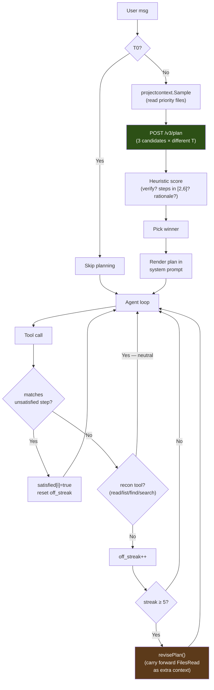

#### 구성요소

##### v3-service: `/v3/plan` (Python)

`services/v3-service/planning.py`에 정의되어 있고, `services/v3-service/main.py`가 라우트를 제공합니다. 핸들러는 다음을 수행합니다:

1. 사용자 메시지, 작업 디렉터리, 잘라낸 프로젝트 파일로 `PLAN_PROMPT_TEMPLATE`을 렌더링합니다.
2. 시드 오프셋과 온도 `[0.3, 0.5, 0.7]`로 LLM을 3번 호출합니다. 기본적으로 선택적 `chat_template_kwargs: {enable_thinking: false}` 제어를 보내고 계획 JSON용으로 출력 토큰 2,048개를 확보합니다. 이를 지원하는 템플릿은 추론 채널을 끄고, 다른 템플릿은 이 플래그를 무시합니다. `ATLAS_PLAN_THINKING=1`은 추론을 요청하고 예산을 8,192로 올립니다. 모델 계열별 프롬프트 지시문은 주입하지 않습니다.
3. 각 원시 응답을 마크다운 펜스를 허용하고 중괄호 깊이를 인식하는 추출기(`_parse_plan_json`)로 파싱합니다.
4. 파싱된 각 계획을 `_score_plan`으로 채점합니다(상한 1.0):
   - `verify_step`이 있으면 **+0.3**
   - `len(steps) ∈ [2, 6]`이면 **+0.2**, 그 밖의 1단계 이상이면 **+0.05**. 단계가 없는 계획은 0점입니다
   - verify 단계가 프로그램이나 그 테스트를 실행하거나 페이지를 가져오면(`pytest`, `python3 app.py`, `curl`, `go test` 등) **+0.2**. 빌드, 파싱, 린트만 하는 단계(`py_compile`, `tsc`, `ruff`, `go build`)에는 점수가 없습니다. 에이전트 루프도 이를 검증으로 세지 않습니다
   - verify 단계가 서버를 시작하기만 하면 **−0.3**. 이것으로 +0.3이 상쇄됩니다
   - 이미 있는 파일을 만드는 단계가 있으면 **−0.5**
   - 사용자가 이름을 말한 파일을 대상으로 하는 단계마다 **+0.1**(상한 +0.2)
   - `rationale`이 비어 있지 않으면 **+0.1**
5. 점수가 가장 높은 계획을 고릅니다. 동점이면 단계가 적은 계획이 우선합니다(군더더기를 줄이기 위해). 우승 계획의 verify 단계가 서버를 시작하기만 하면 그 `verify_step` 표시를 떼어 냅니다. 단계 자체는 계획에 남고, 루프 자체의 검증 게이트에 맡깁니다.
6. 모든 후보의 파싱이 실패하면 한 단계짜리 폴백(`{action: "investigate the request and act"}`)을 반환하므로, 플래너 실패로 에이전트 루프가 멈추는 일은 없습니다.

API 계약은 [API.md § POST /v3/plan](../../reference/API.md#post-v3plan)에 문서화되어 있습니다.

##### proxy: 브리지, 훅, 게이트 (Go)

| 파일 | 역할 |
|---|---|
| `services/proxy/internal/v3client/client.go` | `PlanStreaming(reqCtx, v3URL, requestID, req, onProgress)` — SSE 스트림을 열고, 진행 이벤트를 콜백으로 전달하며, `event: result` 프레임에서 최종 `Plan`을 반환합니다. `reqCtx`가 에이전트의 요청 컨텍스트를 묶으므로 `/cancel`은 진행 중인 계획을 중단합니다. V3 파이프라인 실행용 `GenerateStreaming`과 같은 구조입니다. |
| `services/proxy/internal/wire/` | `V3PlanRequest`(`v3.go`), `Plan`, `PlanStep`(`messages.go`) 타입. |
| `services/proxy/loop_state.go` | `AgentContext`에 `Plan`, `PlanStepsSatisfied[]`, `PlanOffStreak`, `PlanRevisions`가 추가됩니다. |
| `services/proxy/plan_generation.go`, `services/proxy/internal/projectcontext/sample.go` | `projectcontext.Sample()`는 플래너를 위해 우선 파일(app.py, templates/index.html, package.json, …)을 순회합니다. `shouldGeneratePlan()`은 티어, 메시지 길이, 읽기 전용 요청 여부로 판단합니다. `generatePlan()`은 브리지를 실행하고, 토큰별 잡음을 버리며, 전체 단계 목록과 함께 `plan_loaded`를 내보냅니다. |
| `services/proxy/plan_gates.go` | `matchPlanStep()`(도구 이름과 경로 접미사의 느슨한 일치), `recordPlanAdherence()`(도구 호출별 집계. 어떤 단계와도 일치하지 않는 정찰 호출 — `read_file`/`list_directory`/`find_file`/`search_files` — 은 중립이며 `off_streak`를 늘리지 않습니다), `revisePlan()`(`FilesRead`를 추가 컨텍스트로 넘겨 다시 생성). |

시스템 프롬프트 렌더링은 `buildSystemPrompt`에서 이루어집니다. 계획 단계는 번호 목록으로 렌더링되고 `✓` 표시는 verify 단계에만 붙으며, verify 단계는 검증 게이트가 `done`에 대해 지키는 "수정 증거" 단계로 명시됩니다. (단계별 ☐/✓/⚐ 글리프는 TUI 렌더링에 속합니다. 아래를 참고하세요.)

##### tui: 렌더링 (Go)

`clients/tui/internal/pipelinestate/plan.go`는 `PlanView`(모델의 상태)를 정의하고, `clients/tui/internal/app/state.go`는 `clients/tui/internal/app/events.go`의 채팅 디스패처에 연결된 `applyPlan*` 핸들러 3개를 정의합니다:

| 이벤트 | 핸들러 | UI 효과 |
|---|---|---|
| `plan_loaded` | `applyPlanLoaded` | `m.plan`을 새 계획으로 교체하고, 모든 단계를 상태 글리프와 함께 보여 주는 여러 줄의 채팅 행을 추가합니다. 수정본은 `m.plan`을 덮어쓰고 Satisfied 플래그를 초기화합니다. |
| `plan_adherence` (일치) | `applyPlanAdherence` | 일치한 단계의 `Satisfied` 플래그를 바꾸고, 한 줄짜리 `✓ s2 satisfied · edit_file (1/3)`을 추가합니다. |
| `plan_adherence` (불일치) | `applyPlanAdherence` | **조용함** — 계획 외 호출은 내부 상태만 갱신합니다. 이 필터가 없으면 계획 외 호출마다 채팅 행이 생겨 실제 진행 상황이 묻힙니다. |
| `plan_revise` | `applyPlanRevise` | 현재 계획에 `Revising=true`를 설정하고 `Plan revising (rev 1): <reason>`을 추가합니다. 다음 `plan_loaded`(`revision>0`)가 이를 교체합니다. |
| `v3_plan` | `formatV3StageEvent` | 플래너 자체의 진행 상황(`candidate 1 score=0.80`, `plan 1 won`)을 `plan` 채팅 행 메타 태그 아래에 렌더링합니다. |

#### 튜닝 항목

`services/proxy/plan_gates.go`에 정의:

| 상수 | 기본값 | 이유 |
|---|---|---|
| `planAutoReviseThreshold` | 5 | 자동 수정이 실행되기 전까지의, 정찰이 아닌 계획 외 도구 호출 수입니다(정찰 도구는 연속 횟수를 늘리지 않으므로 자연스러운 탐색은 세지 않습니다). 잘못된 계획을 일찍 잡을 만큼 엄격하고, 빗나간 호출 몇 번으로 헤맴 판정을 하지 않을 만큼 느슨합니다. |
| `planMaxRevisions` | 2 | 루프당 자동 수정 횟수의 상한입니다. 이를 넘으면 마지막 계획이 남고 수정만 멈춥니다. 수정 결과가 같은 단계를 돌려주면 계획을 버립니다. 계획을 벗어나는 비정상적인 입력이 `/v3/plan`을 끝없이 반복하는 것을 막습니다. |

`services/v3-service/planning.py` 상수:

| 상수 | 기본값 | 이유 |
|---|---|---|
| `n_candidates` | 3 | 온도 `[0.3, 0.5, 0.7]`로 다양하게 샘플링합니다. 후보가 많을수록 시간이 더 걸립니다(레퍼런스 모델에서 후보당 약 5~30초). |
| `max_tokens` (후보별) | 2048 | 경험상 근거가 포함된 6단계 계획을 담기에 충분합니다. 초기 테스트에서 1024는 JSON 중간에서 잘렸습니다. |

#### Plan 모드를 건너뛰는 경우

`shouldGeneratePlan`의 세 가지 조건:

1. **`ctx.Tier == Tier0Conversational`** — 사소한 대화("hi", "thanks")는 계획하지 않습니다.
2. **`len(trimmed) < 12`** — 이전 턴의 계획에 기대는 짧은 응답("yes do it", "looks good")은 다시 계획하지 않습니다.
3. **`isReadOnlyRequest(message)`** — 보기만 하는 요청("list the files")에는 계획이 필요 없고, 잘못된 계획은 모델을 편집으로 이끕니다.

그 밖의 모든 턴은 계획합니다. 실패(`/v3/plan` 5xx, 네트워크 오류, 폴백으로도 구할 수 없을 만큼 모든 후보를 파싱할 수 없는 경우)는 조용히 축소 동작합니다. 루프는 `ctx.Plan` 없이 실행되고, 에이전트 루프는 Plan 모드가 꺼져 있을 때와 똑같이 동작합니다.

#### 비용

소요 시간: 레퍼런스 모델에서 **후보당 약 5~30초**(후보 3개 스윕). 토큰 비용: 예산은 `3 × 2048 max_tokens`이고, 실제로는 후보당 약 1500토큰 × 3 = 약 4500토큰입니다.

둘 다 에이전트의 첫 도구 호출 전에 지불합니다. 이 투자는 모델이 쓸모없는 탐색 라운드를 건너뛰는 순간 회수됩니다(도구 호출마다 약 5~10초의 LLM 왕복과 도구 실행이 듭니다).

#### 테스트

| 계층 | 파일 | 다루는 내용 |
|---|---|---|
| v3-service 계획 엔드포인트 | `tests/v3-service/pipeline/test_plan_scoring.py`(채점기). 파서는 `curl /v3/plan`으로 스모크 테스트 | 채점기는 프로그램, 그 테스트 또는 프로브를 실행하는 verify 단계에 점수를 주고, 정적 검사(빌드, 파싱, 린터)와 정찰 호출에는 주지 않습니다. 파서의 허용 범위(펜스, 산문 머리말, 중괄호 중첩)는 후보 3개 샘플러로 확인합니다 |
| 프록시 브리지 | `services/proxy/internal/v3client/client_test.go`, 스테이지 라우팅은 `services/proxy/tool_write_v3_bridge_test.go` | SSE 파싱, 결과 누락 오류, 스테이지 라우팅 |
| 프록시 훅 | `services/proxy/loop_test.go` | 우선 파일 선택, 잘라내기 임계값, 폴백 순회, 티어와 길이 판단 |
| 프록시 준수 | `services/proxy/plan_gates_test.go`, 시스템 프롬프트는 `services/proxy/gates_test.go` | 일치 로직(도구 이름 + 경로 접미사), 실패한 호출 제외, 수정 횟수 상한, 시스템 프롬프트 렌더링 |
| TUI 렌더링 | `clients/tui/internal/pipelinestate/plan_test.go`, 핸들러는 `clients/tui/internal/app/state_plan_test.go` | `PlanView` 상태 전이, 수정 시 plan_loaded 교체, 계획 외 호출의 무음 처리 |

### 안전 제한

운영자 대상 제한과 이를 튜닝하는 손잡이들입니다. 내부 스티어링 가드(트레이스백 위치 파악, 누락 모듈/누락 명령/망가진 인라인 스크립트/대소문자 불일치 스티어, 심볼 그라운딩, no-op/빈 콘텐츠/구문 게이트, doctype 제거)는 `services/proxy/guardrails*.go`와 `services/proxy/loop_*.go`에 있습니다. 구조 게이트(`edit_file`, `structural_edit`, 그리고 모든 `write_file` 분기에서 해석되지 않는 직접 호출 — 잠재적 `NameError` — 을 들여오는 `.py` 쓰기를 거부합니다. 모든 요청에서 실행되며, 이를 끄는 요청 필드는 없습니다)는 `services/proxy/gates.go`에 있습니다. 임베드 스크립트 게이트도 그곳에 있습니다: 이 게이트는 `<script>`/`<style>` 블록 안의 JavaScript를 파싱하고(CSS는 중괄호 균형을 검사), 대상은 `.html`/`.htm`/`.jinja`/`.jinja2` 파일 **그리고 Python 문자열 리터럴 안**(`render_template_string` 형태)입니다. 검사는 v3-service `POST /internal/embedded_script_check`를 통해 수행하며, 이를 새로 망가뜨리는 변경을 거부합니다. 이 게이트가 있는 이유는 다른 모든 게이트가 구조적으로 그 코드를 보지 못하기 때문입니다: 2026-08-01 도그푸딩 세션은 Flask 앱의 인라인 `<script>`에 엉뚱한 `)`를 남겼고, Python은 컴파일되고 서버는 시작되었으며 `curl /`은 200을 돌려주었습니다. 그래서 검증 게이트는 통과했고, 페이지가 브라우저에서 죽어 있는 동안 `done`이 받아들여졌습니다. 구문 게이트와 같은 정상→망가짐 규칙(아직 망가진 수리 진행 중 상태는 허용)과 같은 소프트 실패 태도를 따릅니다: 닿을 수 없는 서비스, 누락된 문법, 모호한 블록(템플릿 문장 태그, `<script src>`, JS가 아닌 `type`, 이스케이프된 Python 문자열)은 발견 사항을 내지 않으며, 결코 쓰기를 막지 않습니다. 누락 명령 스티어는 `command not found` 셸 오류에서 발동합니다: 샌드박스는 읽기 전용 베이스 위의 비루트 환경이므로 없는 바이너리를 런타임에 apt로 설치할 수 없습니다. 스티어는 그렇다고 말하고, 모델이 반복 차단기에 걸릴 때까지 다시 실행하게 두는 대신 pip로 설치할 수 있는 대안이나 미리 설치된 툴체인을 가리킵니다. 망가진 인라인 스크립트 스티어는 `python -c` 검증 한 줄 명령이 `-c` 인자 자체의 SyntaxError(여러 문장의 `def`/`for` 본문을 한 줄에 몰아넣음)로 실패할 때 발동합니다: 해답 파일은 올바르고 검증 명령만 잘못된 형식일 수 있으므로, 파싱할 수 없는 한 줄 명령을 다시 실행하는 대신 테스트를 `.py` 파일로 옮기라고 모델에게 안내합니다.

**활성 반복 중의 빠른 경로 쓰기.** V3는 T2 이상 파일의 *첫* 쓰기(기준선 생성)에서 실행됩니다. 하지만 모델이 파일을 썼고 방금 그 파일이 실행에서 실패하는 것을 보았다면, 다음 쓰기는 편집-테스트-수정 루프의 표적 수정입니다 — V3를 건너뛰고(구문 및 구조 게이트는 여전히 적용) 직접 씁니다. V3의 전체 파이프라인은 호출마다 수 분이 걸리며, 디버깅 중인 파일에서는 쓸 만한 결과 없이 끝나 어차피 폴백하는 일이 잦습니다. 반복마다 그 지연을 치르면 루프는 몇 사이클밖에 돌지 못합니다. 빠른 경로는 `SessionWrites[path]`와, 그 파일을 참조하는 가장 최근의 실패한 실행을 기준으로 합니다.

**반복 수정 대 반복.** 루프 차단기는 *수정을 향해 반복하는* 모델과 *헛도는* 모델을 구별합니다. `write_file` 반복은 대상 경로 **그리고 공백을 제거한 내용 지문**을 키로 합니다: 같은 초안을 다시 내면 충돌하여 임계값에 집계되지만, 실질적으로 다른 내용으로 파일을 다시 쓰면(연이은 컴파일러 오류 수정) 서로 다른 서명이 나와 집계되지 않습니다. 반복이 *검출되면*, 차단기는 **죽이기 전에 먼저 스티어합니다** — 첫 번째 검출은 교정용 `[system note]`를 주입하고 루프는 계속됩니다. 두 번째 검출(모델이 넛지를 보고도 반복함)만 세션을 끝냅니다. 이는 해답이 디스크에 있지만 검증되지 않은 채로 정당한 반복을 끝내 버리던 즉시 강제 중단을 대체했습니다.

| 제한 | 값 | 용도 |
|-------|-------|---------|
| 대화 트림 | 슬롯 크기에 맞춘 슬라이딩 윈도우: 시스템 + 가장 최근 사용자 지시 + 활성 파일의 내용 + `슬롯당 컨텍스트 − ATLAS_MAX_TOKENS − 2048 − slot/8`에 들어가는 만큼의 후행 메시지를 유지(`slot/8` 항은 토크나이저 여유분: chars/4 추정치는 빽빽한 코드/JSON을 적게 셈). 고정된 지시와 파일 내용은 다시 주입될 뿐 아니라 예산에 집계됨. 하한: 8개 유지. `ATLAS_AGENT_HISTORY_BUDGET`을 통한 하드 상한. llama-server가 여전히 프롬프트를 컨텍스트 초과로 거부하면, 루프는 세션을 죽이는 대신 최소 윈도우로 강제 트림하고 한 번 재시도 | 편집 중인 파일을 떨어뜨리지 않으면서 컨텍스트 오버플로 방지 |
| 중복 읽기 단락(short-circuit) | 변경되지 않은 파일의 파일 전체 재읽기는 내용이 아직 라이브일 때만 "이미 컨텍스트에 있음" 포인터를 반환; 그렇지 않으면 전체 파일을 다시 제공(`ATLAS_DEDUP_READS=0`으로 비활성화) | 모델이 깜깜이로 편집하는 일 없이, 변경되지 않은 파일을 매 턴 재인코딩하는 것을 회피 |
| V3 대화형 벽시계 상한 | 단일 V3 파이프라인 호출은 `ATLAS_V3_TIMEOUT`(기본 300초)으로 상한; 타임아웃 시 프록시는 모델의 구문 및 구조 게이트를 통과한 내용으로 폴백하고, 실행의 최종 요약에 그 파일을 밝힘(`0`은 비활성화) | 긴 수리 정체 상황에서도 대화형 세션의 응답성 유지 |
| 턴별 추론 예산 | ~6144 추론 토큰 후 스트림을 끊음(`ATLAS_REASONING_BUDGET`, 0은 비활성화); 복구는 내장된 tool_call을 추출하거나 다시 프롬프트함 | 추론 나선을 제한 |
| 기존 파일에 대한 write_file | 파일이 5줄 초과면 거부; .py/.html/.htm에서는 단계별 문법 게이트가 `structural_edit`로 스티어 | 정밀 편집(`edit_file`) 또는 노드 전체 편집(`structural_edit`)을 강제 |
| 의심스러운 축소 가드 | `oldSize >= 100B`이고 `newSize < 64B`일 때 `structural_edit`/`edit_file` 거부(`services/proxy/guardrails_write.go::validateNotSuspiciouslyShrunk`) | 파괴적 스텁 재작성이 디스크에 닿기 전에 포착 |
| structural_edit 폭주 콘텐츠 가드 | `content` > 8 KB AND > 파일 크기의 4배일 때 거부 | 교체 노드로 방출된 추론 누출 덩어리를 포착 |
| structural_edit 노드 크기 전제 조건 | 교체 내용이 노드의 5배 이상이고 30줄 이상 더 크며, 파일에 이미 있는 내용을 중복하거나 파일에 20줄 이상의 모듈 수준 문자열 상수가 있을 때 거부(`v3-service` `_replacement_dwarfs_node`) | 작은 선택자를 통해 끼워 넣은 덩어리는 노드가 담고 있던 것을 지움. 관찰된 한 세션은 `@app.route`가 하나도 없는, 그래도 파싱은 되는 Flask 앱을 남김 |
| 중복 진입점 가드 | 이전에 최대 하나였던 최상위 `if __name__ == "__main__":`를 둘 이상 남기는 `.py` 쓰기를 거부(`services/proxy/gates_edit_requests.go::duplicateMainGuard`) | 노드 선택자를 통해 끼워 넣은 파일 전체 덩어리의 징후. 파싱되고 실행되지만, 처음으로 막는 `app.run()` 뒤의 모든 것이 죽은 코드가 됨 |
| 중복 렉시컬 바인딩 가드 | 한 스코프에서 `let`/`const`가 같은 이름을 두 번 선언하게 남기는 편집을 거부(`v3-service` `embedded_script_check`) | 조기 SyntaxError: 브라우저가 스크립트 전체를 거부하므로, 서버는 여전히 200을 돌려주는데 페이지의 모든 핸들러가 죽음. tree-sitter는 이를 파싱하므로 구문 검사로는 볼 수 없음 |
| 멈춘 렌더 루프 가드 | 반복 타이머가 구동하던 함수를 정확히 한 번만 예약되고 다시 걸리지 않게 남기는 편집을 거부(편집 전 파일과 함께 `v3-service` `embedded_script_check`; `services/proxy/gates.go::embeddedScriptGate`) | JavaScript는 파싱되고, 서버는 시작되며, 페이지는 200을 돌려주므로, 페이지가 한 프레임 뒤에 멈추는 동안 다른 모든 검사가 통과함 |
| V3 범위 밖 재작성 가드 | 호출자의 편집이 건드리지 않은 줄을 빠뜨린 V3 후보를 버리고 호출자의 내용을 유지(`services/proxy/gates.go::v3RewroteBeyondTheEdit`) | V3는 *파일* 전체를 개선하므로, 작은 파일에서는 편집이 건드리지 않은 모든 것을 다시 입력함. 한 라이브 세션은 `#e94562`를 `#e94162`로, `id="msg"`를 `id=" msg"`로 돌려받았으며, 둘 다 구문 오류가 아님 |
| 에러 루프 브레이커 | **같은 경로에서** **같은 종류의** 연속 3회 실패(메시지 골격: 숫자, 따옴표로 묶인 구간, 경로를 제거). 다른 거부가 오면 연속 횟수가 초기화됨. 서로 다른 거부 세 번은 루프가 아니라 수렴하는 모델이기 때문 | 정당한 반복을 죽이지 않으면서 폭주하는 실패 사이클 중단 |
| 실패 호출 상한 | 실행당 실패한 도구 호출 12회(`maxTotalFailures`) | 거부가 바뀌면 연속 횟수가 초기화되므로, 실패 방식을 돌아가며 순환하는 실행을 제한 |
| 계획 완료 게이트 | 플래너가 계획을 0.6 이상으로 평가했고, 계획에 단계가 2개 이상이며, 적어도 하나가 일치했을 때, 일치하는 도구 호출이 없는 계획 단계가 있는 동안 `done`을 거부(`services/proxy/guardrails.go::planIncompleteMessage`) | 여러 부분으로 된 작업을 일부만 전달하고 완료를 선언하는 경우. 턴별 진행 메모는 이미 있었지만 무시되었음 |
| 탐색 예산 | 연속 4회 읽기 전용 호출에서 넛지; 5회 이상에서 강화된 넛지. 읽기는 항상 실행됩니다 — 넛지는 *다음* 턴을 쓰기 쪽으로 유도할 뿐입니다 | 무한정 탐색하는 대신 쓰도록 모델을 유도 |
| 명령 출력 잘라내기 | stdout 8,000자, stderr 4,000자 | 컨텍스트 범람 방지 |
| 검색 결과 | 최대 200개 일치; 파일 검색은 1 MB 초과 파일 건너뜀 | 검색 비용 제한 |
| 잘림 감지 | 도구 인자에 대한 JSON 파스 점검 | 잘린 모델 출력 포착 |

---

## 4. V3 파이프라인 (안쪽 계층)

T2+ 파일에 대해 `write_file`/`edit_file` 실행기 안에서 활성화됩니다. 파이프라인은 네 개의 페이즈를 가지며, 모든 단계에 조기 종료 지점이 있습니다.

### 파이프라인 흐름

```mermaid
flowchart LR
    Entry["T2 detected"] --> Probe["Probe"] --> Score1["C(x)/G(x)"] --> SB1["Sandbox"]
    SB1 --> Pass1{"Pass?"}
    Pass1 -->|"Yes"| Done["Done"]

    Pass1 -->|"No"| Alloc["CxGx Gate\nk >= 3"] --> PS["PlanSearch"] --> DS["DivSampling"] --> BF["BudgetForcing"] --> Build["Build Check"] --> Score2["Score K"] --> SB2["Test K"]

    SB2 --> AnyPass{"Passed?"}
    AnyPass -->|"1+"| Select["Lens Select"] --> Done

    AnyPass -->|"0"| FA["Failure Analysis"] --> PRCOT["PR-CoT"]
    PRCOT --> PRPass{"Pass?"}
    PRPass -->|"Yes"| Done
    PRPass -->|"No"| Refine["Refinement"] --> Done

    style Entry fill:#1a3a5c,color:#fff
    style Done fill:#333,color:#fff
    style Probe fill:#1a3a5c,color:#fff
    style Alloc fill:#1a3a5c,color:#fff
    style PS fill:#1a3a5c,color:#fff
    style DS fill:#1a3a5c,color:#fff
    style BF fill:#1a3a5c,color:#fff
    style Select fill:#2d5016,color:#fff
    style Score1 fill:#2d5016,color:#fff
    style Score2 fill:#2d5016,color:#fff
    style SB1 fill:#2d5016,color:#fff
    style SB2 fill:#2d5016,color:#fff
    style Build fill:#2d5016,color:#fff
    style PRCOT fill:#5c3a1a,color:#fff
    style Refine fill:#5c3a1a,color:#fff
    style FA fill:#5c3a1a,color:#fff
```

범례: 파랑 = 생성, 초록 = 검증/선택, 갈색 = 수리.

### 페이즈 상세

**Phase 0: Probe**는 점진적 예산 재시도(light → standard → nothink)로 단일 기준 후보를 생성합니다. 선택된 모델의 C(x)/G(x) 아티팩트로 채점하고 샌드박스에서 테스트합니다. 통과하고 그 증거 레코드가 닫히면 파이프라인은 조기 종료합니다. 그렇지 않으면 생성이 계속됩니다.

**기존 파일(incumbent)**(#259). 프록시의 쓰기 및 편집 라우트는 항상 호출자 자신의 파일을 `baseline_code`로 보냅니다. 그 정확한 바이트도 하나의 후보입니다:
- 같은 샌드박스 검증, 계약 레코드, 거부권, 그리고 렌즈 점수를 받습니다. 생성된 후보들과 함께 풀 인덱스 -1로 순위가 매겨지며, 생성 슬롯을 차지하지 않습니다. 자체 레코드가 닫히면 즉시 반환됩니다.
- 생성된 후보는 같은 검사를 통과하고 더 높은 순위를 받을 때만 이를 대체합니다. 후보는 파일의 역할도 유지해야 합니다: 모든 최상위 def, class, 할당 이름, 그리고 다른 프로젝트 파일에서 가져온 모든 이름.
- 공백만 다른 사본은 결코 이를 대체하지 않습니다.

기존 파일이 유지되면 `phase_solved`는 `incumbent`이며, 프록시는 모델 자신의 바이트를 씁니다.

**후보 할당: CxGx 게이트**(`phase2` / `phase2_allocated`로 방출)가 실패한 프로브에 후보를 몇 개 줄지 결정합니다. 프로브의 C(x)+G(x) 결합 점수(임베딩 추출 1회, 두 모델 모두 사용)가 2단계 규칙을 구동합니다: 보정된 C(x) 정규화 에너지가 Budget Forcing이 쓰는 것과 같은 사다리에서 기본 티어를 고르고, G(x) 품질 점수가 모델의 보정된 severe 경계 아래로 떨어지면 그 티어를 +1, 한참 아래(그 0.75배)로 떨어지면 +2 올립니다 — 프로브가 C(x)에는 싸 보이지만 G(x)에는 틀려 보이는 경우입니다. 티어가 k를 정하고(`nothink` 1, `standard` 3, `hard` 5, `extreme` 8) 여기에 **k >= 3의 하드 플로어**가 걸립니다. 따라서 게이트는 기존에 고정돼 있던 k=3에 후보를 더할 수만 있고 뺄 수는 없으며, 최악의 경우가 곧 예전 동작입니다. 두 신호 모두 이 모델의 보정 파일(`cx_normalization.json`, `gx_thresholds.json`)을 필요로 합니다: 렌즈가 보정되지 않았거나, 렌즈가 프로브를 거절하면(임베딩 배치에 비해 너무 김, 비어 있음) `standard`에서 정확히 k=3을 할당하므로, 보정되지 않은 번들은 자기에게 아무 의미도 없는 척도로 라우팅되는 대신 예전에 돌리던 파이프라인을 그대로 돌립니다. 스코어링을 전혀 할 수 없는 렌즈는 대신 실행을 멈춥니다([ADR 0011](../../adr/0011-the-lens-is-required.md)).

이 플로어가 앞서 제거된 C(x) 전용 할당기와의 차이입니다: 그쪽은 플로어가 없어서 *방금 실패한* 프로브의 태스크에 k=1을 건네주었습니다. 렌즈 기반 할당이 고정 또는 무작위 티어 할당보다 나은지는 측정되지 않았습니다. 이전의 4-암 비교(게이트 적용, 고정 k=3, 같은 티어 구성을 태스크 간에 섞은 것, k=8, 암당 n=175)는 어느 쪽의 근거도 되지 않습니다. 이 비교는 Qwen3.5-9B에서, 이 저장소에 없는 패치된 러너로, 라이브 게이트가 적용할 수 없는 에스컬레이션 시 사고(thinking)를 켠 채, G(x) 헤드 학습에 쓰인 LiveCodeBench 태스크에서 실행되었고, 그 표본 크기에서는 암 간 차이가 잡음 범위 안에 있습니다.

라이브 경로와의 차이: 프록시의 V3 브리지는 `ATLAS_V3_TIMEOUT`(기본 300s) 이후 파이프라인 호출을 포기합니다. 벤치에는 없던 상한이라, k=8로의 무제한 에스컬레이션은 예산을 생성에 다 써 버리고 시간 안에 낼 수 있었던 k=3 답 대신 타임아웃 폴백을 반환하게 됩니다. 그래서 라이브 오케스트레이터는 남은 실시간과 해당 태스크에서 관측된 호출당 지연을 함께 넘기고, 게이트는 예산이 실제로 생성할 수 있는 수준까지 티어를 낮춥니다 — 에스컬레이션이 Phase 3를 굶기지 않도록 리파인먼트 1회분을 남겨 두되, 플로어 아래로는 결코 내려가지 않습니다. 벤치 러너는 예산을 넘기지 않고 측정된 그대로 할당합니다. 구현은 `services/v3-service/stages/cxgx_gate.py`이며 두 오케스트레이터가 공유합니다.

**Phase 1: 제약 기반 생성(Constraint-Driven Generation)**

**V3는 항상 실행됩니다.** 계획 수립과 후보 생성은 라우팅 규칙이 보내는 모든 요청에서 실행됩니다: 등급 2 이상의 파일, 구성된 V3 서비스, 그리고 방금 실패하는 것을 본 파일을 반복 수정하고 있지 않은 세션. 둘 중 어느 것도 끄는 요청 필드는 없습니다. `bypass_v3`, `v3_mode`, `feasibility_mode`는 제거되었으며, V3를 끄거나, 플래너만 쓰거나, `enforce`를 요구하는 요청은 다른 시스템에서 조용히 실행되는 일 없이 400입니다. V3 없이 측정하려면 연구용 빌드가 필요합니다.

- **PlanSearch**는 서로 다른 제약 집합을 추출하여 구조적으로 다른 구현 계획을 생성합니다 — 프로브가 아직 채우지 않은 할당된 후보 슬롯마다 하나씩(k-1). 계획 구성과 코드 생성 단계는 워커 스레드로 퍼져 나가며(`services/v3-service/stages/plan_search.py`의 `_fan_out`), 이 때문에 PlanSearch는 요청 스레드 밖에서 추론을 디스패치하는 유일한 V3 스테이지입니다. 워커는 부모로부터 ContextVar도 로컬도 물려받지 않으므로, 요청 범위의 상태는 요청 범위의 `LLMAdapter` — 취소 범위와 같은 운반체 — 를 통해 워커에 닿습니다. 각 추론 호출이 보내지는 신원(`LLMAdapter.request_identity`)이 있는 곳도 여기입니다. 헤더 리졸버는 ContextVar 폴백을 쓰지 않습니다. 워커에서 폴백은 "요청 없음"으로 읽혀 귀속 정보를 조용히 없애기 때문입니다. 모델에 전혀 닿지 못하는 PlanSearch 호출은 짧은 후보 목록을 돌려주는 대신 `PlanSearchInfrastructureError`를 발생시킵니다: DivSampling은 여전히 아래의 슬롯을 채우며, 그렇지 않으면 하위 단계에서 빈 배치와 거부된 배치를 구별할 수 없습니다.
- **DivSampling**은 섭동 다양성을 적용합니다: 4개 역할(competitive_programmer, systems_engineer, mathematician, pragmatist) + 4개 지시(step_by_step, edge_case_first, complexity_aware, constraint_driven) + 4개 스타일(functional, pythonic, optimize_iteratively, structured)
- **Budget Forcing**은 사고 토큰 할당을 제어합니다:

| 등급(Tier) | 사고 토큰 |
|------|----------------|
| nothink | 0 (템플릿 수준에서 사고 비활성화) |
| light | 1,024 |
| standard | 2,048 |
| hard | 4,096 |
| extreme | 8,192 |

각 등급은 시스템 프롬프트(직접 vs. 단계별 사고)와 최대 토큰 예산에 대응합니다. 등급 선택은 선택된 모델의 캘리브레이션된 C(x) 에너지를 사용합니다. 캘리브레이션이 없으면 ATLAS는 다른 모델의 상수를 빌리는 대신 구성된 기본 예산을 사용합니다.

**Phase 2: 검증 및 선택**

- **빌드 검증**: Python(`py_compile`), TypeScript(`tsc --noEmit`), JavaScript(`node --check`), Go(`go build`), Java(`javac`), Kotlin(`kotlinc`), Rust(샌드박스 `/execute` 경로에서는 `rustc`. `Cargo.toml` 프로젝트는 감지되어 `cargo build`를 쓰고, `cargo check`는 빌드 커맨드 허용목록을 통해서만 허용), C/C++(`/execute`에서는 `-Wall`을 붙인 완전한 `gcc`/`g++` 컴파일. `-fsyntax-only`는 `/syntax-check` 경로에만 적용), Ruby(`ruby -c`, 인터프리터 언어라 컴파일 단계 없음), PHP(`php -l`, 동일), Shell(`bash -n`). Next.js, React, Flask, Django, Express에는 프레임워크별 오버라이드가 있습니다.
- **`/syntax-check` 판정**: 구문만, 한 번에 한 파일씩 검사하므로, 단독 파일이 볼 수 없는 형제 파일이나 패키지에 대한 참조는 오류가 아닙니다. Java는 컴파일 없이 파싱만 합니다(`javac -XDshould-stop.ifNoError=PARSE`). Kotlin과 TypeScript는 구문 진단만 셉니다(kotlinc의 `syntax error`, tsc의 TS1xxx). JavaScript는 `.cjs` 파일로 검사하고, 그것이 모듈 구문에서만 실패하면 `.mjs` 파일로 검사하므로 Node의 모듈 유형 감지가 판정을 좌우할 수 없습니다. HTML은 마크업을 담아야 하며 태그, 주석, `<script>`, `<style>` 안에서 끝나서는 안 됩니다. 자원 계약이 멈춘 검사기나 시작조차 하지 못한 검사기는 `valid: true`가 아니라 `outcome`과 함께 `status: "not_run"`을 돌려줍니다. 프록시는 이를 통과나 구문 오류가 아니라 실행되지 않음으로 기록합니다.
- **거부권(Veto)**: 샌드박스를 통과한 후보라도 세 가지 검사가 이를 기각할 수 있습니다 — 렌즈 거부권(스텝별 `gx_min`이 모델의 보정된 severe 임계값 아래인 경우: 코드는 실행되지만 생성 패턴이 스텁 쪽으로 무너진 것), 구조 거부권(Python 대상만: tree-sitter가 로컬 정의·import·빌트인·프로젝트 심볼 어디에도 해석되지 않는 직접 식별자 호출을 찾은 경우 — 예약된 `NameError`. Python 문법은 다른 언어도 관대하게 파싱하므로, HTML 템플릿의 `Time (mins)`를 호출로 보고한 적이 있습니다), 그리고 호출 그래프 거부권(같은 이유로 Python 대상만: 스코프 안에 정의가 없는 파일 간 호출). 거부된 후보는 실패로 표시되고(`passed=false`, `vetoed_by`, 거부 사유가 오류 출력으로), 다른 실패 후보와 마찬가지로 Phase 3 복구 풀에 합류합니다. 최종 에너지 폴백이 이를 반환하는 일은 없습니다. 모든 후보가 거부되고 복구도 실패하면 파이프라인은 코드를 반환하지 않으며, 호출자가 자신의 베이스라인으로 대체합니다
- **입력 전용 합의(CodeT)**: 0/K가 통과했고 생성된 테스트 모음이 있으면, 후보들을 생성된 *입력*으로 실행하고 출력한 내용의 일치에 따라 군집화합니다 — 신호는 독립적으로 생성된 프로그램들 사이의 수렴이지, 모델이 추측한 정답표가 아닙니다. 엄격한 규칙: 후보는 *모든* 프로브 케이스에서 실제 답을 낼 때만 군집화에 참여하며(크래시는 군집화가 거부하는 `CRASH` 표식을 출력하고, 빈 출력은 아무것과도 군집을 이루지 않으며, 부분적 유효성은 일치의 재료가 아님), 군집에는 최소 두 구성원이 필요합니다 — 스스로와 일치하는 프로그램 하나는 증거가 아닙니다
- **Lens 선택**(1개 이상 통과): C(x) 에너지로 정렬해 가장 낮은 것이 승리

**Phase 3: 수리**(0/K 통과 시, 또는 모든 통과 후보가 거부된 경우) — 두 가지 전략, 조기 종료를 동반한 순차 실행:

- **실패 분석(Failure Analysis)**: 실패를 분류(wrong_algorithm, implementation_bug, edge_case_miss, time_limit, format_error, partial_correct)
- **PR-CoT**: 4개 관점(logical_consistency, information_completeness, biases, alternative_solutions) x (분석 + 수리) = ~8회 LLM 호출, 최대 3라운드
- **Refinement 루프**: 실패 분석 → 제약 정제 → 코드 생성 → 테스트 → 학습. 2회 반복, 120초 예산, 각 ~5회 이상 LLM 호출. 코사인 거리 필터링(>= 0.15)으로 가설 반복 방지. 예산 게이트 적용: 오케스트레이터는 남은 실시간(라이브에서는 `ATLAS_V3_TIMEOUT` 상한, 벤치에서는 루프 자체의 120초 예산)이 반복 1회(관측된 호출당 지연 기준 순차 LLM 호출 ~3회)를 감당할 수 있을 때만 루프에 들어갑니다 — 그렇지 않으면 `refinement_skip`을 방출하고 곧바로 폴백으로 갑니다

### 모듈 맵

파이프라인 스테이지는 `services/v3-service/stages/`에 있는 12개의 Python 모듈입니다. `services/v3-service/pipeline.py`가 그중 11개를 오케스트레이션합니다(10개는 직접, `constraint_refinement`는 리파인먼트 루프를 통해). `embedding_store`는 오프라인 벤치 러너(`atlas/bench/v3_runner.py`)에서만 실행되며, 이 러너는 체크아웃의 `services/v3-service/`를 자신의 경로에 올리므로 두 호출자가 하나의 스테이지 구현을 공유합니다:

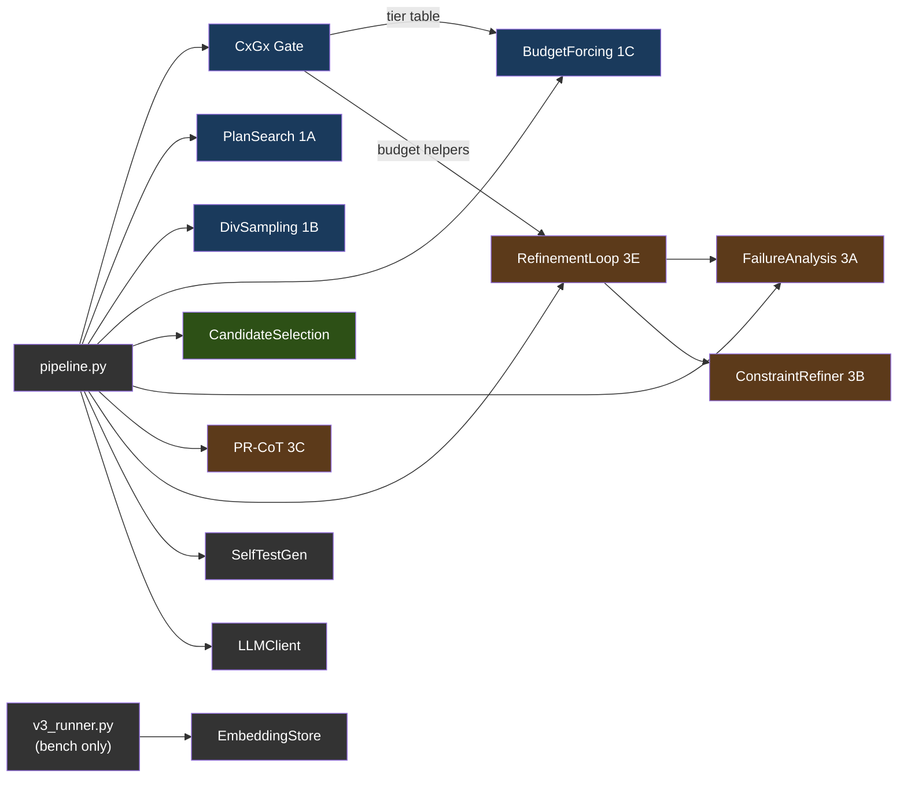

범례: 파랑 = Phase 1(생성), 초록 = Phase 2(선택), 갈색 = Phase 3(수리), 회색 = 유틸리티. `v3_runner.py`가 공급하는 모듈은 벤치 러너 전용이며, 서비스는 이를 호출하지 않습니다. 서비스 자체는 `main.py`(HTTP 핸들러) → `pipeline.py`(오케스트레이터) → `planning.py` / `scoring.py` / `symbols.py` / `adapters.py` 라는 평면적 형제 모듈 구성입니다.

---

## 5. Geometric Lens

모델 임베딩의 기하 구조를 분석하여 코드를 실행하지 않고도 코드 품질을 평가하는 신경 스코어링 시스템입니다. 전적으로 CPU에서 돌아갑니다. 서비스 표면은 내부 전용(`/internal/*`)입니다: C(x)/G(x) 스코어링(단발 및 스텝별).

#### 왜 "Geometric Lens"인가?

Geometric Lens의 핵심 아이디어는 간단한 전제에서 출발합니다: 모델을 키우는 것을 멈추고 지원 인프라로 감싸기 시작하라. Jose Crespo의 ["Everyone's Wrong About AI Programming"](https://www.josecrespophd.org/p/everyones-wrong-about-ai-programming)은, 현재 LLM이 올바른 코드 경로와 잘못된 코드 경로의 비용이 같은 평평한 임베딩 공간에서 작동하기 때문에 AI 생성 코드가 오류 쪽으로 표류한다고 주장합니다. 해법은 올바른 코드가 "내리막"이고 잘못된 코드가 "오르막"인 에너지 지형을 모델 주위에 구축하는 것입니다.

Anthropic의 [Manipulating Manifolds](https://transformer-circuits.pub/2025/linebreaks/index.html) 연구는 트랜스포머가 이미 임베딩 공간에 조작 가능한 기하 구조를 만든다는 증거를 제공합니다 — 원재료는 이미 거기 있습니다. Bar 등의 [Geometric Unification of Generative AI](https://arxiv.org/html/2510.00666v1)는 데이터 매니폴드 위의 거리 함수를 학습하고 스코어링에 사용하는 방법을 형식화합니다.

ATLAS는 이를 두 개의 상호 보완적 모델로 구현합니다. C(x)는 선택된 모델 자체 임베딩 위의 학습된 에너지 함수(`hidden_dim`→512→128→1 MLP)입니다. 각 코드 후보는 llama-server에 의해 임베딩되고, C(x)는 그것이 그 기하 구조에서 어디에 위치하는지 스코어링합니다. 낮은 에너지는 후보가 알려진 정답 코드와 군집함을 의미합니다. 높은 에너지는 알려진 오답 코드와 군집함을 의미합니다. 외부 오라클도, 실행도 필요 없습니다 — 선택된 모델 표현의 기하 구조만 필요합니다.

G(x)는 품질 예측기입니다 — PCA로 축소된 임베딩 위의 XGBoost 분류기로, 후보가 축소된 공간에서 어디에 위치하는지로부터 통과/실패를 예측합니다. C(x)가 "이 후보가 얼마나 좋은가?"에 답한다면, G(x)는 "이 후보가 통과할 가능성이 있는가?"에 답합니다. 이것이 유일한 G(x) 구현입니다: 이전의 메트릭 텐서 정식화와 그 correctability 엔드포인트는 XGBoost가 배포 경로가 되면서 제거되었습니다(기하 인식 변형은 git 이력을 참고하세요).

### 스코어링 모델

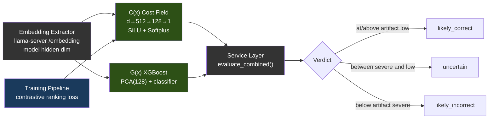

다음 수치는 공개된 V3 연구에 사용된 동결 레퍼런스 아티팩트를 설명합니다. 출처(provenance)일 뿐 런타임 차원이나 기본값이 아닙니다:

| 모델 | 레퍼런스 아키텍처 | 학습 데이터 | 성능 |
|-------|-------------|---------------|-------------|
| **C(x)** | 4096→512→128→1 MLP (SiLU, Softplus) | 597개 LCB 임베딩 (504 PASS, 93 FAIL) | Val AUC 0.9467, sep 2.04x |
| **G(x)** | PCA(4096→128) + XGBoost | 13,398개 임베딩 (4,835 PASS, 8,563 FAIL) | PCA 80.8% 분산 |

C(x) 정규화는 `sigmoid(steepness × (energy - midpoint))`입니다. 선택된 모델의 `cx_normalization.json`이 두 값을 공급하며, `atlas lens build`가 그 모델의 라벨링된 PASS/FAIL 후보로부터 이를 도출합니다. G(x) 판정 임계값도 마찬가지로 `gx_thresholds.json`에서 옵니다. 어느 쪽 캘리브레이션도 없으면, 정규화된 판단은 레퍼런스 아티팩트의 스케일을 빌리는 대신 중립/비캘리브레이션 상태로 유지됩니다.

**모델 서버로 가는 호출의 귀속 정보.** Lens가 모델 서버로 보내는 모든 요청(`/embedding`, `/v1/models` 신원 탐침)은 하나의 전송 계층, `geometric_lens/model_transport.py`를 거칩니다. 이 계층은 ATLAS의 나머지 부분이 이미 쓰는 두 상관관계 헤더 `X-ATLAS-Request-ID`와 `X-ATLAS-V3-Invocation-ID`를 전달합니다. 그 값은 Lens 미들웨어가 현재 요청에 묶어 둔 신원(모든 ATLAS Python 서비스가 쓰는 것과 같은 ContextVar)에서만 옵니다. V3는 스코어링 호출에서 두 헤더를 모두 보냅니다. 묶인 신원이 없으면 헤더도 없고, 한쪽만 있는 쌍은 한쪽만 있는 채로 남으며, 요청이 끝나면 바인딩이 지워지므로 동시 요청과 백그라운드 작업이 신원을 맞바꾸거나 물려받을 수 없습니다. 시작 및 준비 작업(부팅 자가 테스트, `/ready` 재실행)은 `ATLAS_LENS_STARTUP_REQUEST_ID`와 `ATLAS_LENS_STARTUP_INVOCATION_ID`가 둘 다 설정된 경우에만 신원을 가집니다. 귀속된 임베딩 트래픽이 필요한 수집 작업은 그 쌍을 선언하고 자신의 릴레이에 등록하며, 일반 배포는 둘 다 설정하지 않습니다. 귀속 전용입니다: 어떤 스코어링, 선택, 승인, 완료 로직도 이 헤더를 읽지 않으며, 어떤 후보 바이트나 사용자 내용도 이 헤더에 들어가지 않습니다.

**프록시의 직접 Lens 호출은 자체 호출 신원을 가집니다.** 프록시는 모델 서버로 가는 한 경로, 쓰기별 스코어링(`/internal/lens/score-per-step`)에서 Lens와 직접 통신하며, 이는 V3 후보 호출이 아닙니다. 단일 소유자인 `services/proxy/lens_identity.go`가 그 요청을 만들고, 묶인 `X-ATLAS-Request-ID`와 함께 그 요청 id만으로 도출한, 프록시가 소유한 Lens 호출 신원을 붙입니다: `proxy-lens:` 뒤에 `sha256("atlas/proxy-lens-invocation/v1\n" + request_id)`의 처음 16진수 32자리가 옵니다. 이 값은 결정적이고(릴레이가 모델 서버로 가는 트래픽 전에 쌍을 등록할 수 있음), 한 요청 안의 모든 직접 Lens 호출에서 같으며, 요청 간에 그리고 V3의 UUID 호출 신원과 구별되고, 타입이 있는 요청 id 외에는 아무것에서도 도출되지 않습니다: 산문, 경로, 후보 바이트, 도구 인자, 모델 출력에서 도출되지 않으며, 모델이 설정할 수도 없습니다. 이 값은 기존 `X-ATLAS-V3-Invocation-ID` 채널로 전달됩니다. 헤더 이름은 역사적인 것이며, 값은 모델 서버로 가는 일반 호출 신원입니다. 이는 자격 증명이 아니라 범위 레이블입니다: 변경, 권한, 후보, 완료를 승인하려고 이를 읽는 것은 없으며, SSE 이벤트, 도구 결과, 프롬프트, 로그에 결코 나타나지 않습니다. 요청 id가 없거나 닫힌 형식(`[A-Za-z0-9._:-]{1,128}`)을 벗어나면 호출 신원을 도출하지 않습니다. 닫힌 명세와 벡터는 `services/proxy/testdata/lens_invocation_vectors.json`에 있습니다.

**임베딩 용량 경계.** llama-server는 하나의 `/embedding` 요청을 단일 물리 배치(`-ub`, `ATLAS_UBATCH`)로 처리하며, 그보다 긴 입력은 거부합니다. 모든 Lens 점수는 시퀀스 전체에 대한 한 번의 순전파입니다. 이 거부는 배포의 전송 한계이지 텍스트에 대한 판단이 아니며, 모든 점수와 분리되어 유지됩니다: 응답은 `scored: false`, 모든 점수 필드에 `null`, 그리고 타입이 있는 `failure`(서버의 `input_tokens`와 `capacity_tokens`를 담은 `embed_capacity`, `model_server_error`, `model_server_unreachable`, `embedding_contract`, NaN이나 무한대 값에 대한 `nonfinite_score`, `internal`)를 말합니다. 서빙 경로에서는 아무것도 자르거나 나누지 않습니다. 나뉜 입력은 아티팩트가 학습된 벡터가 아니기 때문입니다. v3-service는 그 실패를 후보에 기록하고, 점수가 있는 모든 후보 뒤에 순위를 매기며, 남은 마지막 검증된 후보일 때만 전달합니다. 프록시는 점수가 없는 쓰기에 임계값을 적용하지 않습니다. 렌즈가 아는 용량(`LLAMA_EMBED_CAPACITY_TOKENS`로 선언되거나 거부에서 관찰됨)은 `/health`와 `/ready`에 보고되며, 프록시의 생성 상한보다 낮으면 상태 차원에 `lens_scoring: partial`로 보고됩니다. 결정 기록: [ADR 0010](../../adr/0010-lens-capacity-boundary-is-typed.md).

현재의 모든 Lens 번들에는 `model_identity.json`도 포함됩니다. 서비스는 그 모델 이름이 llama-server의 `/v1/models`가 보고하는 서빙 모델 id와 일치할 것을 요구합니다(탐침이 실패하면 `ATLAS_MODEL_NAME`이 폴백). 임베딩 폭이 같다는 것만으로는 서로 다른 두 모델 간의 호환성을 입증할 수 없습니다.

> **참고:** 모델 가중치(.pt, .pkl 파일)는 저장소에 커밋되지 않습니다 — 학습 중에 빌드되어 컨테이너 이미지에 구워지거나 런타임에 마운트됩니다. 모델 파일이 없으면 스코어링 엔드포인트는 `enabled: false`로 응답합니다(자리 표시 숫자: C(x) 0.0, G(x) `gx_score: 0.5`, `verdict: "unavailable"`). 프록시와 V3는 그 응답을 스코어링할 수 없는 렌즈로 취급하며, ATLAS는 파일이 존재할 때까지 요청을 거부합니다([ADR 0011](../../adr/0011-the-lens-is-required.md)). Lens가 시도했으나 계산하지 못한 점수는 숫자 없이 `scored: false`와 타입이 있는 `failure`로 응답합니다: 렌즈나 그 모델 서버의 실패는 실행을 멈추고, 렌즈가 거절한 입력(너무 김, 비어 있음, 유한하지 않음)은 점수 없음으로 보고됩니다. 학습 데이터와 가중치는 [HuggingFace](https://huggingface.co/datasets/itigges22/ATLAS)에서 제공됩니다.

> **실행 사이에 보관되는 것은 없습니다.** 렌즈는 스코어링하는 코드를 하나도 보관하지 않습니다: 프로젝트 인덱스도, 지난 세션의 저장소도 갖지 않으므로, 한 실행의 어떤 것도 렌즈를 통해 이후의 실행에 닿지 않습니다. 렌즈는 상태 및 준비 검사와 세 개의 `/internal/lens/*` 스코어링 호출을 제공합니다(`services/geometric-lens/main.py`).

---

## 6. Sandbox

컴파일, 테스트, 린팅을 갖춘 격리된 코드 실행 환경입니다.

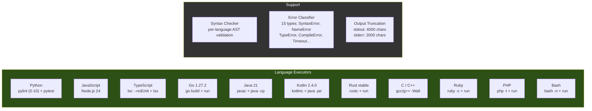

허용되는 언어 별칭: `py`/`python3` (Python), `js`/`node` (JavaScript), `ts` (TypeScript), `golang` (Go), `java` (Java), `kt`/`kts` (Kotlin), `rs` (Rust), `c++` (C++), `rb` (Ruby), `php` (PHP), `sh`/`shell` (Bash). 흔히 쓰는 CLI 도구는 이미지에 구워져 있고(`git`, `sqlite3`, `jq`, `patch`, `zip`/`unzip`, `xz`, `curl`), 바이너리 검사 도구(binutils의 `strings`, `objdump`, `readelf`, `nm`, 그리고 `file`, `xxd`)도 함께 들어 있습니다 — 컨테이너는 읽기 전용 베이스 위에서 비루트로 돌아가므로, 태스크가 셸로 호출하는 것은 전부 미리 설치돼 있어야 하며 런타임에 apt로 설치할 수 없습니다. 바이너리에 대한 `read_file`은 원시 바이트 대신 이 도구들을 가리키는 안내를 반환합니다. 최대 실행 시간: Docker 배포에서는 300초(compose가 프록시의 5분 `run_command` 상한에 맞춰 `MAX_EXECUTION_TIME=${ATLAS_SANDBOX_MAX_EXECUTION_TIME:-300}`를 설정; 순수 코드 기본값은 60초). 메모리, CPU, 프로세스 상한은 컨테이너 수준입니다: compose가 `mem_limit ${ATLAS_SANDBOX_MEM:-1536m}`, `cpus ${ATLAS_SANDBOX_CPUS:-2}`, `pids_limit ${ATLAS_SANDBOX_PIDS:-1024}`를 설정하며, `atlas init`이 호스트에 맞는 값(RAM과 코어의 ~75%)을 `.env`에 기록합니다. 쓰기 가능한 마운트는 언어 생태계마다 하나씩인 tmpfs이며, Docker는 기본적으로 이를 `noexec`로 마운트합니다. `/home/sandbox/gobuild`는 예외로 `exec`를 가집니다. `go run`이 네이티브 바이너리를 `GOTMPDIR`에 링크한 뒤 실행하기 때문입니다. 기본값 `GOTMPDIR=/tmp`에서는 모든 `go run`이 `fork/exec ...: permission denied`로 실패했습니다. 컴파일 언어를 추가할 때는 그 툴체인이 스크래치 디렉터리에서 실행하는지 프로젝트 트리에서 실행하는지 확인해야 합니다. `/workspace`는 이미 exec를 허용하므로 아무것도 필요하지 않습니다. 두 개의 워크스페이스 경로: **`/execute`**(V3 후보 테스트 경로)는 `/tmp/sandbox`(tmpfs) 아래의 일시적 스크래치 디렉토리를 사용; **`/shell`**(에이전트의 `run_command` 경로, 그리고 백그라운드 프로세스용 `/jobs/*`)은 `/workspace`에 대해 실행됩니다 — `ATLAS_PROJECT_DIR`(Docker)에서 바인드 마운트된 프로젝트 루트 또는 hostPath `${ATLAS_PROJECTS_DIR}`(K3s)로, 프록시가 보는 것과 동일한 경로입니다.

---

## 7. VRAM 예산 예시

9B Q6 모델과 32K 컨텍스트를 사용해 실측한 RTX 5060 Ti 16GB 배포 사례 하나:

| 구성요소 | VRAM |
|-----------|------|
| Qwen3.5-9B-Q6_K 모델 가중치 | ~6.9 GB |
| KV 캐시 (32K 컨텍스트) | ~1.3 GB |
| **llama-server 총합** | **~8.2 GB** |
| Geometric Lens | 0 (CPU 전용, 모델용 ~12 MB RAM, PyTorch 런타임용 ~128 MB) |
| v3-service | 0 (CPU 전용) |
| sandbox | 0 (CPU 전용) |
| atlas-proxy | 0 (Go 바이너리, ~30 MB RAM) |
| **여유 VRAM** | **~7.8 GB** |

llama-server 외부의 모든 연산은 CPU에서 돌아갑니다. GPU는 오로지 LLM 추론과 임베딩 추출에만 사용됩니다.

### 7.1 백엔드별 VRAM 예산

위의 8.2 GB / 7.8 GB 여유 분할은 예시일 뿐 ATLAS 모델 기본값이 아닙니다. 실제 사용량은 `atlas init`가 선택한 모델, 양자화, 컨텍스트, 병렬 슬롯 설정을 따릅니다. 다른 백엔드는 구조적으로 다릅니다:

| 백엔드 | 보고되는 "VRAM" | 부하 시 현실적 예산 | 비고 |
|---|---|---|---|
| **CUDA** (전용 VRAM) | 하드웨어 스펙(정규 5060 Ti에서 16 GB) | 스펙의 ~95%(드라이버가 ~500 MB 예약) | 위 표의 수치가 직접 적용됨. |
| **ROCm** (전용 VRAM) | 하드웨어 스펙 | 스펙의 ~90–95%(HIP 런타임이 CUDA보다 약간 무거움) | RX 7900 XTX (24 GB) → 14B Q5 + 32K 컨텍스트를 2개 병렬 슬롯으로 여유롭게 실행. |
| **Metal** (Apple 통합) | 총 시스템 RAM | 시스템 RAM의 **~70%** | OS + 브라우저 + IDE가 ~30%를 잡아먹음. 16 GB MBP의 *현실적* 예산은 11 GB — macOS 자체 GPU 워킹셋이 같은 메모리에 얹히면 Qwen3.5-9B Q6_K(가중치 ~6.9 GB + 32K에서 KV ~1.3 GB, §7 기준)에는 여유가 거의 없음. ≤16 GB에서는 Q4_K_M(5 GB) 사용; Q6_K는 ≥24 GB 통합 메모리를 원함. |
| **Vulkan** (크로스 벤더) | 하드웨어 스펙 | 실측된 배포 아직 없음 (프리뷰(Preview) — lavapipe CPU 경로에서만 검증됨) | 같은 카드에서 튜닝된 네이티브 백엔드 대비 ~20–40% 낮은 성능 예상. |
| **SYCL** (Intel Arc) | 하드웨어 스펙 | 로드맵(Roadmap) — Intel Arc는 현재 Vulkan 사용 | A770 (16 GB) 목표는 NVIDIA 16 GB와 보수적으로 동등. |

---

## 8. 배포

서비스 의존성 그래프(배포 모드 전반에서 동일):

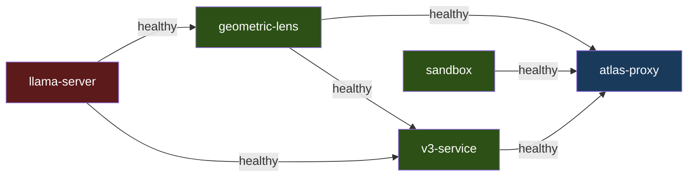

`llama-server`와 `sandbox`는 독립적으로 시작합니다. `geometric-lens`는 `llama-server`가 healthy해지기를 기다리고, `v3-service`는 `llama-server`와 `geometric-lens`를, `atlas-proxy`는 `llama-server`, `geometric-lens`, `v3-service`, `sandbox`를 기다립니다. Docker Compose, 베어메탈, K3s는 동일한 `services/inference/entrypoint-v3.1.sh`로 구동되므로, 컨텍스트 크기, KV 캐시 양자화, flash attention, mlock이 환경 변수로 제어되며 이 모드들 전반에서 동작이 동일합니다. macOS 하이브리드 경로는 엔트리포인트의 플래그를 미러링하는 `scripts/install/atlas-llama-macos.sh`를 통해 네이티브 llama-server를 실행합니다.

설치와 모드별 기동 절차(NVIDIA / ROCm 오버라이드, 베어메탈, macOS 하이브리드 Metal, K3s 매니페스트)는 [SETUP.md](SETUP.md)에, macOS 네이티브 경로는 [SETUP_MACOS.md](../../guides/SETUP_MACOS.md)에 있습니다.

---

## 9. 데이터 흐름

### T1: 단순 파일 쓰기

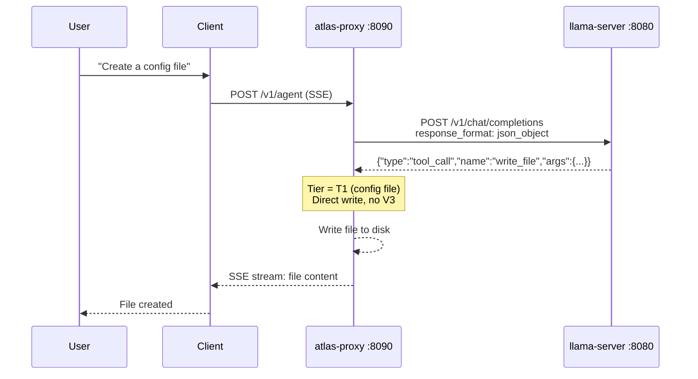

LLM 호출 1회. V3 오버헤드 없음.

### T2: 기능 파일 쓰기

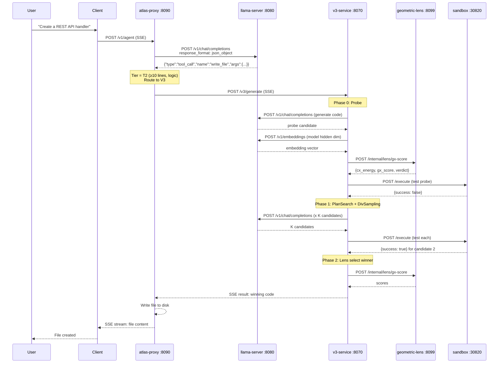

알고리즘성 작업 기준 최소 3회의 llama-server 호출(probe 생성 1회 + 셀프 테스트 생성 1회 + 임베딩 추출 1회). 대화형 작업(게임, UI, 프레임워크 코드)은 셀프 테스트 생성을 건너뛰므로 최소 2회입니다. Phase 3 수리가 모든 전략을 동원하면 최대 30회 이상.

### 기존 코드 편집

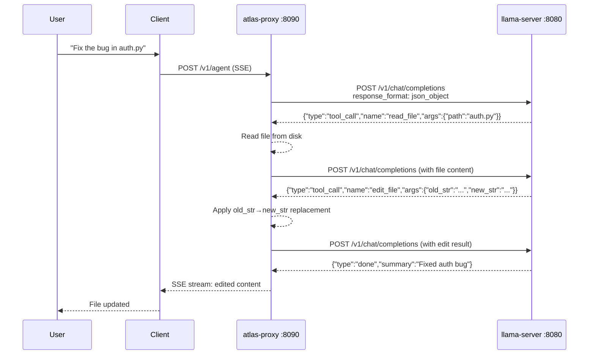

5줄을 초과하는 기존 파일은 `write_file`에 대해 거부됩니다 — 모델은 `edit_file`(정밀, ≤10줄) 또는 `structural_edit`(노드 전체 재작성: Python, HTML, Go, JavaScript, TypeScript)를 사용해야 합니다. `.py`/`.html`/`.htm` 파일에서는 단계별 문법 게이트(BiasBusters #2)가 다음 결정에 대해 도구 이름 생성 규칙에서 `edit_file`/`write_file`를 능동적으로 금지하여 모델이 잘못된 지름길로 되돌아가지 못하게 합니다.
